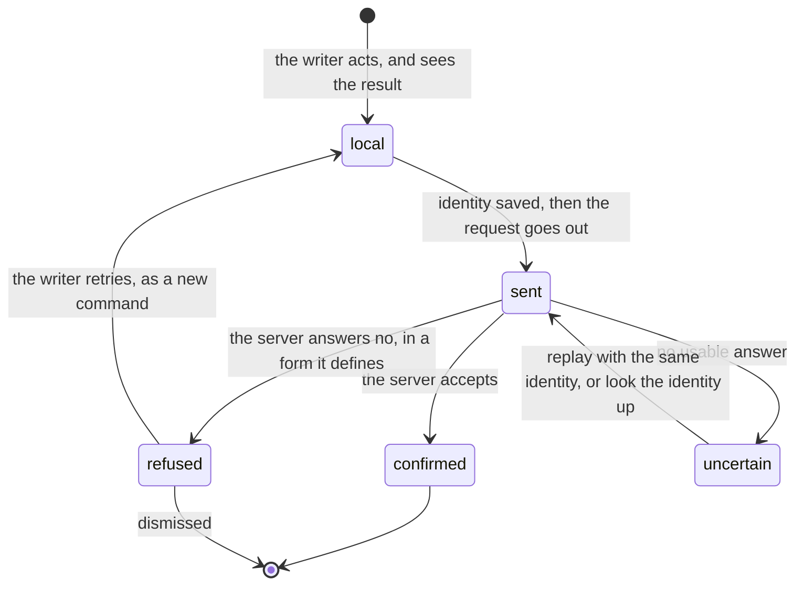

# A command that may have landed

The writer does something, the app shows it at once, and the request that tells the server can
end three ways: accepted, refused, or unanswered. The third is the one that shapes the machine.
A timeout, a dropped connection, a 5xx or an unreadable body says nothing about whether the
server acted.

What every instance does, and why:

- **The identity is minted on the client and saved before the first send.** A replay then
  carries the same id and the server deduplicates. A command that is sent before it is saved
  can be lost by a reload while the server keeps its effect.
- **Only a structured refusal counts as refused.** Anything else is `uncertain`. Calling an
  unanswered request a failure lets the writer redo something the server already did: a
  duplicate message, a second project, a change applied twice.
- **`uncertain` is resolved by asking again**, by replaying the same request or by looking the
  identity up, never by guessing. Until it resolves, the command stays and whatever is queued
  behind it waits.
- **A retry after a real refusal is a new command** with a new identity; a retry of an
  unanswered one keeps the old identity.
- **The server stores the answer** so a replay gets the same one.

## Instances

| Machine | Where | What it calls the uncertain state |
|---|---|---|
| [Chat submission](../../apps/app/src/client/chat-submissions/.context/state-machines.md) | App | `posted`, with no answer |
| [Creation record](../../apps/app/src/client/creation/.context/state-machines.md) | App | resolved inside the request by `createWithRecovery` |
| [Import creation](../../apps/app/src/features/import/.context/state-machines.md) | App | `uncertain` |
| [Apply click command](../../apps/app/src/features/draft-review/.context/state-machines.md) | App | `retrying`, then `stalled` |
| [Queued control](../../apps/app/src/features/chat/.context/state-machines.md) | App | `failed`, retried under the same id |
| [Hand-back and Stop](../../packages/thread-client/.context/state-machines.md) | thread-client | `ambiguous` |
| [Server hold](../../packages/resource-replica/.context/state-machines.md) | resource-replica | `uncertain` |
| [User-turn admission](../../apps/server/server/domains/runtime/.context/state-machines.md) | Server | the server half: `pending` until the turn commits |
| [Branch command](../../apps/server/server/domains/collab/.context/state-machines.md) | Server | the server half: `pending` until the effect commits |
