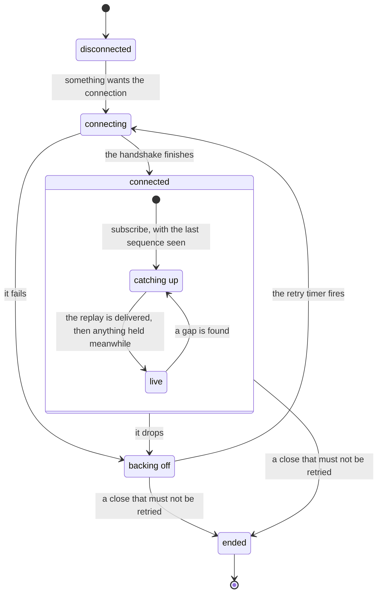

# A connection that replays

A stream of ordered events over a connection that can drop. Two machines sit on top of each
other: the connection, and each subscription on it. Opening the connection does not make a
subscription current; replaying what it missed does.

The rules, and why:

- **Connected means the handshake finished**, not that the socket opened. The retry count
  resets there, so a server that accepts and then drops connections is still backed off from.
- **Events that arrive during catch-up are held**, then delivered after the replay, in
  sequence order, skipping what the replay already covered. Delivering them as they arrive
  shows events out of order.
- **The client names its position; the server replays from it.** When the server no longer has
  that far back, it says so (a gap) and the client reloads its snapshot instead of pretending
  the stream is whole.
- **Some closes are final.** A close code that means "not allowed" or "this room is over" ends
  the machine; retrying it forever hides the real state from the writer.
- **Events from an old connection are ignored.** Each connection has a generation, and a late
  event from the previous one must not tear down the current one.

## Instances

The thread socket and its subscription are the whole pattern. The others have part of it, as
the notes say.

| Machine | Side | Notes |
|---|---|---|
| [Thread socket](../../packages/thread-client/.context/state-machines.md) | Client | The connection half |
| [Thread subscription, client half](../../packages/thread-client/.context/state-machines.md) | Client | The subscription half |
| [Thread subscription, server half](../../apps/server/server/lib/.context/state-machines.md) | Server | Buffers live events while it reads the replay |
| [Document session status](../../apps/app/src/core/editor/.context/state-machines.md) | Client | Computed from the same connection states. There is no replay: Yjs sync brings the document up to date |
| [Tree list connection](../../apps/app/src/core/tree-list/.context/state-machines.md) | Client | The connection only, as for a document; reconnecting levels the copy and the server by Yjs sync, and the whole refusal (`list-rebuild`) is its own state |
| [Tree list room connection](../../apps/server/server/lib/.context/state-machines.md) | Server | The handshake only: a SyncStep1 brings the room to the journal's head, and a read-only connection's updates are dropped |
| [Draft room handshake](../../apps/server/server/lib/.context/state-machines.md) | Server | The handshake only: no edits are accepted before it |
| [Server feed](../../apps/app/src/features/debug/.context/state-machines.md) | Client | The connection only: the browser's `EventSource` reconnects, and nothing is replayed |
