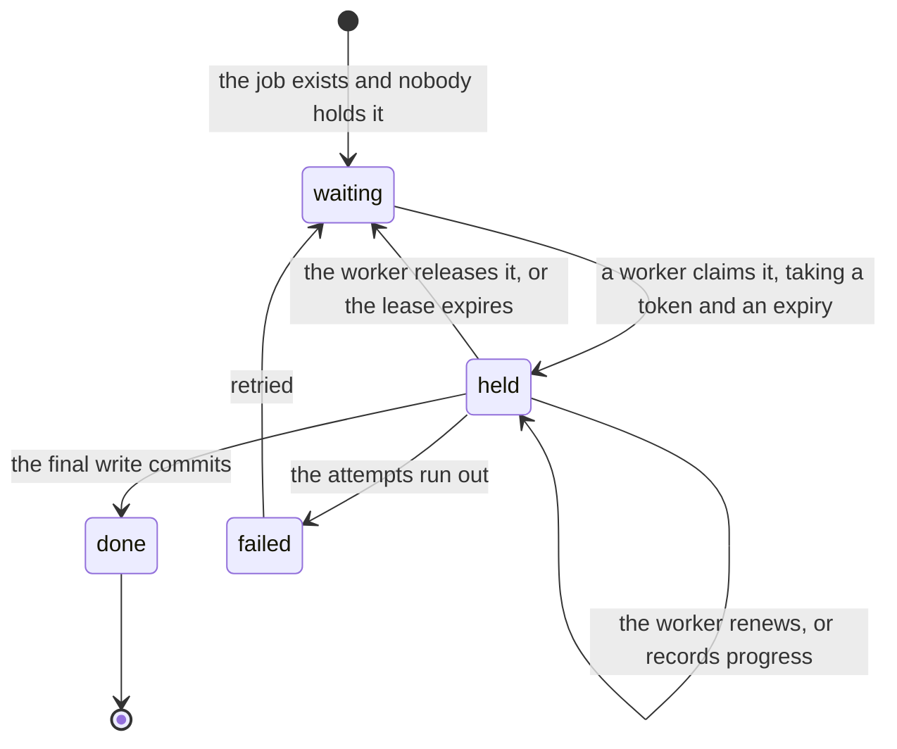

# A job worked under a lease

Work that must be done by exactly one process at a time, and must survive that process dying.
The job's state is a durable row. The worker holds a lease on it: a token and an expiry in the
database's time. Nobody records that a worker died; its lease runs out.

What every instance does, and why:

- **Liveness is the lease, and only the lease.** There is no "running" flag to clear, so a
  crash cannot leave one set. Anything that shows "running" derives it from a live lease.
- **Every write a worker makes checks that it still holds the lease**: the token matches and
  the expiry has not passed, in the same statement or transaction as the write. A worker that
  stalled past its expiry and woke up would otherwise write over its successor.
- **The final step is one transaction with the job's last state change.** There is no state
  for "the work is done but the job does not say so".
- **Expiry is judged by the database's clock**, so two servers with different clocks agree on
  who holds the lease.
- **Attempts are counted on the job, not the worker**, so a job that kills every worker that
  touches it eventually stops being claimed.

## Instances

| Machine | Lease lives on | Recovery |
|---|---|---|
| [Run lease and phase](../../apps/server/server/domains/runtime/.context/state-machines.md) | `thread_run_leases` | An expired run is settled before a new claim |
| [Import](../../apps/server/server/domains/import/.context/state-machines.md) | the `imports` row, while `organizing` | Five claims without progress fail the import |
