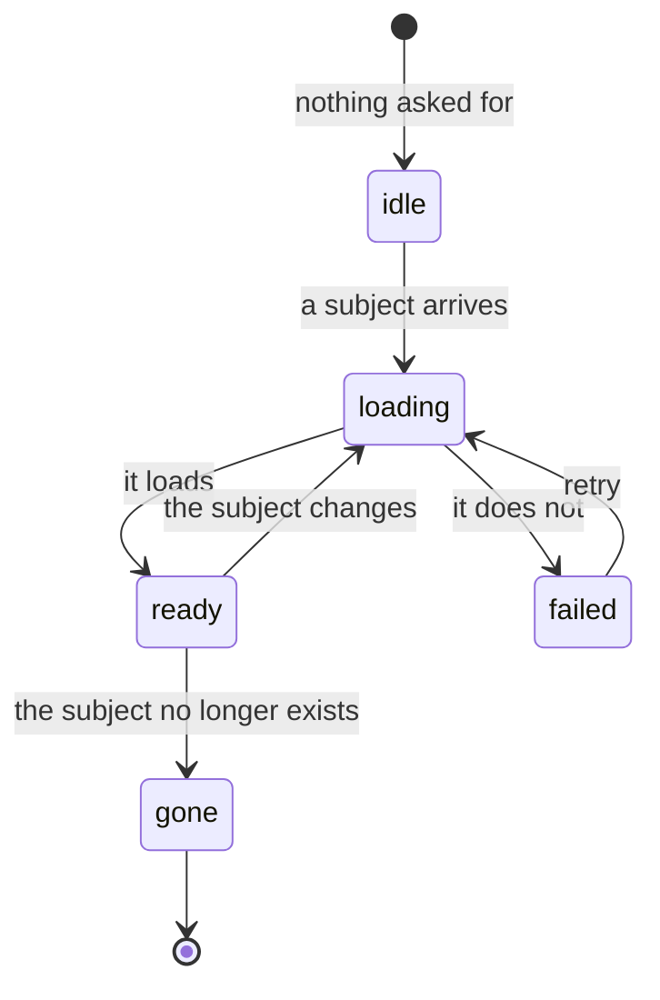

# Load status

Something fetched or opened once and then shown. It is the smallest machine in the app and the
most repeated, so it is drawn once here; a page beside the code mentions it only when it adds
a rule.

The rules that go wrong in practice:

- **A result is used only if it is still the one being waited for.** Each load takes a
  generation, an abort signal or the subject's id, and a result that arrives for an earlier one
  is dropped. Otherwise a slow first load overwrites a fast second one.
- **`failed` is not `ready` with nothing in it.** An error shown as an empty list tells the
  writer their work is not there.
- **`gone` is not `failed`.** Retrying will not bring back something that was deleted, so it
  gets no Retry.
- **A cancelled load is not a failure.** Teardown aborts loads; reporting those as errors
  flashes a failure on the way out.

## Instances

| Machine | Its states |
|---|---|
| [Live document binding](../../apps/app/src/features/project/context/.context/state-machines.md) | `absent`, `opening`, `opened`, `failed` |
| [Draft room read](../../apps/app/src/core/editor/.context/state-machines.md) | `rebuilding`, `usable`, `fenced`, `unavailable`, `error` |
| [Review state and draft changes](../../apps/app/src/features/draft-review/.context/state-machines.md) | `idle`, `loading`, `error`, `ready`, `gone` |
| [Upload store](../../apps/app/src/core/uploads/.context/state-machines.md) | `uploading`, `failed`; success removes the entry |

Draft room read departs from the third rule. Its `unavailable` includes a room that is gone,
and it still offers Retry, which works only when the room can be opened again.
