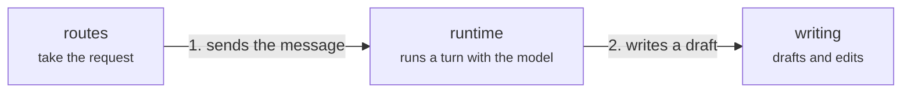
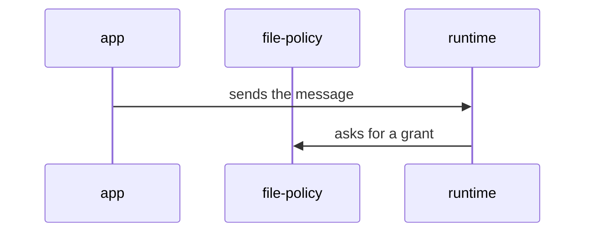

# Architecture map

How Meridian Flow is built. It is a writing app for long fiction: a writer edits a manuscript in
the browser and works on it with a model in chat, and both edit the same documents at once.
Product words are in the [glossary](../glossary.md).

Every page is Markdown with a Mermaid diagram, so it reads on GitHub as it does in the viewer.
`pnpm dev` prints a `map` URL that opens the pages in the viewer. The viewer and the check are a
reusable engine in [tools/architecture-map](../../tools/architecture-map/README.md); what is
specific to Meridian is in the pages here and in [map.config.mjs](map.config.mjs).

## The pages

A level page is a picture of parts and what moves between them, not of imports, with about 12
boxes at most. Where a page has one main path, its arrows are numbered.

- [System](system.md): what runs, and what happens when a writer sends a message.
- [Code](code.md): the apps and packages as layers. Its arrows mean "uses" and carry no numbers.
- [Server](server.md), [App](app.md) and [www](www.md): opened from their boxes on System and Code.
  Their groups open child pages, `server-<group>.md` and `app-<group>.md`.
- [Journeys](journeys/index.md): what a writer does and sees, step by step, linked to the boxes and
  state machines behind each step.
- [Flows](flows/index.md): the calls underneath a journey step, as sequence diagrams.
- [Dependencies](dependencies.md): the import rules, and where the code breaks them.
- [State machines](../state-machines/index.md): pages that sit beside the code they describe. A box
  links each one.

A box with an `Opens` line opens another level page. A page's parent is the page whose box opens
it (System before Code), and the viewer shows the trail, such as `System › Server › conversation`.

## Editing

- **A change that adds, removes or moves something the map names** (a package, a domain, a feature
  directory, or a boundary between them) **updates the map in the same commit.** So does a change
  that adds a state machine page: list it in the index, then on a box.
- **Adding a service** (a new directory under `apps/`) takes one box on `system.md` with an `Opens`
  line, and one page named after the app (`apps/worker` → `worker.md`) whose boxes cover its code;
  its groups' pages are `worker-<group>.md`. `pnpm check:architecture` fails until both exist.
  `tools/` holds no services and is outside this rule.
- **A change that changes a writer journey updates that journey in the same commit.**
- **A change that adds an import breaking a rule in `dependencies.md` adds a row there**, and one
  that removes the last such import deletes the row.
- **`pnpm check:architecture` catches a path that has disappeared, not a picture that has gone
  wrong.** It passing is not the test: read the box you touched and ask whether its words and its
  arrows are still true at run time.

### A level page

````markdown
# Server

One paragraph: what this level is, shown to the reader above the diagram.



## runtime

Runs a turn: one line (it also shows in the box list).

Two or three sentences that orient a newcomer.

- Kind: domain
- Paths: `apps/server/server/domains/runtime`
- Docs: [CONTEXT](../../apps/server/server/domains/runtime/.context/CONTEXT.md)
- Machines: [runtime](../../apps/server/server/domains/runtime/.context/state-machines.md)
- Drift: where the docs and the code disagree

## writing

Drafts and edits.

- Kind: group
- Opens: [Server: writing](server-writing.md)
````

- **One `mermaid` block, a `flowchart`.** Each line is the `flowchart` header, a node
  `id["Name<br/><small>role</small>"]:::kind`, an arrow, a note link, or a `%%` comment. A label holds only `<br/>` and `<small>`. Anything else fails the check.
- **An arrow** is `a -->|"label"| b`, or `<-->` when data flows back, and points from the side that
  starts the exchange. The label says what moves ("streams the reply"). The main path's labels start
  `1. `, `2. `, … and must run in order on the page; side arrows have no number. An `import` arrow
  fails: imports are not drawn. A note takes no arrow, only its dotted link.
- **A note** explains a box in a sentence or two: `note1["text"]:::note`, attached to the box with an
  unlabelled dotted link, `note1 -.- runtime`. A note takes no `##` section, no `Paths` and no `Kind`;
  it must link to a box. GitHub draws it as an ordinary box.
- **A node's id is its section.** Every node has a `## <id>` section on the page and every `##`
  section is a node. A box that belongs to another level, shown for reference, has kind `context`
  and `- See: [label](other.md#id)`.
- **Node kinds** (the class): `person`, `client`, `service`, `store`, `external`, `files`, `domain`,
  `feature`, `module`, `package`, `context`, `group`. A `group` needs `- Opens: [label](child.md)` and takes no `Paths`: its coverage is the paths of
  the boxes on the child page (`server-*` and `app-*` pages).
- **List items:** `Kind` (required, equals the class), `Paths`, `Docs`, `Machines`, `Opens`,
  `Breaks`, `Drift`, `See`, and `Shot` (a screenshot, later). Paths and links must resolve.
- A level page is listed in the pages above, or opened by a group.

### A flow page

````markdown
# A message becomes an edit

Intro: what the flow starts from and ends with.



1. The writer sends a message from [app](../app.md#client).
2. [runtime](../server.md#runtime) asks [file-policy](../server.md#file-policy).
````

A participant is a box id. When the same id is on two level pages (`routes` is on both `server`
and `app`), write `<page>-<id>` and give it a display name: `participant server-routes as routes`.
The numbered steps under the diagram link to boxes and state machines, and
[flows/index.md](flows/index.md) lists every flow.

### dependencies.md

The rules in prose, then a table with one row per break: `| from | to | rule | example file |`.
`from` and `to` are named by their last path segment (`runtime`, `lib`, `contracts`, `server`).
`rule` is one of the rules in `map.config.mjs`, which [CONTEXT.md](../CONTEXT.md) writes down; a
new rule is a new entry there. Only value imports count: a type-only import is not run-time
coupling.

### A journey page

A `#` title, a summary, then a `##` section per step with a `Does:` and a `Sees:` paragraph, and
the items `Map` (links to `#<box id>` on a level page), `Machines` and later `Shot`:
[Start a project](journeys/start-a-project.md) is a full example.

## What `pnpm check:architecture` catches

- **Format:** a Mermaid line the format doesn't allow; a box without a section, or a section
  without a box; a `Kind` that isn't the box's class; numbered arrows out of order; an import arrow;
  a group with no `Opens` or with `Paths`; a context box with no `See`; an `Opens` that isn't a
  level page; a list item that isn't one of the known keys; a note that links to nothing, joins two
  notes or two boxes, or has a section.
- **Journeys:** a journey missing from `journeys/index.md`; a step without `Does:` and `Sees:`, or
  with a list item other than the known keys.
- **Links and paths:** a path that doesn't exist; a link whose file or `#id` doesn't resolve; a
  journey `Map` link that isn't a box or a flow.
- **Coverage:** an app, package, server domain or app feature directory that no box's `Paths`
  reaches; an `apps/*` directory with no System box that opens its page; a level page nothing lists
  or opens.
- **Flows:** a participant that isn't exactly one box; a flow missing from `flows/index.md`, without
  numbered steps, or linked from no journey step.
- **State machines:** a `*state-machine*.md` page the index links that is on no box, or one the
  index doesn't link.
- **Dependencies:** a break of a written rule with no row, a row that matches no break, or an
  example file that doesn't make the break. The check reads value imports from source (relative
  imports, `@/` in `apps/app`, `~/` in `apps/www`, `@meridian/*` names, stylesheet `@import`) and
  leaves out tests, `test-support` files and comments.
- **Colours:** `styles/tokens.css` must match `packages/design-tokens`, and the engine's `page.css`
  holds no raw colour.

It doesn't catch: whether a box's words or an arrow are still true; an ordinary import (none is
listed anywhere); `Drift` and `Breaks` notes that went stale; a feature importing another feature,
or an app layer importing another (no rule is written, and the code imports both ways); anything
the checker can't see in source text, such as a path built at run time.

## The viewer

`pnpm dev` serves it at `/architecture/`, the `map` URL it prints. Opened from disk, it says to
run `pnpm dev`.

- **Map and Read.** A level page opens as Map (boxes you can drag; positions are remembered per
  page on this computer, and "Reset layout" clears them) or Read (the Markdown with its diagram).
  The header switches between them.
- **Repo files open in the viewer:** a box's `Paths` and `Docs`, and any link in a page. Markdown
  is rendered, source shows line numbers, a directory lists its tracked entries, and each view
  links to GitHub.
- **Only tracked files are served**, plus new unignored files in this directory, so `.env` and
  `node_modules` are never shown. `pnpm dev:funnel` publishes the dev server and with it the
  tracked source, which is already public.
- Scripts come from a CDN with pinned versions and integrity hashes. More in [AGENTS.md](AGENTS.md).
