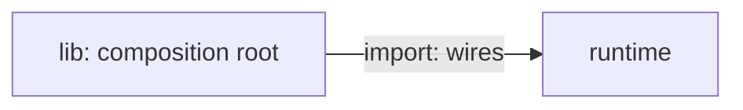

# Architecture map

How Meridian Flow is built. It is a writing app for long fiction: a writer edits a manuscript in
the browser and works on it with a model in chat, and both edit the same documents at once.
Product words are in the [glossary](../glossary.md).

Every page is Markdown with one Mermaid diagram. `pnpm dev` prints a `map` URL that opens the
same pages as a clickable map; the HTML is only a viewer.

## The pages

Each level is one page: a paragraph, a flowchart, and a `##` section for every box in the flowchart.

- [System](system.md): what runs when a writer uses it: browser, app, server, site, Postgres, storage, outside services.
- [Code](code.md): the apps and packages, and which imports which.
- [Server](server.md): `apps/server/server`: `lib`, routes, plugins and each domain.
- [App](app.md): `apps/app/src`: routes, `core`, `client`, `components` and each feature.

State machine pages sit in `.context/` beside the code they describe and are listed in the
[state machines index](../state-machines/index.md); the map attaches each one to a box.

## The journeys

What a writer does and sees, one step per card, linked to the boxes and state machines behind it:
[journeys](journeys/index.md).

## Editing

- **A change that adds, removes or moves something the map names** (a package, a domain, a feature
  directory, a boundary, or a dependency direction between them) **updates the map in the same
  commit.** So does a change that adds a state machine page: list it in the index, then on a box.
- **A change that changes a writer journey updates that journey in the same commit.**
- **`pnpm check:architecture` catches a path that has disappeared, not a picture that has gone
  wrong.** It passing is not the test: read the box you touched and ask whether its words and its
  arrows are still true.

### A level page

````markdown
# Server

One paragraph: what this level is and the rule that shapes it.



## runtime

Runs turns: one line (the card's sub).

Two or three sentences that orient a newcomer.

- Kind: domain
- Paths: `apps/server/server/domains/runtime`
- Docs: [CONTEXT](../../apps/server/server/domains/runtime/.context/CONTEXT.md)
- Machines: [runtime](../../apps/server/server/domains/runtime/.context/state-machines.md)
- Opens: [Server runtime](server-runtime.md)
- Breaks: what dependency rule it breaks, and where
- Drift: where the docs and the code disagree
````

- **One `mermaid` block, a `flowchart`.** Each line is the `flowchart` header, a node
  `id["Label"]:::kind`, an edge, `subgraph ... ["Title"]` / `end`, or a `%%` comment. Anything else
  fails the check.
- **A node's id is its section.** Every node has a `## <id>` section on the page and every `##`
  section is a node. A box that belongs to another level, shown for reference, has kind `context`
  and `- See: [label](other.md#id)`.
- **Node kinds** (the class): `person client service store external files domain feature module
  package context`. **Edge kinds:** `http ws sql model files call port import`.
  An edge is `a -->|"<kind>: <label>"| b`, or `<-->` when data flows back, and points from the side
  that starts the exchange. `import` is a code dependency, `call` goes into code the from-box
  imports a value from, `port` goes through a dependency handed in.
- **An edge that breaks a dependency rule says so:** `"import: wires (breaks: domain imports lib)"`.
- **List items:** `Kind` (required, equals the class), `Paths`, `Docs`, `Machines`, `Opens`,
  `Breaks`, `Drift`, `See`, and `Shot` (a screenshot, later). Paths and links must resolve.
- A level that grows past about 25 boxes splits into a child page, and a box opens it with `Opens`.

### A journey page

A `#` title, a summary, then a `##` section per step with a `Does:` and a `Sees:` paragraph, an
optional `Source:` paragraph (where the step's wording comes from, shown in the step's panel) and
the items `Map` (links to `#<box id>` on a level page), `Machines` and later `Shot`:
[Start a project](journeys/start-a-project.md) is a full example.

## What `pnpm check:architecture` catches

- A Mermaid line the format doesn't allow; a box without a section or a section without a box; a
  `Kind` that isn't the box's class; an unknown node or edge kind.
- A path that doesn't exist; a link whose file or `#id` doesn't resolve, in every page here and in
  the journeys; a journey `Map` link that isn't a box.
- An app, package (with a `package.json`), server domain or app feature directory that no box's
  `Paths` reaches: a new one needs a box, or a path on the box that holds it.
- A state machine page the index links that is on no box; a `*state-machine*.md` the index doesn't link.
- An `import` or `call` edge between boxes that have `Paths` when nothing in the first box's paths
  imports the second's. It reads the source (relative imports, `@/` in `apps/app`, `~/` in
  `apps/www`, `@meridian/*` package names, stylesheet `@import`), leaving out tests and `test-support` files, and ignoring imports in comments.
- A dependency rule broken in the code and not marked on the map. Only the rules
  [CONTEXT.md](../CONTEXT.md) writes and that hold as written are checked. Every domain-to-domain
  value import inside a cycle needs an edge in its own direction (from the importing domain's box to
  the imported one's, or `<-->`) with `breaks:` in its label; the failure names that import. A domain's
  imports of `apps/server/server/lib/` need one marked edge between its box and the lib box, either
  direction; it covers all of that domain's imports. A domain that joins a cycle fails once for each
  of its edges that was acyclic until now, and the one that names the new file is the cause.
- The viewer's colours: `styles/tokens.css` must match `packages/design-tokens`, and `styles/page.css`
  holds no raw colour.

It doesn't catch: whether a box's words are still true; an import with no edge (a real import
the map doesn't draw is a review point, not a failure); `Drift` and `Breaks` notes that went stale;
a feature importing another feature, or an app layer importing another (no rule is written, and
the code imports both ways); anything the checker can't see in source text, such as a path built at
run time.

## The viewer

`index.html` (the map) and `journeys.html` need the pages served from the repo: `pnpm dev` does
that (`apps/app/dev/architecture-dev-plugin.ts`), opened from disk they say so. Mermaid and
`marked` come from a CDN with pinned versions and integrity hashes. See [AGENTS.md](AGENTS.md)
for how the viewer is built.
