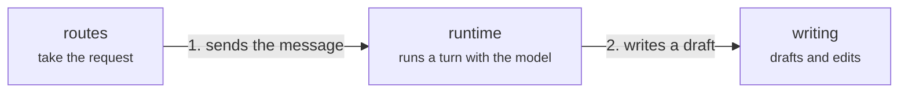
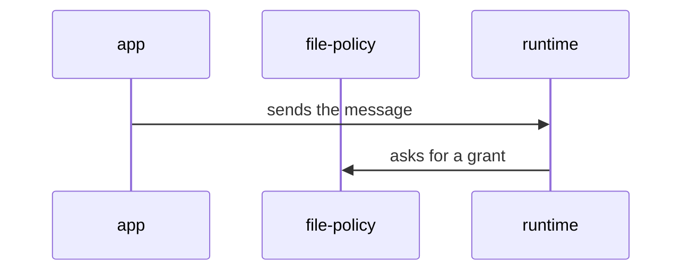

# Architecture map

How Meridian Flow is built. It is a writing app for long fiction: a writer edits a manuscript in
the browser and works on it with a model in chat, and both edit the same documents at once.
Product words are in the [glossary](../glossary.md).

Every page is Markdown with a Mermaid diagram, so it reads on GitHub and in an editor as it
does in the viewer. `pnpm dev` prints a `map` URL that opens the same pages in a viewer; the HTML
holds no content. The viewer and the check are an engine, [tools/architecture-map](../../tools/architecture-map/README.md);
everything about Meridian that they use is in [map.config.mjs](map.config.mjs) (the repo, the globs that say
what must be covered, the dependency rules, the nav labels) and in the pages here.

## The pages

Each level is a picture of **parts and the flow between them**, not of imports: at most about 12
boxes, arrows that say what moves. Where there is one main path it is numbered (System, Server, App, www); on Code an arrow means "uses", so nothing is. A box that stands for several parts is a
group and opens a page of its own.

- [System](system.md): what runs when a writer uses it, and what happens when they send a message.
- [Code](code.md): the apps and packages as layers.

Everything below those two is reached by drilling in. The `server` and `app` boxes on System and on
Code open [Server](server.md) (`apps/server/server`, in groups of domains by the writer work they
serve) and [App](app.md) (`apps/app/src`: routes, `core`, `client`, `components` and the features);
their groups open the child pages `server-<group>.md` and `app-<group>.md`. Any box with an `Opens`
line opens a level page. A page's parent is the page whose box opens it, System before Code, and the
viewer shows the trail (`System › Server › conversation`) under the nav.

[Flows](flows/index.md): end-to-end sequences, one page each, linked from the journey step each one
traces and listed under the journeys as "What happens underneath". [Dependencies](dependencies.md): the
rules the code is meant to keep and the places it breaks them. [Journeys](journeys/index.md): what a
writer does and sees, one step per card, linked to the boxes and state machines behind it. State
machine pages sit in `.context/` beside the code they describe and are listed in the
[state machines index](../state-machines/index.md); a box attaches each one.

## Editing

- **A change that adds, removes or moves something the map names** (a package, a domain, a feature
  directory, or a boundary between them) **updates the map in the same commit.** So does a change
  that adds a state machine page: list it in the index, then on a box.
- **Adding a service** (a new directory under `apps/`) takes one box on `system.md` with an `Opens`
  line, and one page named after the app (`apps/worker` → `worker.md`) whose boxes cover its code;
  its groups' pages are `worker-<group>.md`. `pnpm check:architecture` fails until both exist.
  `tools/` holds no services and is outside this rule.
- **A change that changes a writer journey updates that journey in the same commit.**
- **A change that adds an import breaking a rule in `dependencies.md` adds a row there**, and one
  that removes the last such import deletes the row.
- **`pnpm check:architecture` catches a path that has disappeared, not a picture that has gone
  wrong.** It passing is not the test: read the box you touched and ask whether its words and its
  arrows are still true at run time.

### A level page

````markdown
# Server

One paragraph: what this level is, shown to the reader above the diagram.



## runtime

Runs a turn: one line (it also shows in the box list).

Two or three sentences that orient a newcomer.

- Kind: domain
- Paths: `apps/server/server/domains/runtime`
- Docs: [CONTEXT](../../apps/server/server/domains/runtime/.context/CONTEXT.md)
- Machines: [runtime](../../apps/server/server/domains/runtime/.context/state-machines.md)
- Drift: where the docs and the code disagree

## writing

Drafts and edits.

- Kind: group
- Opens: [Server: writing](server-writing.md)
````

- **One `mermaid` block, a `flowchart`.** Each line is the `flowchart` header, a node
  `id["Name<br/><small>role</small>"]:::kind`, an arrow, a note link, or a `%%` comment. A label holds only `<br/>` and `<small>`. Anything else fails the check.
- **An arrow** is `a -->|"label"| b`, or `<-->` when data flows back, and points from the side that
  starts the exchange. The label says what moves ("streams the reply"). The main path's labels start
  `1. `, `2. `, … and must run in order on the page; side arrows have no number. An `import` arrow
  fails: imports are not drawn. A note takes no arrow, only its dotted link.
- **A note** explains a box in a sentence or two: `note1["text"]:::note`, attached to the box with an
  unlabelled dotted link, `note1 -.- runtime`. A note takes no `##` section, no `Paths` and no `Kind`;
  it must link to a box. GitHub draws it as an ordinary box.
- **A node's id is its section.** Every node has a `## <id>` section on the page and every `##`
  section is a node. A box that belongs to another level, shown for reference, has kind `context`
  and `- See: [label](other.md#id)`.
- **Node kinds** (the class): `person`, `client`, `service`, `store`, `external`, `files`, `domain`,
  `feature`, `module`, `package`, `context`, `group`. A `group` needs `- Opens: [label](child.md)` and takes no `Paths`: its coverage is the paths of
  the boxes on the child page (`server-*` and `app-*` pages).
- **List items:** `Kind` (required, equals the class), `Paths`, `Docs`, `Machines`, `Opens`,
  `Breaks`, `Drift`, `See`, and `Shot` (a screenshot, later). Paths and links must resolve.
- A level page is listed in the pages above, or opened by a group.

### A flow page

````markdown
# A message becomes an edit

Intro: what the flow starts from and ends with.



1. The writer sends a message from [app](../app.md#client).
2. [runtime](../server.md#runtime) asks [file-policy](../server.md#file-policy).
````

A participant is a box id that is unique among the non-context boxes of all level pages. When two pages use one id (`routes` is on both `server` and `app`), write `<page>-<id>`: `server-routes`, `server-files-import`. The numbered steps under the diagram link to
boxes and state machines. [flows/index.md](flows/index.md) lists every flow.

### dependencies.md

The rules in prose, then one table of the places the code breaks them today, one row per
break: `| from | to | rule | example file |`. `from` and `to` are single domains, a domain and `lib`, or a
package and an app, each named by its last path segment (`runtime`, `lib`, `contracts`, `server`). `rule` is one of the rules in `map.config.mjs` (`domains are acyclic`, `domains do not import lib/`, `packages do
not import apps`; [CONTEXT.md](../CONTEXT.md) writes them). A new rule is a new entry there. The example file is an importing file.
Only value imports count; a type-only import is not run-time coupling.

### A journey page

A `#` title, a summary, then a `##` section per step with a `Does:` and a `Sees:` paragraph, and
the items `Map` (links to `#<box id>` on a level page), `Machines` and later `Shot`:
[Start a project](journeys/start-a-project.md) is a full example.

## What `pnpm check:architecture` catches

- A Mermaid line the format doesn't allow; a box without a section or a section without a box; a
  `Kind` that isn't the box's class; an unknown node kind; an arrow with a kind prefix or an import
  arrow; numbered arrows out of order (a page may have none); a group with no `Opens`; a level page nothing lists or opens; an `apps/*` directory with no System box that covers it and opens its page;
  a note that links to nothing, joins two notes or two boxes, or has a section.
- A path that doesn't exist; a `Paths` line on a group; a link whose file or `#id` doesn't resolve, in every page here and in
  the journeys and flows; a journey `Map` link that isn't a box or a flow; a flow no journey step links.
- A flow participant that isn't one box (an id on two pages needs `<page>-<id>`); a flow that isn't in `flows/index.md` or has no numbered
  steps.
- An app, package (with a `package.json`), server domain or app feature directory that no box's
  `Paths` reaches: a new one needs a box, or a path on the box that holds it.
- A `*state-machine*.md` page the index links that is on no box (the index's other links, such as the pattern pages and the glossary, are exempt); a `*state-machine*.md` the index doesn't link.
- A break with no row ("a regression: remove the import first"), a row that matches no break (stale
  or too broad), or an example file that doesn't make the break, computed from value imports. The check reads source (relative imports, `@/` in `apps/app`,
  `~/` in `apps/www`, `@meridian/*` package names, stylesheet `@import`), leaves out tests and
  `test-support` files, and ignores imports in comments.
- A break of a written rule with no row: a domain's value import of another domain inside an import
  cycle (one row per direction), a domain's value import of `apps/server/server/lib/`, a package's
  import of an app. The failure names the importing and imported files.
- The viewer's colours: `styles/tokens.css` must match `packages/design-tokens`, and the engine's `page.css`
  holds no raw colour.

It doesn't catch: whether a box's words or an arrow are still true; an ordinary import (none is
listed anywhere); `Drift` and `Breaks` notes that went stale; a feature importing another feature,
or an app layer importing another (no rule is written, and the code imports both ways); anything
the checker can't see in source text, such as a path built at run time.

## The viewer

`pnpm dev` serves it at `/architecture/` (the `map` URL it prints; `apps/app/vite.config.ts` registers the engine's
plugin with this directory's config). Opened from disk it says so. A level page opens as Map (boxes you can drag;
where you put them is remembered for that page on this computer, and "Reset layout" undoes it) or Read (the
Markdown with its diagram); the header toggles. Every repo path in it, a box's `Paths` (files and directories),
its `Docs`, `AGENTS.md`, a link inside Markdown, opens in the viewer: Markdown rendered, source with line
numbers, a directory as its tracked entries; each view links "on GitHub". The dev server serves only files git
tracks (and new unignored files in this directory), so `.env` and `node_modules` are never shown; `pnpm dev:funnel`
publishes the dev server, and with it the tracked source, which is public here. Scripts come from a CDN with pinned
versions and integrity hashes. See [AGENTS.md](AGENTS.md).
