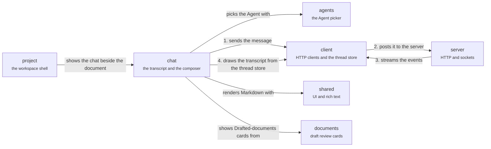

# App: conversation

Chat on the screen. The composer sends the message through the client (1), which posts it (2); the server streams the events back (3) and the transcript draws them from the thread store (4). The Agent picker records which Agent and revision a new chat uses. Back to the [app](app.md).

## chat

The transcript and the composer.

The transcript is drawn from the same view model `./mf` prints.

- Kind: feature
- Paths: `apps/app/src/features/chat`
- Docs: [CONTEXT](../../apps/app/src/features/chat/.context/CONTEXT.md), [AGENTS](../../apps/app/src/features/chat/AGENTS.md)
- Machines: [chat](../../apps/app/src/features/chat/.context/state-machines.md)

## agents

The Agent picker and Agent identity.

A new chat records exactly which Agent, and which revision of it, the writer picked.

- Kind: feature
- Paths: `apps/app/src/features/agents`
- Docs: [CONTEXT](../../apps/app/src/features/agents/.context/CONTEXT.md), [AGENTS](../../apps/app/src/features/agents/AGENTS.md)

## project

The workspace shell.

Panes, sidebar, tabs, Works and routing.

- Kind: context
- See: [project](app.md#project)

## client

Talking to the server.

HTTP clients, query hooks and the thread store.

- Kind: context
- See: [client](app.md#client)

## shared

Shared UI and helpers.

The group of `components`, `hooks`, `lib` and `rich-content`.

- Kind: context
- See: [shared](app.md#shared)

## documents

Editor and draft review.

The group of `editor`, `draft-review` and `links`.

- Kind: context
- See: [documents](app.md#documents)

## server

The server.

HTTP, the thread socket and the Yjs socket.

- Kind: context
- See: [server](system.md#server)
