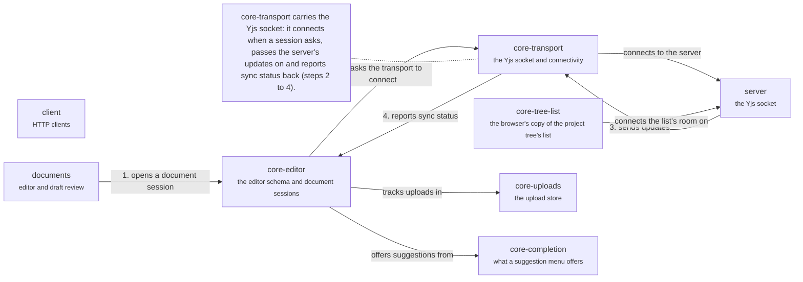

# App: core

What the features stand on. A document session is opened by the editor core (1); it asks the transport to connect the Yjs socket (2); the server's updates arrive on it (3) and the transport reports sync status back to the session (4). The browser's copy of the project's tree list is read by every screen that shows a name or a place. Back to the [app](app.md).

## core-editor

The TipTap schema and the Yjs document session.

`createEditorExtensions()` is the one way to build the extensions. The schema mirrors `@meridian/prosemirror-schema`, and a test compares the two.

- Kind: module
- Paths: `apps/app/src/core/editor`
- Docs: [CONTEXT](../../apps/app/src/core/editor/.context/CONTEXT.md), [AGENTS](../../apps/app/src/core/editor/AGENTS.md)
- Machines: [editor core](../../apps/app/src/core/editor/.context/state-machines.md)
- Drift: `core/editor` and `core/transport` import each other (editor to transport 2 files, transport to editor 1).

## core-transport

The Hocuspocus document transport, connectivity hints and the wire taps the debug overlay reads.

A dev transport exists for local use. The thread socket is not here: it is `@meridian/thread-client`, wired in `client`.

- Kind: module
- Paths: `apps/app/src/core/transport`
- Docs: [CONTEXT](../../apps/app/src/core/transport/.context/CONTEXT.md), [AGENTS](../../apps/app/src/core/transport/AGENTS.md)

## core-tree-list

The browser's copy of a project's tree list, beside the document sessions.

A Yjs document in `y-indexeddb` shared by the tabs, one tab owning the connection, with a sync status. Every name and place on screen is read from its replay, live or a Work's view (the sidebar's Live/Draft toggle), and the sidebar's Undo stack is kept per copy (`core/project-tree/tree-undo.ts`).

- Kind: module
- Paths: `apps/app/src/core/tree-list`
- Docs: [AGENTS](../../apps/app/src/core/tree-list/AGENTS.md)
- Machines: [tree list](../../apps/app/src/core/tree-list/.context/state-machines.md)

## core-uploads

The upload store.

Tracks files being uploaded.

- Kind: module
- Paths: `apps/app/src/core/uploads`
- Docs: [app CONTEXT](../../apps/app/.context/CONTEXT.md)
- Machines: [upload store](../../apps/app/src/core/uploads/.context/state-machines.md)

## core-completion

What a suggestion menu offers, without drawing it.

The menu's state and the browser that completes a reference to a document. It draws nothing, so the composer and the editor both use it.

- Kind: module
- Paths: `apps/app/src/core/completion`
- Docs: [CONTEXT](../../apps/app/src/core/completion/.context/CONTEXT.md), [AGENTS](../../apps/app/src/core/completion/AGENTS.md)

## client

Talking to the server.

HTTP clients, query hooks and the thread store.

- Kind: context
- See: [client](app.md#client)

## documents

Editor and draft review.

The group of `editor`, `draft-review` and `links`.

- Kind: context
- See: [documents](app.md#documents)

## server

The server.

HTTP, the thread socket and the Yjs socket.

- Kind: context
- See: [server](system.md#server)
