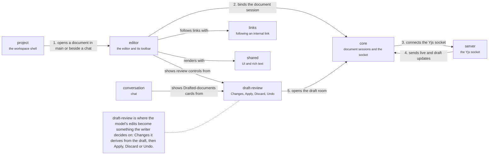

# App: documents

The editing screens. A document opens from the workspace in main's tab row, or beside a chat (1); the editor binds a document session from the core (2); the core connects the Yjs socket to the server (3) and the server's updates, the writer's and the model's, come back through it (4). A draft is shown through `draft-review`, which opens the draft's room (5) and derives Changes from the draft's text. Back to the [app](app.md).

## editor

Editor chrome and its surfaces over `core/editor`.

Binds the document session, chooses live or review presentation and mounts the toolbar, identity bar and sync pill.

- Kind: feature
- Paths: `apps/app/src/features/editor`
- Docs: [CONTEXT](../../apps/app/src/features/editor/.context/CONTEXT.md), [AGENTS](../../apps/app/src/features/editor/AGENTS.md)
- Machines: [editor](../../apps/app/src/features/editor/.context/state-machines.md)

## draft-review

Review of a draft: Changes, Apply, Discard, Undo.

Review is derived from the draft's text, not from stored change records.

- Kind: feature
- Paths: `apps/app/src/features/draft-review`
- Docs: [AGENTS](../../apps/app/src/features/draft-review/AGENTS.md)
- Machines: [draft-review](../../apps/app/src/features/draft-review/.context/state-machines.md)

## links

Following an internal link.

Resolves links from the local project index first, then the server; a failed request keeps the local answer. A link still opens after its target is moved or renamed.

- Kind: feature
- Paths: `apps/app/src/features/links`
- Docs: [CONTEXT](../../apps/app/src/features/links/.context/CONTEXT.md), [AGENTS](../../apps/app/src/features/links/AGENTS.md)

## project

The workspace shell.

Main and side panes, sidebar, tabs, Works and routing.

- Kind: context
- See: [project](app.md#project)

## core

The editor core.

The group of the editor session, transport, tree list, uploads and completion.

- Kind: context
- See: [core](app.md#core)

## shared

Shared UI and helpers.

The group of `components`, `hooks`, `lib` and `rich-content`.

- Kind: context
- See: [shared](app.md#shared)

## conversation

Chat and Agents.

The group of `chat` and `agents`.

- Kind: context
- See: [conversation](app.md#conversation)

## server

The server.

HTTP, the thread socket and the Yjs socket.

- Kind: context
- See: [server](system.md#server)
