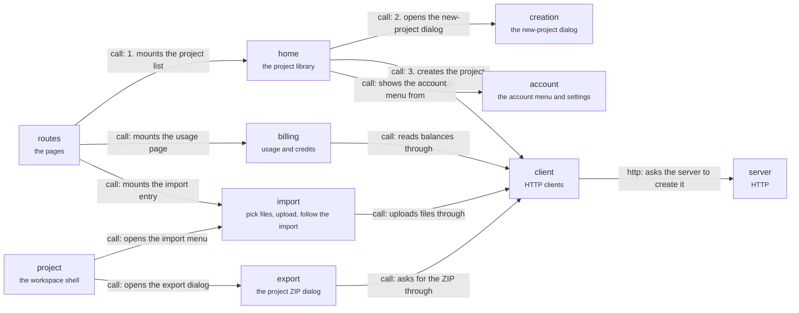

# App: library

The screens around the workspace. The route mounts the project list (1); the writer opens the new-project dialog (2) and the client creates the project, showing it before the server answers (3). Import and export are opened from the workspace; they send the files or ask for the ZIP through the client. Back to the [app](app.md).

## home

The project library and the new-project entry.

The root screen after sign-in: the project list and the new-project view.

- Kind: feature
- Paths: `apps/app/src/features/home`

## creation

The dialog for creating a project.

The record that lets the app open a new project before the server answers is in `client/creation`.

- Kind: feature
- Paths: `apps/app/src/features/creation`

## import

Pick or drop files, upload them, and follow the import.

An account-lifetime coordinator keeps an import running while the writer navigates.

- Kind: feature
- Paths: `apps/app/src/features/import`
- Docs: [CONTEXT](../../apps/app/src/features/import/.context/CONTEXT.md), [AGENTS](../../apps/app/src/features/import/AGENTS.md)
- Machines: [import](../../apps/app/src/features/import/.context/state-machines.md)

## export

The project ZIP dialog.

Asks the server for a ZIP of the live documents. Drafts are not in it.

- Kind: feature
- Paths: `apps/app/src/features/export`

## account

The account menu and the settings dialog.

The menu, the settings dialog (with a phone variant) and the provider that caches account settings.

- Kind: feature
- Paths: `apps/app/src/features/account`

## billing

The usage and credits page.

Shows what the server's credit ledger reports. The browser never computes a balance.

- Kind: feature
- Paths: `apps/app/src/features/billing`
- Docs: [AGENTS](../../apps/app/src/features/billing/AGENTS.md)

## routes

The app's routes.

Each URL mounts a screen.

- Kind: context
- See: [routes](app.md#routes)

## project

The workspace shell.

Panes, sidebar, tabs, Works and routing.

- Kind: context
- See: [project](app.md#project)

## client

Talking to the server.

HTTP clients, query hooks and the thread store.

- Kind: context
- See: [client](app.md#client)

## server

The server.

HTTP, the thread socket and the Yjs socket.

- Kind: context
- See: [server](system.md#server)
