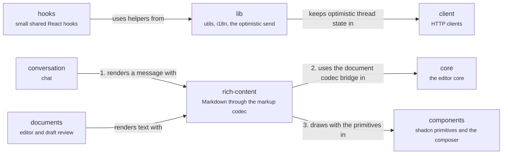

# App: shared

Small shared parts. Chat messages and reviewed drafts both render their text through `rich-content` (1), which turns it into a document with the markup codec (2) and draws it with `components` (3). `lib` holds the helpers, including the optimistic send, and `hooks` the small React hooks. Back to the [app](app.md).

## components

Shared UI: shadcn primitives and the composer.

`ui/` holds the primitives; `app/` holds the composer, link chips and banners. The composer toolbar has a state machine.

- Kind: module
- Paths: `apps/app/src/components`
- Docs: [app CONTEXT](../../apps/app/.context/CONTEXT.md)
- Machines: [composer toolbar](../../apps/app/src/components/app/composer-toolbar/.context/state-machines.md)
- Drift: No written dependency rule covers the app's layers, and imports run both ways between them: `client` imports `features/project`, `components` imports `features/editor` and `features/project`, `core/editor` imports `components`, `client` and `features/project`, and `lib` imports `features/agents`.

## hooks

Small shared React hooks.

Pointer type, the phone shell, text size, theme, a minute clock and a virtual list. No server state.

- Kind: module
- Paths: `apps/app/src/hooks`
- Docs: [app CONTEXT](../../apps/app/.context/CONTEXT.md)

## lib

Helpers: utils, i18n and optimistic thread helpers.

Context-URI parsing, formatting, thread titles and the optimistic send helper `send-project-chat.ts`.

- Kind: module
- Paths: `apps/app/src/lib`
- Docs: [app CONTEXT](../../apps/app/.context/CONTEXT.md)

## rich-content

`Markdown` and `DocumentMarkdown`: render text through the markup codec.

Chat messages and reviewed drafts both render through it, so they show the same text the same way.

- Kind: module
- Paths: `apps/app/src/rich-content`
- Docs: [CONTEXT](../../apps/app/src/rich-content/.context/CONTEXT.md), [AGENTS](../../apps/app/src/rich-content/AGENTS.md)

## conversation

Chat and Agents.

The group of `chat` and `agents`.

- Kind: context
- See: [conversation](app.md#conversation)

## documents

Editor and draft review.

The group of `editor`, `draft-review` and `links`.

- Kind: context
- See: [documents](app.md#documents)

## core

The editor core.

The group of the editor session, transport, resource replica, uploads and completion.

- Kind: context
- See: [core](app.md#core)

## client

Talking to the server.

HTTP clients, query hooks and the thread store.

- Kind: context
- See: [client](app.md#client)
