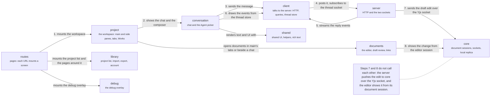

# App

`apps/app/src`: the web app. Follow the numbers for one chat turn: a route mounts the workspace (1),
which shows the chat (2). The chat sends the message (3) through the client, which posts it and
listens on the thread socket (4). The server streams the reply back (5) and the chat draws it from
the thread store (6). When the model edits a document, the edit arrives over the Yjs socket (7) and
the editor shows it (8). No dependency rule is written for these layers, so read an arrow as
"uses". The server's side: [a message becomes an edit](flows/message-becomes-edit.md).

## routes

The pages: TanStack file routes, and the server-side sign-in code.

The `_authenticated` layout mounts one provider tree for every route: do not gate a provider by pathname. `/logout` is a full-document `<a href>`, never a `<Link>`. The code in `src/server` runs `meridianAuthkitMiddleware` and keeps the list of which `/api` routes the app owns and which go to the server.

- Kind: module
- Paths: `apps/app/src/routes`, `apps/app/src/server`
- Docs: [app CONTEXT](../../apps/app/.context/CONTEXT.md)

## project

The workspace shell: main and side panes, tabs, Works and routing.

Two panes always hold different kinds: main shows a document or a chat (the Write | Chat switch picks which), and the side shows the other kind. Main keeps one row of tabs per kind; the left sidebar lists Chats, Manuscript, Knowledge and, while a Work has drafts, Changes. `shell` draws the sidebar and main's band, `side` the other pane, `routing` turns a project address into what main shows, `context` hosts documents and the Manuscript tree, `work` manages Works, and `mobile` is the phone layout. The pane page says where an item opens.

The largest feature: every other feature except `billing` imports it or is imported by it.

- Kind: feature
- Paths: `apps/app/src/features/project`
- Docs: [CONTEXT](../../apps/app/src/features/project/.context/CONTEXT.md), [AGENTS](../../apps/app/src/features/project/AGENTS.md)
- Machines: [panes](../../apps/app/src/features/project/.context/pane-state-machine.md), [project](../../apps/app/src/features/project/context/.context/state-machines.md)
- Drift: Features import each other freely: `project` imports `draft-review` from 22 files, `project` imports `chat` from 14, `chat` imports `project` from 19, `editor` imports `draft-review` from 7 (tests left out). No rule forbids it.

## conversation

Chat and the Agent picker.

`chat` draws the transcript and the composer from the same view model `./mf` prints; `agents` is the picker and the Agent identity a new chat records.

- Kind: group
- Opens: [Conversation](app-conversation.md)

## documents

Writing and reviewing documents.

`editor` is the editor's chrome and surfaces, `draft-review` is Changes, Apply, Discard and Undo, `links` follows an internal link.

- Kind: group
- Opens: [Documents](app-documents.md)

## library

The project list, project creation, import, export and the account pages.

`home`, `creation`, `import`, `export`, `account` and `billing`: the screens around the workspace.

- Kind: group
- Opens: [Library](app-library.md)

## debug

The debug overlay: trace capture, model-request inspector, server feed.

A pill shows transport health; inspectors open by alt-clicking the transcript or the composer. Read-only.

- Kind: feature
- Paths: `apps/app/src/features/debug`
- Docs: [CONTEXT](../../apps/app/src/features/debug/.context/CONTEXT.md)
- Machines: [debug](../../apps/app/src/features/debug/.context/state-machines.md)

## client

Talking to the server: HTTP clients, query hooks, the thread store, providers.

HTTP clients, React Query hooks, the thread store and the transport provider. Also chat submissions and the project creation record, which let the app show a result before the server answers, the working set and recents, and `project-shell`: main's open tabs, the last item of each kind on screen (the pane slots) and each document's view, per browser tab.

- Kind: module
- Paths: `apps/app/src/client`
- Docs: [app CONTEXT](../../apps/app/.context/CONTEXT.md), [chat-submissions CONTEXT](../../apps/app/src/client/chat-submissions/.context/CONTEXT.md), [working-set CONTEXT](../../apps/app/src/client/working-set/.context/CONTEXT.md), [recents CONTEXT](../../apps/app/src/client/recents/.context/CONTEXT.md)
- Machines: [chat submissions](../../apps/app/src/client/chat-submissions/.context/state-machines.md), [creation](../../apps/app/src/client/creation/.context/state-machines.md)
- Drift: No written dependency rule covers the app's layers, and imports run both ways between them: `client` imports `features/project`, `components` imports `features/editor` and `features/project`, `core/editor` imports `components`, `client` and `features/project`, and `lib` imports `features/agents`.

## core

The editor core: document sessions, the socket to the server, the local replica.

`core-editor`, `core-transport`, `core-resources`, `core-uploads` and `core-completion`. They draw nothing of their own; the features use them.

- Kind: group
- Opens: [Core](app-core.md)

## shared

Shared UI, helpers and rich text.

`components` (UI primitives and the composer), `hooks`, `lib` (utils, i18n, the optimistic send helper) and `rich-content` (Markdown through the markup codec).

- Kind: group
- Opens: [Shared](app-shared.md)

## server

The server.

HTTP, the thread socket and the Yjs socket.

- Kind: context
- See: [server](system.md#server)
