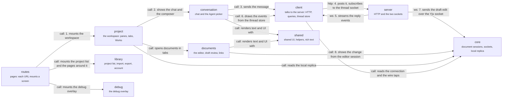

# App

`apps/app/src`: the web app. Follow the numbered arrows for one chat turn: the route mounts the workspace (1), the workspace shows the chat (2), the chat sends the message (3) through the client, which posts it and listens on the thread socket (4); the server streams the reply events back (5), the chat draws them from the thread store (6); when the model edits a document the draft edit arrives over the Yjs socket (7) and the editor shows it (8). Click a group for its parts. **No dependency rule is written for these layers**, and imports run both ways between them, so read an arrow as "uses". The server side of the same story: [a message becomes an edit](flows/message-becomes-edit.md).

## routes

The pages: TanStack file routes, and the server-side sign-in code.

The `_authenticated` layout mounts one provider tree for every route: do not gate a provider by pathname. `/logout` is a full-document `<a href>`, never a `<Link>`. The code in `src/server` runs `meridianAuthkitMiddleware` and keeps the list of which `/api` routes the app owns and which go to the server.

- Kind: module
- Paths: `apps/app/src/routes`, `apps/app/src/server`
- Docs: [app CONTEXT](../../apps/app/.context/CONTEXT.md)

## project

The workspace shell: panes, sidebar, tabs, Works and routing.

The largest feature: every other feature except `billing` imports it or is imported by it. It opens documents in tabs and mounts the chat beside them.

- Kind: feature
- Paths: `apps/app/src/features/project`
- Docs: [CONTEXT](../../apps/app/src/features/project/.context/CONTEXT.md), [AGENTS](../../apps/app/src/features/project/AGENTS.md)
- Machines: [project](../../apps/app/src/features/project/context/.context/state-machines.md)
- Drift: Features import each other freely: `project` imports `draft-review` from 25 files, `project` imports `chat` from 20, `chat` imports `project` from 16, `editor` imports `draft-review` from 8 (tests left out). No rule forbids it.

## conversation

Chat and the Agent picker.

`chat` draws the transcript and the composer from the same view model `./mf` prints; `agents` is the picker and the Agent identity a new chat records.

- Kind: group
- Paths: `apps/app/src/features/chat`, `apps/app/src/features/agents`
- Opens: [Conversation](app-conversation.md)

## documents

Writing and reviewing documents.

`editor` is the editor's chrome and surfaces, `draft-review` is Changes, Apply, Discard and Undo, `links` follows an internal link.

- Kind: group
- Paths: `apps/app/src/features/editor`, `apps/app/src/features/draft-review`, `apps/app/src/features/links`
- Opens: [Documents](app-documents.md)

## library

The project list, project creation, import, export and the account pages.

`home`, `creation`, `import`, `export`, `account` and `billing`: the screens around the workspace.

- Kind: group
- Paths: `apps/app/src/features/home`, `apps/app/src/features/creation`, `apps/app/src/features/import`, `apps/app/src/features/export`, `apps/app/src/features/account`, `apps/app/src/features/billing`
- Opens: [Library](app-library.md)

## debug

The debug overlay: trace capture, model-request inspector, server feed.

A pill shows transport health; inspectors open by alt-clicking the transcript or the composer. Read-only.

- Kind: feature
- Paths: `apps/app/src/features/debug`
- Docs: [CONTEXT](../../apps/app/src/features/debug/.context/CONTEXT.md)
- Machines: [debug](../../apps/app/src/features/debug/.context/state-machines.md)

## client

Talking to the server: HTTP clients, query hooks, the thread store, providers.

HTTP clients, React Query hooks, the thread store and the transport provider. Also chat submissions and the project creation record, which let the app show a result before the server answers, and the working set and recents.

- Kind: module
- Paths: `apps/app/src/client`
- Docs: [app CONTEXT](../../apps/app/.context/CONTEXT.md), [chat-submissions CONTEXT](../../apps/app/src/client/chat-submissions/.context/CONTEXT.md), [working-set CONTEXT](../../apps/app/src/client/working-set/.context/CONTEXT.md), [recents CONTEXT](../../apps/app/src/client/recents/.context/CONTEXT.md)
- Machines: [chat submissions](../../apps/app/src/client/chat-submissions/.context/state-machines.md), [creation](../../apps/app/src/client/creation/.context/state-machines.md)
- Drift: No written dependency rule covers the app's layers, and imports run both ways between them: `client` imports `features/project`, `components` imports `features/editor` and `features/project`, `core/editor` imports `components`, `client` and `features/project`, and `lib` imports `features/agents`.

## core

The editor core: document sessions, the socket to the server, the local replica.

`core-editor`, `core-transport`, `core-resources`, `core-uploads` and `core-completion`. They draw nothing of their own; the features use them.

- Kind: group
- Paths: `apps/app/src/core/editor`, `apps/app/src/core/transport`, `apps/app/src/core/resources`, `apps/app/src/core/uploads`, `apps/app/src/core/completion`
- Opens: [Core](app-core.md)

## shared

Shared UI, helpers and rich text.

`components` (shadcn primitives and the composer), `hooks`, `lib` (utils, i18n, the optimistic send helper) and `rich-content` (Markdown through the markup codec).

- Kind: group
- Paths: `apps/app/src/components`, `apps/app/src/hooks`, `apps/app/src/lib`, `apps/app/src/rich-content`
- Opens: [Shared](app-shared.md)

## server

The server.

HTTP, the thread socket and the Yjs socket.

- Kind: context
- See: [server](system.md#server)
