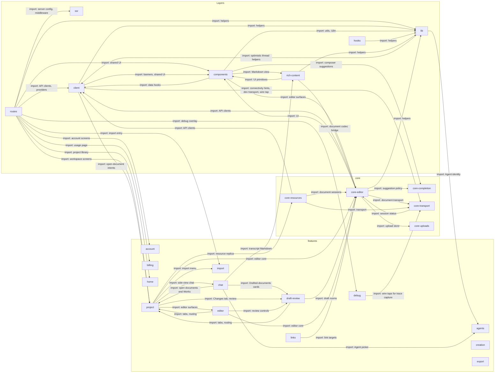

# App

`apps/app/src`: the web app. `routes` mounts a screen from a feature, a feature draws it from
`components` and reads data through `client`, and `core` holds the editor, the resource replica
and the document transport. **No dependency rule is written for these layers**, and imports run
both ways between them, so read an arrow as "uses".

The diagram draws every `routes` import of a feature, and every other import that five or more
files make. It leaves out a feature's imports of `client`, `components`, `lib` and `hooks`, and
imports of packages, which are on [code](code.md).

## routes

TanStack file routes: each URL mounts a screen.

The `_authenticated` layout mounts one provider tree for every route: do not gate a provider by pathname. `/logout` is a full-document `<a href>`, never a `<Link>`.

- Kind: module
- Paths: `apps/app/src/routes`
- Docs: [app CONTEXT](../../apps/app/.context/CONTEXT.md)

## ssr

Server-only code: config, the WorkOS middleware and the route-owner list.

Runs `meridianAuthkitMiddleware` and keeps the list of which `/api` routes the app owns and which go to the server.

- Kind: module
- Paths: `apps/app/src/server`
- Docs: [app CONTEXT](../../apps/app/.context/CONTEXT.md)

## components

Shared UI: shadcn primitives and the composer.

`ui/` holds the primitives; `app/` holds the composer, link chips and banners. The composer toolbar has a state machine.

- Kind: module
- Paths: `apps/app/src/components`
- Docs: [app CONTEXT](../../apps/app/.context/CONTEXT.md)
- Machines: [composer toolbar](../../apps/app/src/components/app/composer-toolbar/.context/state-machines.md)
- Drift: No written dependency rule covers the app's layers, and imports run both ways between them: `client` imports `features/project`, `components` imports `features/editor` and `features/project`, `core/editor` imports `components`, `client` and `features/project`, and `lib` imports `features/agents`.

## client

Talking to the server: HTTP clients, query hooks, the thread store, providers.

HTTP clients, React Query hooks, the thread store and the transport provider. Also chat submissions and the project creation record, which let the app show a result before the server answers, and the working set and recents.

- Kind: module
- Paths: `apps/app/src/client`
- Docs: [app CONTEXT](../../apps/app/.context/CONTEXT.md), [chat-submissions CONTEXT](../../apps/app/src/client/chat-submissions/.context/CONTEXT.md), [working-set CONTEXT](../../apps/app/src/client/working-set/.context/CONTEXT.md), [recents CONTEXT](../../apps/app/src/client/recents/.context/CONTEXT.md)
- Machines: [chat submissions](../../apps/app/src/client/chat-submissions/.context/state-machines.md), [creation](../../apps/app/src/client/creation/.context/state-machines.md)
- Drift: No written dependency rule covers the app's layers, and imports run both ways between them: `client` imports `features/project`, `components` imports `features/editor` and `features/project`, `core/editor` imports `components`, `client` and `features/project`, and `lib` imports `features/agents`.

## hooks

Small shared React hooks.

Pointer type, the phone shell, text size, theme, a minute clock and a virtual list. No server state.

- Kind: module
- Paths: `apps/app/src/hooks`
- Docs: [app CONTEXT](../../apps/app/.context/CONTEXT.md)

## lib

Helpers: utils, i18n and optimistic thread helpers.

Context-URI parsing, formatting, thread titles and the optimistic send helper `send-project-chat.ts`.

- Kind: module
- Paths: `apps/app/src/lib`
- Docs: [app CONTEXT](../../apps/app/.context/CONTEXT.md)

## rich-content

`Markdown` and `DocumentMarkdown`: render text through the markup codec.

Chat messages and reviewed drafts both render through it, so they show the same text the same way.

- Kind: module
- Paths: `apps/app/src/rich-content`
- Docs: [CONTEXT](../../apps/app/src/rich-content/.context/CONTEXT.md), [AGENTS](../../apps/app/src/rich-content/AGENTS.md)

## core-completion

What a suggestion menu offers, without drawing it.

The menu's state and the browser that completes a reference to a document. It draws nothing, so the composer and the editor both use it.

- Kind: module
- Paths: `apps/app/src/core/completion`
- Docs: [CONTEXT](../../apps/app/src/core/completion/.context/CONTEXT.md), [AGENTS](../../apps/app/src/core/completion/AGENTS.md)

## core-editor

The TipTap schema and the Yjs document session.

`createEditorExtensions()` is the one way to build the extensions. The schema mirrors `@meridian/prosemirror-schema`, and a test compares the two.

- Kind: module
- Paths: `apps/app/src/core/editor`
- Docs: [CONTEXT](../../apps/app/src/core/editor/.context/CONTEXT.md), [AGENTS](../../apps/app/src/core/editor/AGENTS.md)
- Machines: [editor core](../../apps/app/src/core/editor/.context/state-machines.md)
- Drift: `core/editor` and `core/transport` import each other (editor to transport 2 files, transport to editor 1).

## core-resources

The account resource replica and its reconciler.

Sits on `@meridian/resource-replica`: documents and folders get a local identity first and the server catches up.

- Kind: module
- Paths: `apps/app/src/core/resources`
- Docs: [CONTEXT](../../apps/app/src/core/resources/.context/CONTEXT.md)

## core-transport

The Hocuspocus document transport, connectivity hints and the wire taps the debug overlay reads.

A dev transport exists for local use. The thread socket is not here: it is `@meridian/thread-client`, wired in `client`.

- Kind: module
- Paths: `apps/app/src/core/transport`
- Docs: [CONTEXT](../../apps/app/src/core/transport/.context/CONTEXT.md), [AGENTS](../../apps/app/src/core/transport/AGENTS.md)

## core-uploads

The upload store.

Tracks files being uploaded.

- Kind: module
- Paths: `apps/app/src/core/uploads`
- Docs: [app CONTEXT](../../apps/app/.context/CONTEXT.md)
- Machines: [upload store](../../apps/app/src/core/uploads/.context/state-machines.md)

## account

The account menu and the settings dialog.

The menu, the settings dialog (with a phone variant) and the provider that caches account settings.

- Kind: feature
- Paths: `apps/app/src/features/account`

## agents

The Agent picker and Agent identity.

A new chat records exactly which Agent, and which revision of it, the writer picked.

- Kind: feature
- Paths: `apps/app/src/features/agents`
- Docs: [CONTEXT](../../apps/app/src/features/agents/.context/CONTEXT.md), [AGENTS](../../apps/app/src/features/agents/AGENTS.md)

## billing

The usage and credits page.

Shows what the server's credit ledger reports. The browser never computes a balance.

- Kind: feature
- Paths: `apps/app/src/features/billing`
- Docs: [AGENTS](../../apps/app/src/features/billing/AGENTS.md)

## chat

The transcript and the composer.

The transcript is drawn from the same view model `./mf` prints.

- Kind: feature
- Paths: `apps/app/src/features/chat`
- Docs: [CONTEXT](../../apps/app/src/features/chat/.context/CONTEXT.md), [AGENTS](../../apps/app/src/features/chat/AGENTS.md)
- Machines: [chat](../../apps/app/src/features/chat/.context/state-machines.md)

## creation

The dialog for creating a project.

The record that lets the app open a new project before the server answers is in `client/creation`.

- Kind: feature
- Paths: `apps/app/src/features/creation`

## debug

The debug overlay: trace capture, model-request inspector, server feed.

A pill shows transport health; inspectors open by alt-clicking the transcript or the composer. Read-only.

- Kind: feature
- Paths: `apps/app/src/features/debug`
- Docs: [CONTEXT](../../apps/app/src/features/debug/.context/CONTEXT.md)
- Machines: [debug](../../apps/app/src/features/debug/.context/state-machines.md)

## draft-review

Review of a draft: Changes, Apply, Discard, Undo.

Review is derived from the draft's text, not from stored change records.

- Kind: feature
- Paths: `apps/app/src/features/draft-review`
- Docs: [AGENTS](../../apps/app/src/features/draft-review/AGENTS.md)
- Machines: [draft-review](../../apps/app/src/features/draft-review/.context/state-machines.md)

## editor

Editor chrome and its surfaces over `core/editor`.

Binds the document session, chooses live or review presentation and mounts the toolbar, identity bar and sync pill.

- Kind: feature
- Paths: `apps/app/src/features/editor`
- Docs: [CONTEXT](../../apps/app/src/features/editor/.context/CONTEXT.md), [AGENTS](../../apps/app/src/features/editor/AGENTS.md)
- Machines: [editor](../../apps/app/src/features/editor/.context/state-machines.md)

## export

The project ZIP dialog.

Asks the server for a ZIP of the live documents. Drafts are not in it.

- Kind: feature
- Paths: `apps/app/src/features/export`

## home

The project library and the new-project entry.

The root screen after sign-in: the project list and the new-project view.

- Kind: feature
- Paths: `apps/app/src/features/home`

## import

Pick or drop files, upload them, and follow the import.

An account-lifetime coordinator keeps an import running while the writer navigates.

- Kind: feature
- Paths: `apps/app/src/features/import`
- Docs: [CONTEXT](../../apps/app/src/features/import/.context/CONTEXT.md), [AGENTS](../../apps/app/src/features/import/AGENTS.md)
- Machines: [import](../../apps/app/src/features/import/.context/state-machines.md)

## links

Following an internal link.

Resolves links from the local project index first, then the server; a failed request keeps the local answer. A link still opens after its target is moved or renamed.

- Kind: feature
- Paths: `apps/app/src/features/links`
- Docs: [CONTEXT](../../apps/app/src/features/links/.context/CONTEXT.md), [AGENTS](../../apps/app/src/features/links/AGENTS.md)

## project

The workspace shell: panes, sidebar, tabs, Works and routing.

The largest feature: every other feature except `billing` imports it or is imported by it.

- Kind: feature
- Paths: `apps/app/src/features/project`
- Docs: [CONTEXT](../../apps/app/src/features/project/.context/CONTEXT.md), [AGENTS](../../apps/app/src/features/project/AGENTS.md)
- Machines: [project](../../apps/app/src/features/project/context/.context/state-machines.md)
- Drift: Features import each other freely: `project` imports `draft-review` from 25 files, `project` imports `chat` from 20, `chat` imports `project` from 16, `editor` imports `draft-review` from 8 (tests left out). No rule forbids it.
