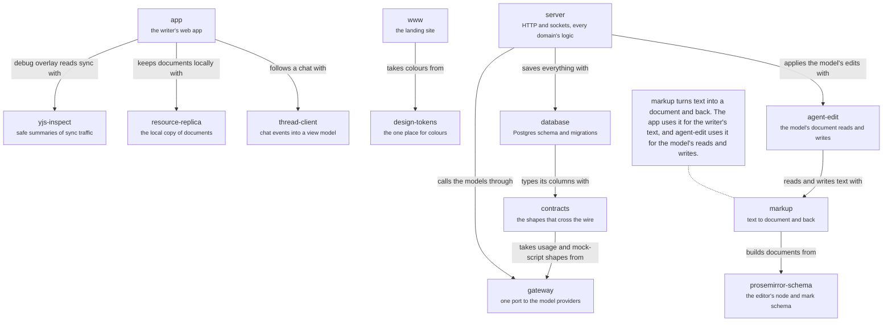

# Code

The apps, and the packages under them. An arrow means "calls code from". The page shows layers,
not a path, so no arrow is numbered. No package imports an app, and `gateway`, `prosemirror-schema`, `yjs-inspect` and
`design-tokens` import no workspace code. Where the code breaks its written rules is on
[dependencies](dependencies.md). `./mf` lives in `tools/`, outside these layers: see
[system](system.md#mf).

## app

`apps/app`: the writer's web app, its pages and its browser code.

Every screen a writer sees: the routes, the editor and the chat.

- Kind: module
- Paths: `apps/app/src`
- Docs: [app CONTEXT](../../apps/app/.context/CONTEXT.md), [app AGENTS](../../apps/app/AGENTS.md)
- Opens: [App](app.md)

## server

`apps/server`: the HTTP and WebSocket server and every domain's logic.

Routes are thin, domains hold the logic and `lib/` composes them. The only app that imports `database`.

- Kind: module
- Paths: `apps/server/server`
- Docs: [server CONTEXT](../../apps/server/.context/CONTEXT.md), [server AGENTS](../../apps/server/AGENTS.md)
- Opens: [Server](server.md)

## www

`apps/www`: the public landing site.

Imports only `design-tokens`.

- Kind: module
- Paths: `apps/www/src`
- Docs: [www AGENTS](../../apps/www/AGENTS.md)
- Machines: [landing](../../apps/www/src/features/landing/.context/state-machines.md)
- Opens: [www](www.md)

## contracts

The shapes that cross the wire.

One schema per HTTP response. A chat's run state is one versioned record, always sent whole; a receiver keeps the newest.

- Kind: package
- Paths: `packages/contracts/src`
- Docs: [CONTEXT](../../packages/contracts/.context/CONTEXT.md), [AGENTS](../../packages/contracts/AGENTS.md)

## gateway

The model gateway: one streaming port to Anthropic, OpenAI and OpenAI-compatible providers.

Published to npm as `@meridian-flow/gateway` for other products, so it imports no workspace code, reads no environment variables and takes keys through its provider config. The server builds it from `FLOW_` variables in `lib/gateway/`.

- Kind: package
- Paths: `packages/gateway/src`
- Docs: [CONTEXT](../../packages/gateway/.context/CONTEXT.md)

## database

The Drizzle schema and the migrations.

Plain Postgres with no business logic. Merged migrations are frozen: append, never edit or renumber.

- Kind: package
- Paths: `packages/database/src`
- Docs: [CONTEXT](../../packages/database/.context/CONTEXT.md), [AGENTS](../../packages/database/AGENTS.md)

## design-tokens

The design tokens: the one place a raw colour may appear.

The app and the landing site take their colours from it, and the architecture viewer mirrors the values it needs and checks the copy.

- Kind: package
- Paths: `packages/design-tokens/src`

## markup

The text and ProseMirror codecs, and the link rules the server and client share.

MDX is the wire format and plain Markdown a subset. It never imports `agent-edit`, and every serialize takes a `DocumentLinkScope`.

- Kind: package
- Paths: `packages/markup/src`
- Docs: [CONTEXT](../../packages/markup/.context/CONTEXT.md), [AGENTS](../../packages/markup/AGENTS.md)

## prosemirror-schema

The editor's node and mark schema, shared by the app and the server.

A change to a node, mark or attribute updates `meridian-extensions.ts` in the app in the same commit; a test compares the two.

- Kind: package
- Paths: `packages/prosemirror-schema/src`
- Docs: [CONTEXT](../../packages/prosemirror-schema/.context/CONTEXT.md), [AGENTS](../../packages/prosemirror-schema/AGENTS.md)

## agent-edit

The Yjs editing core for the model's document `read` and `write`.

Stages one reply's writes, saves them together and builds the inverses Undo applies. It owns no Postgres, routes or auth: the server supplies the journal and does the durable save.

- Kind: package
- Paths: `packages/agent-edit/src`
- Docs: [CONTEXT](../../packages/agent-edit/.context/CONTEXT.md), [AGENTS](../../packages/agent-edit/AGENTS.md)
- Machines: [agent-edit](../../packages/agent-edit/.context/state-machines.md)

## resource-replica

Pure policy for the writer's local copy of documents and folders.

Follows the server's catalogs, its listings of documents and folders. A document's place comes from ids, never from its path. No I/O: the app supplies storage.

- Kind: package
- Paths: `packages/resource-replica/src`
- Docs: [CONTEXT](../../packages/resource-replica/.context/CONTEXT.md), [AGENTS](../../packages/resource-replica/AGENTS.md)
- Machines: [resource-replica](../../packages/resource-replica/.context/state-machines.md)

## thread-client

The thread socket client and view model, shared by the app and `./mf`.

No React and no browser or Node globals. `createThreadSync` never fetches, and the view model emits counts and kinds, never translated strings.

- Kind: package
- Paths: `packages/thread-client/src`
- Docs: [CONTEXT](../../packages/thread-client/.context/CONTEXT.md), [AGENTS](../../packages/thread-client/AGENTS.md)
- Machines: [thread-client](../../packages/thread-client/.context/state-machines.md)

## yjs-inspect

Turns binary Hocuspocus and Yjs messages into metadata-only summaries.

No export may return writer text; a canary test checks it.

- Kind: package
- Paths: `packages/yjs-inspect/src`
- Docs: [CONTEXT](../../packages/yjs-inspect/.context/CONTEXT.md), [AGENTS](../../packages/yjs-inspect/AGENTS.md)
