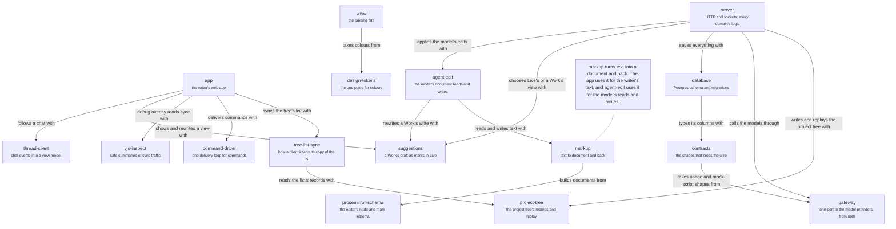

# Code

The apps, and the packages under them. An arrow means "calls code from". The page shows layers,
not a path, so no arrow is numbered. No package imports an app, and `prosemirror-schema`, `suggestions`, `yjs-inspect` and
`design-tokens` import no workspace code. `gateway` is not in this repository: it is
the `@meridian-flow/runtime/gateway` entry of [`@meridian-flow/runtime`](https://github.com/haowjy/meridian-runtime/tree/main/src/gateway) from npm. Where the code breaks its written rules is on
[dependencies](dependencies.md). `./mf` lives in `tools/`, outside these layers: see
[system](system.md#mf).

## app

`apps/app`: the writer's web app, its pages and its browser code.

Every screen a writer sees: the routes, the editor and the chat.

- Kind: module
- Paths: `apps/app/src`
- Docs: [app CONTEXT](../../apps/app/.context/CONTEXT.md), [app AGENTS](../../apps/app/AGENTS.md)
- Opens: [App](app.md)

## server

`apps/server`: the HTTP and WebSocket server and every domain's logic.

Routes are thin, domains hold the logic and `lib/` composes them. The only app that imports `database`.

- Kind: module
- Paths: `apps/server/server`
- Docs: [server CONTEXT](../../apps/server/.context/CONTEXT.md), [server AGENTS](../../apps/server/AGENTS.md)
- Opens: [Server](server.md)

## www

`apps/www`: the public landing site.

Imports only `design-tokens`.

- Kind: module
- Paths: `apps/www/src`
- Docs: [www AGENTS](../../apps/www/AGENTS.md)
- Machines: [landing](../../apps/www/src/features/landing/.context/state-machines.md)
- Opens: [www](www.md)

## contracts

The shapes that cross the wire.

One schema per HTTP response. A chat's run state is one versioned record, always sent whole; a receiver keeps the newest.

- Kind: package
- Paths: `packages/contracts/src`
- Docs: [CONTEXT](../../packages/contracts/.context/CONTEXT.md), [AGENTS](../../packages/contracts/AGENTS.md)

## gateway

The model gateway: one streaming port to Anthropic, OpenAI, Gemini and OpenAI-compatible providers.

Not code in this repository: the `meridian-runtime` repository publishes it to npm in `@meridian-flow/runtime` (entry `/gateway`), and Flow depends on it by version. The server builds it from `FLOW_` variables in `lib/gateway/`; `contracts` re-exports its `shapes` entry, which is free of Node built-ins and SDKs so the browser bundle can take it.

- Kind: external
- Paths: `apps/server/server/lib/gateway`
- Docs: [server gateway wiring CONTEXT](../../apps/server/server/lib/gateway/.context/CONTEXT.md), [package CONTEXT](https://github.com/haowjy/meridian-runtime/blob/main/src/gateway/.context/CONTEXT.md)

## database

The Drizzle schema and the migrations.

Plain Postgres with no business logic. Before the first deploy with retained data, regenerate one baseline from schema and custom SQL; reset local data after schema changes.

- Kind: package
- Paths: `packages/database/src`
- Docs: [CONTEXT](../../packages/database/.context/CONTEXT.md), [AGENTS](../../packages/database/AGENTS.md)

## design-tokens

The design tokens: the one place a raw colour may appear.

The app and the landing site take their colours from it, and the architecture viewer mirrors the values it needs and checks the copy.

- Kind: package
- Paths: `packages/design-tokens/src`

## markup

The text and ProseMirror codecs, and the link rules the server and client share.

MDX is the wire format and plain Markdown a subset. It never imports `agent-edit`, and every serialize takes a `DocumentLinkScope`.

- Kind: package
- Paths: `packages/markup/src`
- Docs: [CONTEXT](../../packages/markup/.context/CONTEXT.md), [AGENTS](../../packages/markup/AGENTS.md)

## prosemirror-schema

The editor's node and mark schema, shared by the app and the server.

A change to a node, mark or attribute updates `meridian-extensions.ts` in the app in the same commit; a test compares the two.

- Kind: package
- Paths: `packages/prosemirror-schema/src`
- Docs: [CONTEXT](../../packages/prosemirror-schema/.context/CONTEXT.md), [AGENTS](../../packages/prosemirror-schema/AGENTS.md)

## agent-edit

The Yjs editing core for the model's document `read` and `write`.

Plans, lowers and describes one model write on a document room, and builds the inverses Undo applies. It owns no Postgres, routes or auth: the server supplies the journal and does the durable save.

- Kind: package
- Paths: `packages/agent-edit/src`
- Docs: [CONTEXT](../../packages/agent-edit/.context/CONTEXT.md), [AGENTS](../../packages/agent-edit/AGENTS.md)

## suggestions

A Work's draft stored as suggestion marks inside the Live document, behind `FLOW_SUGGESTIONS` / `VITE_FLOW_SUGGESTIONS` until the draft documents go.

One decision table (`kindOf`) says what a view shows and what an edit there does; `rewrite` applies it to any ProseMirror transaction, so the editor's typing and the model's writes take the same path. Discard is `reject`. Imports no workspace code and no Yjs.

- Kind: package
- Paths: `packages/suggestions/src`
- Docs: [CONTEXT](../../packages/suggestions/.context/CONTEXT.md), [AGENTS](../../packages/suggestions/AGENTS.md)

## project-tree

The project tree as an append-only list of records in a Yjs document, and the replay that turns it into a tree.

The records, the replay and its rules, Apply, Discard and Undo, the server's check of a client's update, and the rows to write after a replay. It owns no database or access rules: the server supplies what only it knows. Not yet imported by the server or the app.

- Kind: package
- Paths: `packages/project-tree/src`
- Docs: [CONTEXT](../../packages/project-tree/.context/CONTEXT.md), [AGENTS](../../packages/project-tree/AGENTS.md)

## command-driver

The one delivery loop for every command the server may or may not have received: a journal of the writer's intent, one delivering tab per account, and the server's stored outcome as the only answer.

Framework-free. The browser's journal, lock, channel and transport come in as ports from the app's `client/commands`; domains project the unsettled records over their own data.

- Kind: package
- Paths: `packages/command-driver/src`
- Docs: [AGENTS](../../packages/command-driver/AGENTS.md)
- Machines: [command-driver](../../packages/command-driver/.context/state-machines.md)

## thread-client

The thread socket client and view model, shared by the app and `./mf`.

No React and no browser or Node globals. `createThreadSync` never fetches, and the view model emits counts and kinds, never translated strings.

- Kind: package
- Paths: `packages/thread-client/src`
- Docs: [CONTEXT](../../packages/thread-client/.context/CONTEXT.md), [AGENTS](../../packages/thread-client/AGENTS.md)
- Machines: [thread-client](../../packages/thread-client/.context/state-machines.md)

## tree-list-sync

How a client keeps its copy of the project tree's list the server's: the connection to the list's room, sending in parts of at most an eighth of an admission, and the rebuild after a whole refusal.

Owns no storage and no tabs: the browser's copy comes in through `ListCopy`. The server's room cuts what it sends with the same function.

- Kind: package
- Paths: `packages/tree-list-sync/src`
- Docs: [CONTEXT](../../packages/tree-list-sync/.context/CONTEXT.md), [AGENTS](../../packages/tree-list-sync/AGENTS.md)

## yjs-inspect

Turns binary Hocuspocus and Yjs messages into metadata-only summaries.

No export may return writer text; a canary test checks it.

- Kind: package
- Paths: `packages/yjs-inspect/src`
- Docs: [CONTEXT](../../packages/yjs-inspect/.context/CONTEXT.md), [AGENTS](../../packages/yjs-inspect/AGENTS.md)
