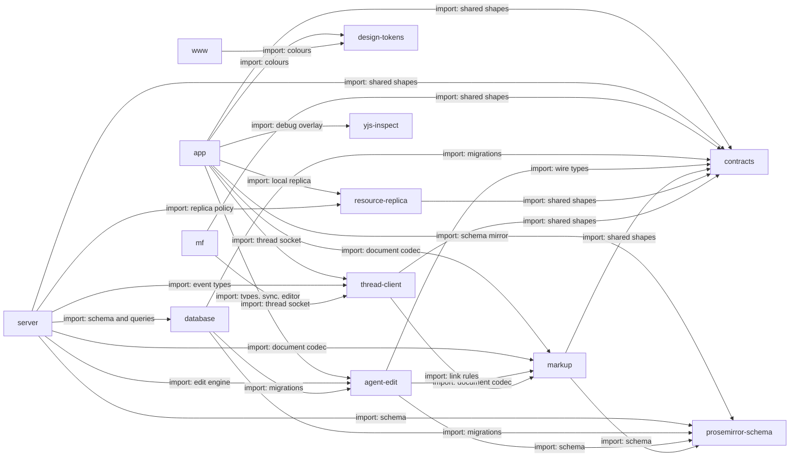

# Code

The apps and packages, and which imports which. Dependencies run down: apps import packages, and
packages import only packages lower in the list. `contracts`, `prosemirror-schema`, `yjs-inspect`
and `design-tokens` import no workspace code. No package imports an app.
`tools/` is outside these rules and imports server adapters directly.

## app

`apps/app`: the writer's web app, its pages and its browser code.

TanStack Start on Nitro. It holds the routes, the editor, the chat transcript and every screen a writer sees. It is the largest consumer of `contracts` and `thread-client`. Its layers are on the next level.

- Kind: module
- Paths: `apps/app/src`
- Docs: [app CONTEXT](../../apps/app/.context/CONTEXT.md), [app AGENTS](../../apps/app/AGENTS.md)
- Opens: [App](app.md)

## server

`apps/server`: the HTTP and WebSocket server and every domain's logic.

Routes are thin; domains hold the logic and `lib/` composes them. It imports the most packages, and `database` is imported only here. Its layers are on the next level.

- Kind: module
- Paths: `apps/server/server`
- Docs: [server CONTEXT](../../apps/server/.context/CONTEXT.md), [server AGENTS](../../apps/server/AGENTS.md)
- Opens: [Server](server.md)

## www

`apps/www`: the public landing site.

Imports only `design-tokens`. It has one state machine, the landing page's.

- Kind: module
- Paths: `apps/www/src`
- Docs: [www AGENTS](../../apps/www/AGENTS.md)
- Machines: [landing](../../apps/www/src/features/landing/.context/state-machines.md)

## mf

`tools/mf`: the `./mf` command-line client.

It reads the same HTTP responses and thread events as the app, through `contracts` and `thread-client`, so a bug seen in `./mf` and a bug seen in the app share a cause.

- Kind: module
- Paths: `tools/mf/src`

## contracts

The shapes that cross the wire.

One schema per HTTP response, shared by the app and `./mf`. A run's state travels whole on every carrier and is replaced by version; there is no second field for a fact the record carries.

- Kind: package
- Paths: `packages/contracts/src`
- Docs: [CONTEXT](../../packages/contracts/.context/CONTEXT.md), [AGENTS](../../packages/contracts/AGENTS.md)

## database

The Drizzle schema and the migrations.

The schema stays ordinary Postgres and holds no business logic. Migrations merged to `main` or `staging` are frozen: append, never edit or renumber. Migrations import `agent-edit`, `contracts` and `prosemirror-schema`.

- Kind: package
- Paths: `packages/database/src`
- Docs: [CONTEXT](../../packages/database/.context/CONTEXT.md), [AGENTS](../../packages/database/AGENTS.md)

## design-tokens

The design tokens: the one place a raw colour may appear.

The app and the landing site take their colours from it, and the architecture viewer mirrors the values it needs and checks the copy.

- Kind: package
- Paths: `packages/design-tokens/src`

## markup

The text and ProseMirror codecs, and the link rules the server and client share.

MDX is the wire format and plain Markdown a supported subset. A leaf: it never imports `agent-edit`. Link rules are at `./links` and Yjs walks at `./stored-links`, both outside the root export. Every serialize takes a `DocumentLinkScope`.

- Kind: package
- Paths: `packages/markup/src`
- Docs: [CONTEXT](../../packages/markup/.context/CONTEXT.md), [AGENTS](../../packages/markup/AGENTS.md)

## prosemirror-schema

The editor's node and mark schema, shared by the app and the server.

A change to a node, mark or attribute updates `meridian-extensions.ts` in the app in the same commit; a test compares the two.

- Kind: package
- Paths: `packages/prosemirror-schema/src`
- Docs: [CONTEXT](../../packages/prosemirror-schema/.context/CONTEXT.md), [AGENTS](../../packages/prosemirror-schema/AGENTS.md)

## agent-edit

The Yjs editing core for the model's document `read` and `write`.

It buffers a reply's saves, hands out write handles and makes inverses. Hosts supply the journal, coordinator and ports; it owns no Postgres, routes or auth. It holds no document or cache between calls. Every write lands through `ResponseCommitter` and `prepareSave`, and durability belongs to the host's commit. `./diff` and `./yjs-mutation` load in the browser and import no host code.

- Kind: package
- Paths: `packages/agent-edit/src`
- Docs: [CONTEXT](../../packages/agent-edit/.context/CONTEXT.md), [AGENTS](../../packages/agent-edit/AGENTS.md)
- Machines: [agent-edit](../../packages/agent-edit/.context/state-machines.md)

## resource-replica

Pure policy for the writer's local copy of documents and folders.

A catalog commit is a whole checkpoint, and placement is an identity dependency graph, not path replacement. No I/O: the app supplies storage.

- Kind: package
- Paths: `packages/resource-replica/src`
- Docs: [CONTEXT](../../packages/resource-replica/.context/CONTEXT.md), [AGENTS](../../packages/resource-replica/AGENTS.md)
- Machines: [resource-replica](../../packages/resource-replica/.context/state-machines.md)

## thread-client

The thread socket client and view model, shared by the app and `./mf`.

Framework-free: no React and no browser or Node globals at module evaluation. It depends only on `contracts` and `markup/links`. `createThreadSync` never fetches, and the view model emits counts and kinds, never translated strings.

- Kind: package
- Paths: `packages/thread-client/src`
- Docs: [CONTEXT](../../packages/thread-client/.context/CONTEXT.md), [AGENTS](../../packages/thread-client/AGENTS.md)
- Machines: [thread-client](../../packages/thread-client/.context/state-machines.md)

## yjs-inspect

Turns binary Hocuspocus and Yjs messages into metadata-only summaries.

No export may return writer text. A canary test is the only check that writer text stays out of diagnostics.

- Kind: package
- Paths: `packages/yjs-inspect/src`
- Docs: [CONTEXT](../../packages/yjs-inspect/.context/CONTEXT.md), [AGENTS](../../packages/yjs-inspect/AGENTS.md)
- Drift: the README's "Shared packages" lists 4 of these 9 packages.
