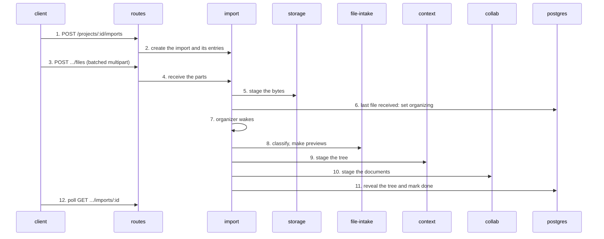

# An import

The writer drops a folder of Markdown files on a project. The files go up first; a server-owned
organizer then builds the whole tree in one step. "import" below is the server's `import` domain; the
browser side is the app's `import` feature, which calls through the client.

1. **Create.** The app's `import` feature (`features/import/import-coordinator.ts`, an account-lifetime coordinator, so navigating away does not stop it) posts to `routes/api/projects/[projectId]/imports/index.post.ts` through [client](../app.md#client).
2. **Admit.** The [import](../server-files.md#import) domain persists the import, one root and one entry per folder, file and unreadable item. The import id is permanent: a replay returns the first answer.
3. **Upload.** The client sends the files in batched multipart posts to `.../imports/[importId]/files.post.ts`.
4. **Receive.** The route reads the parts (`lib/import-body.ts`) and `service.receive` bounds parts, bytes and concurrency.
5. **Stage.** The bytes go to [storage](../server-files.md#storage) under a staging key.
6. **Complete.** When the last file is received the import moves to `organizing` in the same step; the client reports nothing. (`picked.post.ts` is only for Continue, a re-pick of files already received.) *Not traced:* the code that detects the last receipt; the domain's CONTEXT says upload completion sets `organizing`.
7. **Wake.** A durable queue row wakes the organizer lane; the wake is only a latency hint and the rows are authoritative.
8. **Classify.** The organizer calls [file-intake](../server-files.md#file-intake) to classify each file and make WebP previews for HEIC, BMP and TIFF.
9. **Stage tree.** It stages bounded generations of the tree through [context](../server-documents.md#context).
10. **Stage documents.** Document bodies go through [collab](../server-documents.md#collab) (`MarkdownDocumentStore`, link binding).
11. **Reveal.** One transaction publishes the tree, the catalog and the terminal import status in [postgres](../system.md#postgres), so the writer never sees a half-built tree.
12. **Poll.** The coordinator polls the import's status until it is terminal.

State machines: [import (server)](../../../apps/server/server/domains/import/.context/state-machines.md), [import (app)](../../../apps/app/src/features/import/.context/state-machines.md), [context uploads](../../../apps/server/server/domains/context/uploads/.context/state-machines.md).
