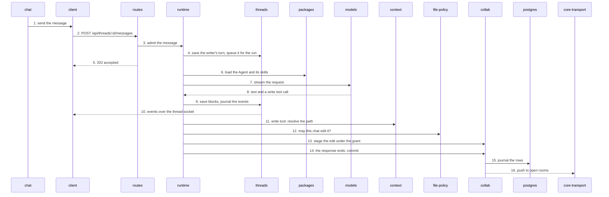

# A message becomes an edit

The writer sends "tighten chapter 3" in chat and the model edits the chapter. The message travels
over HTTP, the run streams its reply over the thread socket, and the model's edit reaches the browser
over the Yjs socket. The numbers below are the steps in the list under the picture.

1. **Send.** [chat](../app-conversation.md#chat) calls the optimistic send helper `lib/send-project-chat.ts`, which shows the message at once and keeps it in the send journal in `localStorage` until the server confirms.
2. **Post.** [client](../app.md#client) posts to `routes/api/threads/[threadId]/messages.post.ts` with a `submissionId`, so a retry is the same message.
3. **Admit.** The route checks the thread belongs to the writer, then calls `app.userTurnAdmission.admit` ([runtime](../server-conversation.md#runtime), `admission/user-turn-admission.ts`). A replay of the same `submissionId` returns the first answer.
4. **Save.** In one transaction `admission/writer-turn-producer.ts` saves the writer's turn through [threads](../server-conversation.md#threads) repositories, appends the message to the thread's durable inbox and wakes the thread. No run starts here. After the commit, `runtime-delivery.ts` calls `runStarter.start(threadId)`, which claims the thread and starts the run's drain; the drain creates the assistant turn. If that call is lost, the recovery scheduler's sweep (`sweepWakes`) finds threads with pending messages and starts them the same way.
5. **Answer.** The route returns `202` with the user turn id and the event cursor. The client does not wait for the run.
6. **Assemble.** `loop/turn-context-assembly.ts` loads the bound Agent revision and skills from [packages](../server-conversation.md#packages), pending notices from `notices`, and the thread's history.
7. **Ask.** `loop/orchestrator.ts` calls `gateway.stream(request)` on the runtime's model gateway, which talks to [models](../system.md#models). `loop/turn-accounting.ts` checks the writer's credits through the billing port before the call and debits the cost after the model returns.
8. **Reply.** The stream yields text and, here, a `write` tool call.
9. **Journal.** The orchestrator persists each block through the threads repositories and emits `OrchestratorEvent`s; threads appends them to the event journal in Postgres and a Postgres notification wakes the thread hub.
10. **Stream.** The hub sends the events to every client subscribed on the thread socket (`routes/api/threads/ws.ts`, `lib/ws-thread-handler.ts`); the client's thread store updates and the transcript redraws.
11. **Resolve.** The tool executor (`runtime/tools/tool-executor.ts`) runs the `write` handler. The handler is not in runtime: `lib/model-tools/document-tools.ts` binds it, and it resolves the path (`manuscript://chapter-3`) to a tracked document through [context](../server-documents.md#context).
12. **Ask policy.** The handler asks [file-policy](../server-documents.md#file-policy) for an edit grant (`documentGrant`). A refusal goes back to the model as the tool result.
13. **Stage.** With the grant, it calls `documentSync.agentEdit().write(...)` on [collab](../server-documents.md#collab) (the thread-peer pool). In draft mode an edit to a manuscript, Knowledge, `user://` or `unfiled://` document goes to the Work's draft; `scratch://` is always edited directly. The edit is staged in the reply's edit scope; nothing is in a room yet.
14. **Commit.** When the model response ends, the orchestrator calls `responseWrites.commitResponse` (`lib/model-tools/response-write-lifecycle.ts`), which calls `finalizeResponseCommit` on collab.
15. **Journal.** One transaction saves all the response's live and draft journal rows and receipts in [postgres](../system.md#postgres). A rollback leaves nothing visible.
16. **Push.** After commit, collab delivers the live writes into the open Hocuspocus room, and every connected tab gets them over `/ws/yjs` ([core-transport](../app-core.md#core-transport)). A draft write takes the same route: after the commit, `draft-runtime.ts` installs the committed draft and `hocuspocus-binding.ts` applies the update to that draft's room, which broadcasts it to the tabs that have it open.

State machines on this path: [runtime](../../../apps/server/server/domains/runtime/.context/state-machines.md), [threads](../../../apps/server/server/domains/threads/.context/state-machines.md), [collab](../../../apps/server/server/domains/collab/.context/state-machines.md), [chat submissions](../../../apps/app/src/client/chat-submissions/.context/state-machines.md), [chat](../../../apps/app/src/features/chat/.context/state-machines.md).
