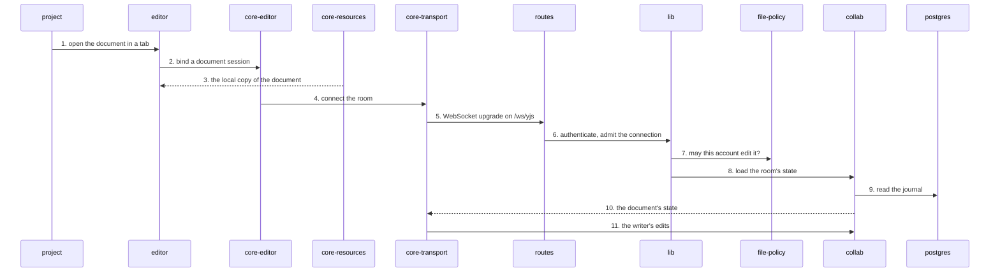

# Opening a document

The writer clicks a chapter in the sidebar. The tab shows the local copy at once, then connects to
the document's live room, which the server admits only after asking the file policy.

1. **Open.** [project](../app.md#project) opens the document in a tab (`features/project/context/open-project-document.ts`) and mounts `ContextDocumentHost`.
2. **Bind.** [editor](../app-documents.md#editor) asks [core-editor](../app-core.md#core-editor) for a document session from the session registry.
3. **Local first.** [core-resources](../app-core.md#core-resources) holds the writer's local replica of documents and folders, so the tab can show the document's identity and last known text before the socket is up. The replica gets ids from the server's catalog: it fetches a snapshot or changes through the project catalog API (`resource-catalog-transport.ts`) and installs each entry with the entry's id as the document id.
4. **Connect.** The session asks [core-transport](../app-core.md#core-transport) to connect a Hocuspocus provider (`hocuspocus-document-transport.ts`).
5. **Upgrade.** The provider opens a WebSocket at `/ws/yjs` ([routes](../server.md#routes), `routes/ws/yjs.ts`), sending the `wos-session` cookie and the client's schema version.
6. **Admit.** The route hands the connection to `lib/yjs-ws-handler.ts` (in [lib](../server.md#lib)), which checks the session and the schema version.
7. **Ask policy.** `onConnect` calls `fileAccess.authorize` for an `edit` grant on the document; a denied edit with read access gives a read-only connection, anything else is refused ([file-policy](../server-documents.md#file-policy)).
8. **Load.** `onLoadDocument` calls `loadHocuspocusDocument` on [collab](../server-documents.md#collab) for a live room, or `loadHocuspocusDraftState` for a draft room.
9. **Read.** Collab rebuilds the room from the document's checkpoint and journal tail in [postgres](../system.md#postgres).
10. **Sync.** The state goes to the tab and the editor shows the live text.
11. **Edit.** The writer's keystrokes go up the same socket as Yjs updates; collab judges and journals each of the writer's frames (`finalizeAppend`) before the room accepts it.

State machines on this path: [editor core](../../../apps/app/src/core/editor/.context/state-machines.md), [editor](../../../apps/app/src/features/editor/.context/state-machines.md), [collab](../../../apps/server/server/domains/collab/.context/state-machines.md), [lib](../../../apps/server/server/lib/.context/state-machines.md).
