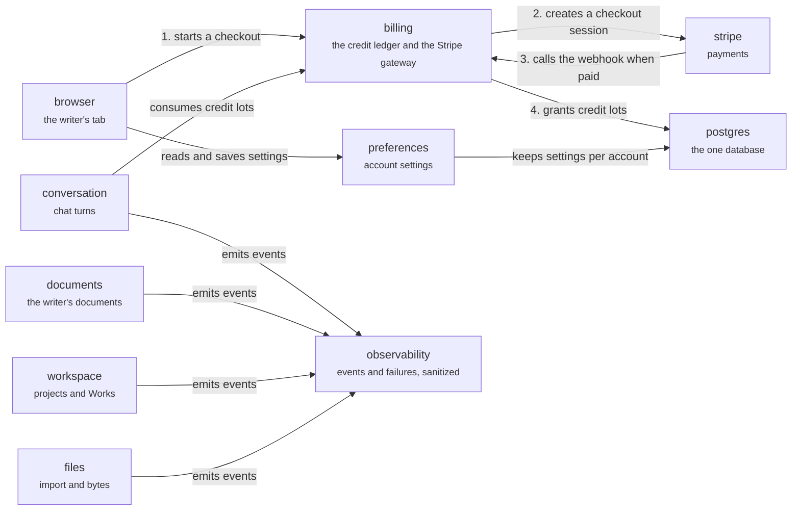

# Server: account

The domains about the writer's account and the operator. Paying for credits: the browser starts a checkout (1), `billing` creates a Stripe session (2), Stripe calls the webhook when it is paid (3), and `billing` grants credit lots in Postgres (4). A run consumes those lots first in, first out. `observability` takes events from the other groups and sanitizes them before any sink, which is how writer text stays out of logs. Back to the [server](server.md).

## billing

Stripe gateway and the credit ledger.

Credit lots are consumed first in, first out; `consume_credit_lots_fifo` is the idempotency authority. Entitlement comes from unexpired lots: do not add a subscription store.

- Kind: domain
- Paths: `apps/server/server/domains/billing`
- Docs: [CONTEXT](../../apps/server/server/domains/billing/.context/CONTEXT.md), [AGENTS](../../apps/server/server/domains/billing/AGENTS.md)

## preferences

Account settings.

Per-account preferences.

- Kind: domain
- Paths: `apps/server/server/domains/preferences`

## observability

Events and failures, sanitized before any sink.

Every event passes the allowlist in `safe-event.ts` before the one output, `EventSink`. This is how writer text stays out of logs.

- Kind: domain
- Paths: `apps/server/server/domains/observability`
- Docs: [CONTEXT](../../apps/server/server/domains/observability/.context/CONTEXT.md)

## browser

The writer's browser tab.

Holds the HTTP client, the thread socket and the Yjs socket.

- Kind: context
- See: [browser](system.md#browser)

## stripe

Stripe: checkout and a webhook.

- Kind: context
- See: [stripe](system.md#stripe)

## postgres

The one database.

Every domain's tables.

- Kind: context
- See: [postgres](system.md#postgres)

## conversation

Chat turns and the model.

The group of `runtime`, `threads`, `notices` and `packages`.

- Kind: context
- See: [conversation](server.md#conversation)

## documents

The writer's documents.

The group of `collab`, `context` and `file-policy`.

- Kind: context
- See: [documents](server.md#documents)

## workspace

Projects and Works.

The group of `projects`, `working-set` and `recent-documents`.

- Kind: context
- See: [workspace](server.md#workspace)

## files

Import, export, uploads and bytes.

The group of `import`, `export`, `file-intake` and `storage`.

- Kind: context
- See: [files](server.md#files)
