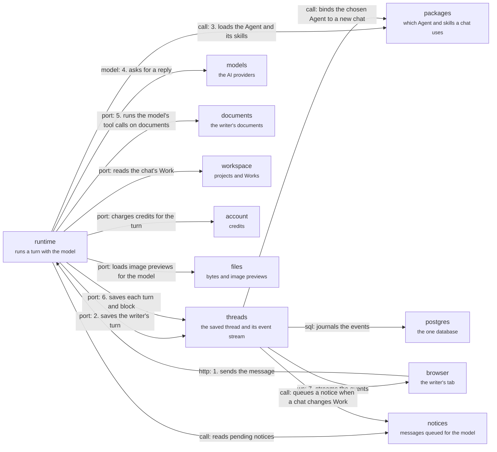

# Server: conversation

The domains behind a chat turn, in the order a message uses them. The browser sends the message to `runtime` (1); `runtime` saves the writer's turn through `threads` (2), loads the Agent and its skills from `packages` (3), asks the model (4), runs the model's tool calls on documents (5), saves each turn and block through `threads` (6), and `threads` streams the events back to the browser (7). The other arrows are side collaborations. Back to the [server](server.md); the same path as calls: [a message becomes an edit](flows/message-becomes-edit.md).

## runtime

Runs a turn: streams the thread through a model with tools and persists the result.

A run takes a writer message, calls the model with tools, saves the turns and emits `OrchestratorEvent`s. The model gateway has one registry and one retry loop.

- Kind: domain
- Paths: `apps/server/server/domains/runtime`
- Docs: [CONTEXT](../../apps/server/server/domains/runtime/.context/CONTEXT.md)
- Machines: [runtime](../../apps/server/server/domains/runtime/.context/state-machines.md)
- Breaks: In the import cycle, which the root CONTEXT.md rules out. Also `gateway/config/create-from-env.ts` imports `lib/production-env.ts`, which the root CONTEXT.md forbids. It reaches into `threads/adapters/drizzle/` (permission grants, admission records), not the threads port.

## threads

Durable threads, turns, blocks and the event journal.

Owns the event hub, the projector to AG-UI events and each thread's Work. Postgres notifications only wake the hub; they never carry the event. Cold replay reads the whole history.

- Kind: domain
- Paths: `apps/server/server/domains/threads`
- Docs: [CONTEXT](../../apps/server/server/domains/threads/.context/CONTEXT.md)
- Machines: [threads](../../apps/server/server/domains/threads/.context/state-machines.md)
- Breaks: In the import cycle, which the root CONTEXT.md rules out. It also imports `projects/adapters/work-projection-mutation.ts` directly.

## notices

A durable queue of notices delivered into the model's context.

Runtime delivers pending notices at call boundaries, and the bytes stay identical on later requests so the cached prefix holds.

- Kind: domain
- Paths: `apps/server/server/domains/notices`
- Docs: [CONTEXT](../../apps/server/server/domains/notices/.context/CONTEXT.md)

## packages

Agent definitions and skills, loaded from packages.

Resolves which Agent and skills a thread uses, from packages compiled into revisions that never change. An unknown name in an allow-list is refused.

- Kind: domain
- Paths: `apps/server/server/domains/packages`
- Docs: [CONTEXT](../../apps/server/server/domains/packages/.context/CONTEXT.md)

## browser

The writer's browser tab.

Holds the HTTP client, the thread socket and the Yjs socket.

- Kind: context
- See: [browser](system.md#browser)

## models

The model providers.

Called through the runtime's gateway.

- Kind: context
- See: [models](system.md#models)

## postgres

The one database.

Every domain's tables.

- Kind: context
- See: [postgres](system.md#postgres)

## documents

The writer's documents.

The group of `collab`, `context` and `file-policy`.

- Kind: context
- See: [documents](server.md#documents)

## workspace

Projects and Works.

The group of `projects`, `working-set` and `recent-documents`.

- Kind: context
- See: [workspace](server.md#workspace)

## account

Credits, settings and safe logging.

The group of `billing`, `preferences` and `observability`.

- Kind: context
- See: [account](server.md#account)

## files

Import, export, uploads and bytes.

The group of `import`, `export`, `file-intake` and `storage`.

- Kind: context
- See: [files](server.md#files)
