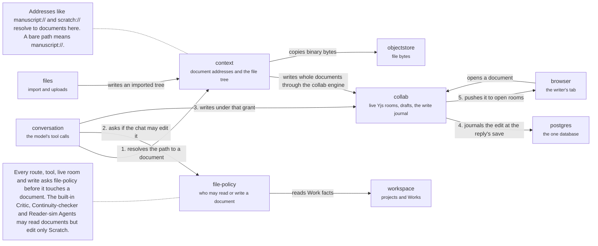

# Server: documents

The domains that hold a writer's text and decide who may change it. When the model writes, the call resolves the path to a document in `context` (1), asks `file-policy` whether this chat may edit it (2), writes through `collab` under that grant (3), `collab` journals the edit at the reply's save (4) and pushes it to the browsers that have the document open (5). A writer opening a document connects to `collab` over the Yjs socket; the same `file-policy` check admits the connection. Back to the [server](server.md).

## collab

Live documents: Yjs rooms, the write journal, drafts, branches and Apply.

Runs the Hocuspocus rooms for live documents and drafts, and keeps the write journal, the inverses Undo applies, receipts and checkpoints. A write is journaled before the room accepts it.

- Kind: domain
- Paths: `apps/server/server/domains/collab`
- Docs: [CONTEXT](../../apps/server/server/domains/collab/.context/CONTEXT.md), [AGENTS](../../apps/server/server/domains/collab/AGENTS.md)
- Machines: [collab](../../apps/server/server/domains/collab/.context/state-machines.md)
- Breaks: In the import cycle, which the root CONTEXT.md rules out.

## context

The context filesystem behind `manuscript://`, `kb://`, `user://`, `unfiled://`, `scratch://` and `uploads://`.

Catalog views, the tree, copy, uploads, links and arrivals. `skills://` exists for the model only. Writes to documents go through the collab engine. The project tree's list of records is stored through the collab journal and its rows are written with it (the tree list store). The model's tree commands (move, delete, restore, folders) are one command per tool call on that list; each resolves paths through the names the chat was shown and keeps a receipt for its Undo. Trash entries for a view, and the tree half of a Discard's entry, are read from the same list.

- Kind: domain
- Paths: `apps/server/server/domains/context`
- Docs: [CONTEXT](../../apps/server/server/domains/context/.context/CONTEXT.md), [AGENTS](../../apps/server/server/domains/context/AGENTS.md)
- Machines: [document content](../../apps/server/server/domains/context/.context/state-machines.md), [context uploads](../../apps/server/server/domains/context/uploads/.context/state-machines.md)
- Breaks: In the import cycle, which the root CONTEXT.md rules out. It also imports `projects/adapters/project-repository/shared.ts` and `threads/adapters/drizzle/top-primary-chat.ts`.

## file-policy

The question every route, tool, room and write asks before touching a document.

Answers who may read or write a document, and why not. A route asks `requireFileGrant` before a read and wraps a write in `withEditGrants`.

- Kind: domain
- Paths: `apps/server/server/domains/file-policy`
- Docs: [CONTEXT](../../apps/server/server/domains/file-policy/.context/CONTEXT.md)
- Breaks: In the import cycle, which the root CONTEXT.md rules out. It also imports `collab/adapters/drizzle-branches.ts`.

## conversation

Chat turns and the model.

The group of `runtime`, `threads`, `notices` and `packages`.

- Kind: context
- See: [conversation](server.md#conversation)

## workspace

Projects and Works.

The group of `projects`, `working-set` and `recent-documents`.

- Kind: context
- See: [workspace](server.md#workspace)

## files

Import, export, uploads and bytes.

The group of `import`, `export`, `file-intake` and `storage`.

- Kind: context
- See: [files](server.md#files)

## browser

The writer's browser tab.

Holds the HTTP client, the thread socket and the Yjs socket.

- Kind: context
- See: [browser](system.md#browser)

## postgres

The one database.

Every domain's tables.

- Kind: context
- See: [postgres](system.md#postgres)

## objectstore

Where file bytes live.

Behind `ObjectStorePort`.

- Kind: context
- See: [objectstore](system.md#objectstore)
