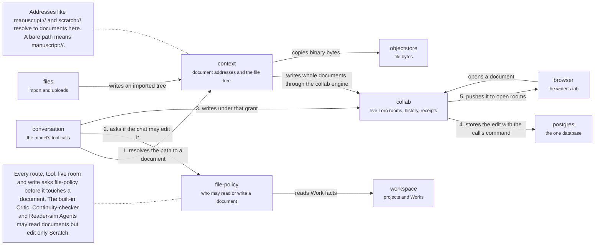

# Server: documents

The domains that hold a writer's text and decide who may change it. When the model writes, the call resolves the path to a document in `context` (1), asks `file-policy` whether this chat may edit it (2), writes through `collab` under that grant (3), `collab` stores the edit in the document's Loro room with the call's command (4) and pushes it to the browsers that have the document open (5). A writer opening a document connects to `collab` over `/ws/loro`; the same `file-policy` check admits the connection. Back to the [server](server.md).

## collab

Live documents: Loro rooms, their history, receipts and the inverses Undo applies, and the press of a Work's tree draft.

Holds each document's Live text in a Loro room stored as `document_snapshots` rows (`DocumentRooms`), serves it on `/ws/loro` with presence, and cuts old history once a room's rows pass about 5 MB. Every read, write, seed, copy and derivation goes through the room. A model's write commits its batch and receipt in its command's transaction; a tab's batch is acked at once and stored within seconds, and after a server restart the tab resends what the room lost. A Draft chat's writes land in its draft's fork room of the document (`fork:<draft>:<document>`).

- Kind: domain
- Paths: `apps/server/server/domains/collab`
- Docs: [CONTEXT](../../apps/server/server/domains/collab/.context/CONTEXT.md), [AGENTS](../../apps/server/server/domains/collab/AGENTS.md)
- Breaks: In the import cycle, which the root CONTEXT.md rules out.

## context

The context filesystem behind `manuscript://`, `kb://`, `user://`, `unfiled://`, `scratch://` and `uploads://`.

The sources query, the tree, copy, uploads, links and arrivals. `skills://` exists for the model only. Writes to documents go through the collab engine. The project tree's list of records is a Loro document stored as one `document_snapshots` row, its rows written in the same transaction (the tree list store), and synced to clients in its room on `/ws/loro`. The model's tree commands (move, delete, restore, folders) are one command per tool call on that list; each resolves paths through the names the chat was shown and keeps a receipt for its Undo. Trash entries for a view are read from the same list.

- Kind: domain
- Paths: `apps/server/server/domains/context`
- Docs: [CONTEXT](../../apps/server/server/domains/context/.context/CONTEXT.md), [AGENTS](../../apps/server/server/domains/context/AGENTS.md)
- Machines: [document content](../../apps/server/server/domains/context/.context/state-machines.md), [context uploads](../../apps/server/server/domains/context/uploads/.context/state-machines.md)
- Breaks: In the import cycle, which the root CONTEXT.md rules out. It also imports `projects/adapters/project-repository/shared.ts` and `threads/adapters/drizzle/top-primary-chat.ts`.

## file-policy

The question every route, tool, room and write asks before touching a document.

Answers who may read or write a document, and why not. A route asks `requireFileGrant` before a read and wraps a write in `withEditGrants`. A file of an Agents level is an ordinary place: its setting decides whether an AI's write lands live or as a draft.

- Kind: domain
- Paths: `apps/server/server/domains/file-policy`
- Docs: [CONTEXT](../../apps/server/server/domains/file-policy/.context/CONTEXT.md)
- Breaks: In the import cycle, which the root CONTEXT.md rules out. It also imports `collab/adapters/drizzle-drafts.ts`.

## conversation

Chat turns and the model.

The group of `runtime`, `threads`, `notices` and `packages`.

- Kind: context
- See: [conversation](server.md#conversation)

## workspace

Projects and Works.

The group of `projects` and `recent-documents`.

- Kind: context
- See: [workspace](server.md#workspace)

## files

Import, export, uploads and bytes.

The group of `import`, `export`, `file-intake` and `storage`.

- Kind: context
- See: [files](server.md#files)

## browser

The writer's browser tab.

Holds the HTTP client, the thread socket and the Loro socket.

- Kind: context
- See: [browser](system.md#browser)

## postgres

The one database.

Every domain's tables.

- Kind: context
- See: [postgres](system.md#postgres)

## objectstore

Where file bytes live.

Behind `ObjectStorePort`.

- Kind: context
- See: [objectstore](system.md#objectstore)
