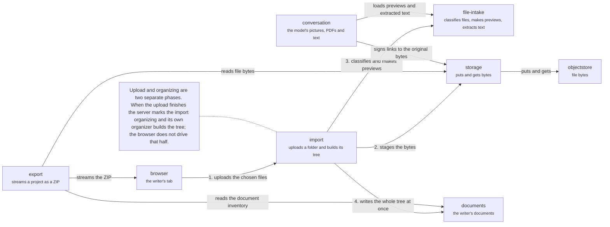

# Server: files

The domains that move bytes. An import: the browser uploads the chosen files to `import` (1), which stages their bytes in `storage` (2) and uses `file-intake` to classify them and make image previews (3); a server-owned organizer then writes the whole tree into the documents group and reveals it at once (4). An export runs the other way: `export` reads the document inventory, checks the grant, reads bytes from `storage` and streams a ZIP to the browser. Back to the [server](server.md); the import as calls: [an import](flows/an-import.md).

## import

Upload-first import of a folder or files into a project.

The browser uploads bytes, then a durable server organizer reveals the whole tree at once. Import ids are permanent tombstones.

- Kind: domain
- Paths: `apps/server/server/domains/import`
- Docs: [CONTEXT](../../apps/server/server/domains/import/.context/CONTEXT.md), [AGENTS](../../apps/server/server/domains/import/AGENTS.md)
- Machines: [import](../../apps/server/server/domains/import/.context/state-machines.md)

## export

Streams a project as a ZIP of live documents.

Drafts are not included. The inventory and addresses are captured before any content is read. There is no ZIP64, so it refuses near 4 GiB.

- Kind: domain
- Paths: `apps/server/server/domains/export`
- Docs: [CONTEXT](../../apps/server/server/domains/export/.context/CONTEXT.md), [AGENTS](../../apps/server/server/domains/export/AGENTS.md)
- Drift: `export/AGENTS.md` says to go through Context's public index, but `export` imports `context/adapters/context-file-entry.ts`.

## file-intake

Classifies uploaded files, makes image previews and extracts text from PDFs and EPUBs.

HEIC, BMP and TIFF become WebP previews, and an EPUB or PDF becomes Markdown (and a PDF's page count), each on a small worker pool that stops a job at its deadline. `sharp` is native, so build on the target platform.

- Kind: domain
- Paths: `apps/server/server/domains/file-intake`

## storage

`ObjectStorePort`: put, get, stream, copy, sign and list bytes. A signed link is what a model provider fetches.

Results are tagged ok or error and never throw. It has no domain meaning: which bytes mean what is the callers' business.

- Kind: domain
- Paths: `apps/server/server/domains/storage`
- Docs: [CONTEXT](../../apps/server/server/domains/storage/.context/CONTEXT.md)

## browser

The writer's browser tab.

Holds the HTTP client, the thread socket and the Yjs socket.

- Kind: context
- See: [browser](system.md#browser)

## documents

The writer's documents.

The group of `collab`, `context` and `file-policy`.

- Kind: context
- See: [documents](server.md#documents)

## conversation

Chat turns and the model.

The group of `runtime`, `threads`, `notices` and `packages`.

- Kind: context
- See: [conversation](server.md#conversation)

## objectstore

Where file bytes live.

Behind `ObjectStorePort`.

- Kind: context
- See: [objectstore](system.md#objectstore)
