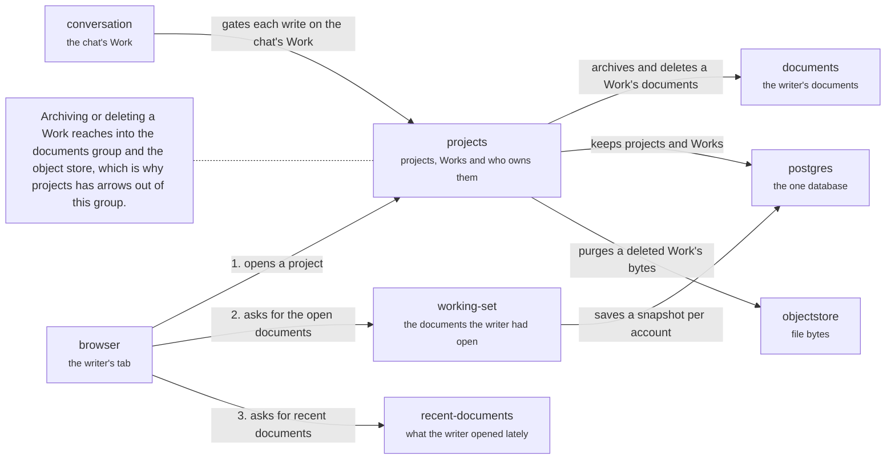

# Server: workspace

The domains about the writer's project and what they were doing in it. Opening a project: `projects` checks the writer owns it (1), `working-set` returns the documents that were open (2), and `recent-documents` lists what was opened lately from the document catalog (3). Archiving or deleting a Work reaches into the documents group and the object store. Back to the [server](server.md).

## projects

Projects and Works: ownership gates, bootstrap and the Work lifecycle.

`requireProjectOwner` is the ownership gate. Every write that depends on a Work locks its row first, so it cannot land during an archive or delete.

- Kind: domain
- Paths: `apps/server/server/domains/projects`
- Docs: [CONTEXT](../../apps/server/server/domains/projects/.context/CONTEXT.md)
- Machines: [projects](../../apps/server/server/domains/projects/.context/state-machines.md)
- Breaks: In the import cycle, which the root CONTEXT.md rules out. It also reaches into `context/adapters/context-fs/document-locations.ts`.

## working-set

The writer's working-set snapshot.

A snapshot of the documents the writer had open in a project, per account.

- Kind: domain
- Paths: `apps/server/server/domains/working-set`

## recent-documents

Recently opened documents.

Lists what the writer opened lately, from the catalog. It imports two Context adapters, not the Context port.

- Kind: domain
- Paths: `apps/server/server/domains/recent-documents`

## browser

The writer's browser tab.

Holds the HTTP client, the thread socket and the Yjs socket.

- Kind: context
- See: [browser](system.md#browser)

## conversation

Chat turns and the model.

The group of `runtime`, `threads`, `notices` and `packages`.

- Kind: context
- See: [conversation](server.md#conversation)

## documents

The writer's documents.

The group of `collab`, `context` and `file-policy`.

- Kind: context
- See: [documents](server.md#documents)

## postgres

The one database.

Every domain's tables.

- Kind: context
- See: [postgres](system.md#postgres)

## objectstore

Where file bytes live.

Behind `ObjectStorePort`.

- Kind: context
- See: [objectstore](system.md#objectstore)
