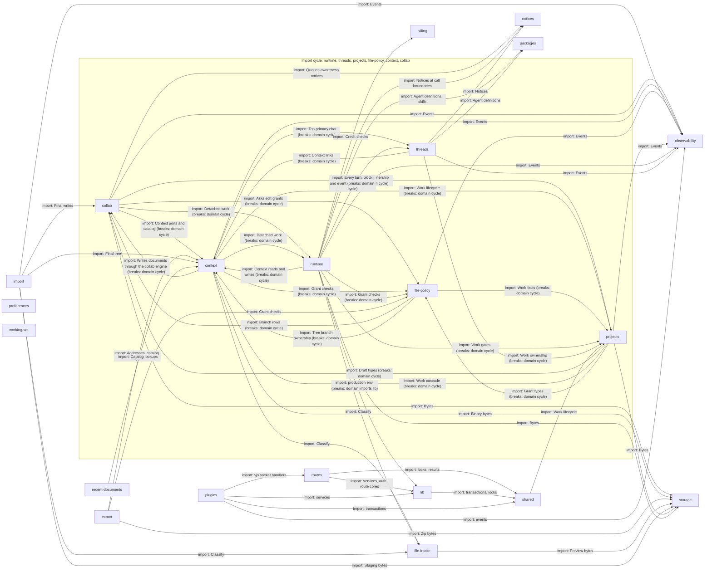

# Server

`apps/server/server`: the Nitro server. Routes are thin, each domain holds one area's logic behind
a public `index.ts` and ports, and `lib/` builds the domains into `AppServices`. The root
`CONTEXT.md` says domains should not import each other in a cycle or import `lib/`. **Neither
holds today**: six domains form a cycle and `runtime` imports `lib/`; those edges are marked
`breaks`.

The diagram draws each domain's imports of other domains. It leaves out the edges nearly every
box has: `lib` and routes importing a domain, and a domain importing `shared/` or
`@meridian/contracts`.

## routes

Nitro file routes: authenticate, call a domain, return contract shapes.

A route authenticates, runs the domain's gate and returns `@meridian/contracts` shapes only. A route that touches a document also asks file policy.

- Kind: module
- Paths: `apps/server/server/routes`
- Docs: [server CONTEXT](../../apps/server/.context/CONTEXT.md), [server AGENTS](../../apps/server/AGENTS.md)

## lib

The composition root: builds every domain into `AppServices`.

`compose.ts` builds `AppServices` and `app.ts` holds it as the process singleton. It is the one place allowed to import every domain's adapters, and also holds auth and the route cores (`*-route.ts`).

- Kind: module
- Paths: `apps/server/server/lib`
- Docs: [lib CONTEXT](../../apps/server/server/lib/.context/CONTEXT.md)
- Machines: [lib](../../apps/server/server/lib/.context/state-machines.md)

## plugins

Startup, request observability and CORS.

The startup plugin boots the process and, in a built server, ends it on a boot failure. It imports `routes/ws/yjs`, so plugins depend on routes.

- Kind: module
- Paths: `apps/server/server/plugins`, `apps/server/server/middleware`
- Docs: [server CONTEXT](../../apps/server/.context/CONTEXT.md)

## shared

Small helpers used across domains: locks, transactions, results.

The Drizzle transaction wrapper, keyed mutexes and `lockSeamWorks`, which a new write path calls before any other lock. No dependency rule is written for `shared/`.

- Kind: module
- Paths: `apps/server/server/shared`
- Docs: [server CONTEXT](../../apps/server/.context/CONTEXT.md)
- Drift: `shared/work-lifecycle-lock.ts` imports `projects/domain/work-lifecycle.ts` while `projects` imports `shared`, so the helper layer reaches up into a domain. No written rule covers it.

## runtime

Runs a turn: streams the thread through a model with tools and persists the result.

A run takes a writer message, calls the model with tools, saves the turns and emits `OrchestratorEvent`s. The model gateway has one registry and one retry loop.

- Kind: domain
- Paths: `apps/server/server/domains/runtime`
- Docs: [CONTEXT](../../apps/server/server/domains/runtime/.context/CONTEXT.md)
- Machines: [runtime](../../apps/server/server/domains/runtime/.context/state-machines.md)
- Breaks: In the import cycle, which the root CONTEXT.md rules out. Also `gateway/config/create-from-env.ts` imports `lib/production-env.ts`, which the root CONTEXT.md forbids. It reaches into `threads/adapters/drizzle/` (permission grants, admission records), not the threads port.

## threads

Durable threads, turns, blocks and the event journal.

Owns the event hub, the projector to AG-UI events and each thread's Work. Postgres notifications only wake the hub; they never carry the event. Cold replay reads the whole history.

- Kind: domain
- Paths: `apps/server/server/domains/threads`
- Docs: [CONTEXT](../../apps/server/server/domains/threads/.context/CONTEXT.md)
- Machines: [threads](../../apps/server/server/domains/threads/.context/state-machines.md)
- Breaks: In the import cycle, which the root CONTEXT.md rules out. It also imports `projects/adapters/work-projection-mutation.ts` directly.

## projects

Projects and Works: ownership gates, bootstrap and the Work lifecycle.

`requireProjectOwner` is the ownership gate. Every write that depends on a Work locks its row first, so it cannot land during an archive or delete.

- Kind: domain
- Paths: `apps/server/server/domains/projects`
- Docs: [CONTEXT](../../apps/server/server/domains/projects/.context/CONTEXT.md)
- Machines: [projects](../../apps/server/server/domains/projects/.context/state-machines.md)
- Breaks: In the import cycle, which the root CONTEXT.md rules out. It also reaches into `context/adapters/context-fs/document-locations.ts`.

## context

The context filesystem behind `manuscript://`, `kb://`, `user://`, `unfiled://`, `scratch://` and `uploads://`.

Catalog views, the tree, copy, uploads, links and arrivals. `skills://` exists for the model only. Writes to documents go through the collab engine.

- Kind: domain
- Paths: `apps/server/server/domains/context`
- Docs: [CONTEXT](../../apps/server/server/domains/context/.context/CONTEXT.md), [AGENTS](../../apps/server/server/domains/context/AGENTS.md)
- Machines: [context uploads](../../apps/server/server/domains/context/uploads/.context/state-machines.md)
- Breaks: In the import cycle, which the root CONTEXT.md rules out. It also imports `projects/adapters/project-repository/shared.ts` and `threads/adapters/drizzle/top-primary-chat.ts`.

## collab

Live documents: Yjs rooms, the write journal, drafts, branches and Apply.

Runs the Hocuspocus rooms for live documents and drafts, and keeps the write journal, the inverses Undo applies, receipts and checkpoints. A write is journaled before the room accepts it.

- Kind: domain
- Paths: `apps/server/server/domains/collab`
- Docs: [CONTEXT](../../apps/server/server/domains/collab/.context/CONTEXT.md), [AGENTS](../../apps/server/server/domains/collab/AGENTS.md)
- Machines: [collab](../../apps/server/server/domains/collab/.context/state-machines.md)
- Breaks: In the import cycle, which the root CONTEXT.md rules out.

## file-policy

The question every route, tool, room and write asks before touching a document.

Answers who may read or write a document, and why not. A route asks `requireFileGrant` before a read and wraps a write in `withEditGrants`.

- Kind: domain
- Paths: `apps/server/server/domains/file-policy`
- Docs: [CONTEXT](../../apps/server/server/domains/file-policy/.context/CONTEXT.md)
- Breaks: In the import cycle, which the root CONTEXT.md rules out. It also imports `collab/adapters/drizzle-branches.ts`.

## import

Upload-first import of a folder or files into a project.

The browser uploads bytes, then a durable server organizer reveals the whole tree at once. Import ids are permanent tombstones.

- Kind: domain
- Paths: `apps/server/server/domains/import`
- Docs: [CONTEXT](../../apps/server/server/domains/import/.context/CONTEXT.md), [AGENTS](../../apps/server/server/domains/import/AGENTS.md)
- Machines: [import](../../apps/server/server/domains/import/.context/state-machines.md)

## export

Streams a project as a ZIP of live documents.

Drafts are not included. The inventory and addresses are captured before any content is read. There is no ZIP64, so it refuses near 4 GiB.

- Kind: domain
- Paths: `apps/server/server/domains/export`
- Docs: [CONTEXT](../../apps/server/server/domains/export/.context/CONTEXT.md), [AGENTS](../../apps/server/server/domains/export/AGENTS.md)
- Drift: `export/AGENTS.md` says to go through Context's public index, but `export` imports `context/adapters/catalog-file-mapper.ts`.

## storage

`ObjectStorePort`: put, get, stream, copy, sign and list bytes.

Results are tagged ok or error and never throw. It has no domain meaning: which bytes mean what is the callers' business.

- Kind: domain
- Paths: `apps/server/server/domains/storage`
- Docs: [CONTEXT](../../apps/server/server/domains/storage/.context/CONTEXT.md)

## file-intake

Classifies uploaded files and makes image previews.

HEIC, BMP and TIFF become WebP previews on a small worker pool. `sharp` is native, so build on the target platform.

- Kind: domain
- Paths: `apps/server/server/domains/file-intake`

## billing

Stripe gateway and the credit ledger.

Credit lots are consumed first in, first out; `consume_credit_lots_fifo` is the idempotency authority. Entitlement comes from unexpired lots: do not add a subscription store.

- Kind: domain
- Paths: `apps/server/server/domains/billing`
- Docs: [CONTEXT](../../apps/server/server/domains/billing/.context/CONTEXT.md), [AGENTS](../../apps/server/server/domains/billing/AGENTS.md)

## notices

A durable queue of notices delivered into the model's context.

Runtime delivers pending notices at call boundaries, and the bytes stay identical on later requests so the cached prefix holds.

- Kind: domain
- Paths: `apps/server/server/domains/notices`
- Docs: [CONTEXT](../../apps/server/server/domains/notices/.context/CONTEXT.md)

## packages

Agent definitions and skills, loaded from packages.

Resolves which Agent and skills a thread uses, from packages compiled into revisions that never change. An unknown name in an allow-list is refused.

- Kind: domain
- Paths: `apps/server/server/domains/packages`
- Docs: [CONTEXT](../../apps/server/server/domains/packages/.context/CONTEXT.md)

## observability

Events and failures, sanitized before any sink.

Every event passes the allowlist in `safe-event.ts` before the one output, `EventSink`. This is how writer text stays out of logs.

- Kind: domain
- Paths: `apps/server/server/domains/observability`
- Docs: [CONTEXT](../../apps/server/server/domains/observability/.context/CONTEXT.md)

## preferences

Account settings.

Per-account preferences.

- Kind: domain
- Paths: `apps/server/server/domains/preferences`

## working-set

The writer's working-set snapshot.

A snapshot of the documents the writer had open in a project, per account.

- Kind: domain
- Paths: `apps/server/server/domains/working-set`

## recent-documents

Recently opened documents.

Lists what the writer opened lately, from the catalog. It imports two Context adapters, not the Context port.

- Kind: domain
- Paths: `apps/server/server/domains/recent-documents`
