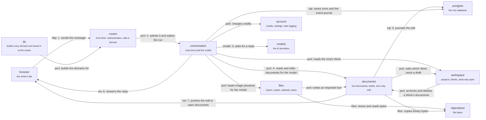

# Server

The server is one Nitro process. Its 17 domains are grouped here by the writer work they serve. Follow
the numbered arrows for one chat turn: the writer's message arrives (1), a route admits it (2), the
conversation group asks the model for a reply (3), the model's tool calls read and edit documents
through the documents group (4), the edit is journaled in Postgres (5), and the reply (6) and the
edit (7) stream back to the browser. Click a group to see its domains and the same story at that
scale. The imports that break the written dependency rules, among them a cycle between six domains,
are on [dependencies](dependencies.md), not drawn here. Step by step with the calls named:
[a message becomes an edit](flows/message-becomes-edit.md).

## conversation

Chat turns: admitting a message, the run with the model, the saved thread.

`runtime`, `threads`, `notices` and `packages`. A message is admitted, a run asks the model with tools, and the threads domain journals the events and pushes them to the browser. `lib/model-tools` binds the model's `read` and `write` tools to the documents group.

- Kind: group
- Paths: `apps/server/server/domains/runtime`, `apps/server/server/domains/threads`, `apps/server/server/domains/notices`, `apps/server/server/domains/packages`
- Opens: [Conversation](server-conversation.md)

## documents

The writer's documents: live Yjs rooms, drafts, the context filesystem and who may edit what.

`collab`, `context` and `file-policy`. The model and the writer both edit through collab; context gives documents their addresses; file-policy answers whether this actor may read or write this document.

- Kind: group
- Paths: `apps/server/server/domains/collab`, `apps/server/server/domains/context`, `apps/server/server/domains/file-policy`
- Opens: [Documents](server-documents.md)

## workspace

Projects and Works: who owns what, and what the writer had open.

`projects`, `working-set` and `recent-documents`. A Work is a task-scoped editing context in a project; these domains gate writes on it and remember what the writer was looking at.

- Kind: group
- Paths: `apps/server/server/domains/projects`, `apps/server/server/domains/working-set`, `apps/server/server/domains/recent-documents`
- Opens: [Workspace](server-workspace.md)

## files

Bytes in and out: import, export, uploads and the object store.

`import`, `export`, `file-intake` and `storage`. A writer imports a folder, exports a ZIP, or attaches an image; these domains classify, move and keep the bytes.

- Kind: group
- Paths: `apps/server/server/domains/import`, `apps/server/server/domains/export`, `apps/server/server/domains/file-intake`, `apps/server/server/domains/storage`
- Opens: [Files](server-files.md)

## account

What belongs to the account and the operator: credits, settings, and the safe event stream.

`billing`, `preferences` and `observability`. Billing is the credit ledger that runs consume; observability sanitizes every event so writer text stays out of logs.

- Kind: group
- Paths: `apps/server/server/domains/billing`, `apps/server/server/domains/preferences`, `apps/server/server/domains/observability`
- Opens: [Account](server-account.md)

## routes

The front door: Nitro file routes, startup, request observability and CORS.

The startup plugin boots the process and, in a built server, ends it on a boot failure. A route authenticates, runs the domain's gate and returns `@meridian/contracts` shapes only. A route that touches a document also asks file policy.

- Kind: module
- Paths: `apps/server/server/routes`, `apps/server/server/plugins`, `apps/server/server/middleware`
- Docs: [server CONTEXT](../../apps/server/.context/CONTEXT.md), [server AGENTS](../../apps/server/AGENTS.md)
- Drift: the startup plugin imports `routes/ws/yjs`, so plugins depend on routes.

## lib

The composition root: builds every domain into `AppServices` and gives it to the routes.

`compose.ts` builds `AppServices` and `app.ts` holds it as the process singleton. It is the one place allowed to import every domain's adapters, and also holds auth, the route cores (`*-route.ts`) and `lib/model-tools`, which binds the model's tools to the documents. `shared/` beside it holds small helpers: the Drizzle transaction wrapper, keyed mutexes and `lockSeamWorks`, which a new write path calls before any other lock.

- Kind: module
- Paths: `apps/server/server/lib`, `apps/server/server/shared`
- Docs: [lib CONTEXT](../../apps/server/server/lib/.context/CONTEXT.md)
- Machines: [lib](../../apps/server/server/lib/.context/state-machines.md)
- Drift: `shared/work-lifecycle-lock.ts` imports `projects/domain/work-lifecycle.ts` while `projects` imports `shared`, so the helper layer reaches up into a domain. No written rule covers `shared/`.

## browser

The writer's browser tab.

Sends HTTP requests, holds the thread socket and the Yjs socket.

- Kind: context
- See: [browser](system.md#browser)

## models

The model providers.

Called through one gateway owned by the runtime domain.

- Kind: context
- See: [models](system.md#models)

## postgres

The one database.

Every domain's tables; the thread hub is woken by a Postgres notification.

- Kind: context
- See: [postgres](system.md#postgres)

## objectstore

Where file bytes live.

Behind `ObjectStorePort` in the files group.

- Kind: context
- See: [objectstore](system.md#objectstore)
