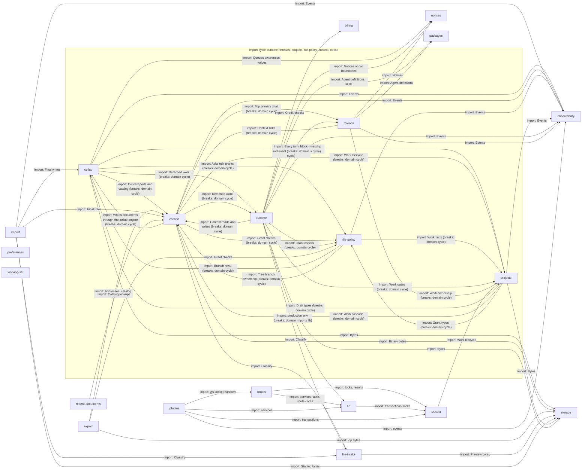

# Server

`apps/server/server`: the Nitro server. Routes are thin; each domain holds one area's logic, behind
a public `index.ts` and ports; `lib/` is the composition root that builds the domains into
`AppServices`. The root `CONTEXT.md` says domains are acyclic and do not import `lib/`. **Neither is
true today**: six domains import each other in a cycle (drawn in the box below, every edge marked
`breaks`), and `runtime` imports `lib/`. The diagram draws these and each domain's imports of other
domains. `lib` imports every domain except `file-intake` to wire it, and routes also import the domains' public indexes
directly, and domains import `shared/` and `@meridian/contracts`; those edges are left out because
nearly every box has them.

## routes

Nitro file routes: authenticate, call a domain, return contract shapes.

A route authenticates with `requireAppUser`, takes services from the aggregate, runs the domain's gate and returns `@meridian/contracts` shapes only. Heavier routes keep a route core in `lib/*-route.ts` that never sees Nitro events. A route that reads or writes a document also asks file policy. Malformed uuids give 400 before any repository call.

- Kind: module
- Paths: `apps/server/server/routes`
- Docs: [server CONTEXT](../../apps/server/.context/CONTEXT.md), [server AGENTS](../../apps/server/AGENTS.md)

## lib

The composition root: builds every domain into `AppServices`.

`app.ts` owns the process singleton, cached on a global symbol so hot reload does not compose twice, and `compose.ts` builds `AppServices`. It also holds auth, the choice of object-store and other backends, and the route cores (`*-route.ts`). It is the one place allowed to import every domain's adapters.

- Kind: module
- Paths: `apps/server/server/lib`
- Docs: [lib CONTEXT](../../apps/server/server/lib/.context/CONTEXT.md)
- Machines: [lib](../../apps/server/server/lib/.context/state-machines.md)
- Drift: The root CONTEXT.md says domains do not import `lib/`; `runtime` does (marked on the edge). `apps/server/.context/CONTEXT.md` lists 11 of the 17 domains in "Cross-module links" and omits `export`, `file-intake`, `file-policy`, `import`, `notices` and `recent-documents`.

## plugins

Startup, request observability and CORS.

The startup plugin boots the process and, in a built server, ends it on a boot failure (Nitro does not await plugins; under `nitro dev` it does not, so per-request auth rules still refuse). It also runs the recovery sweep for durable delivery outboxes every second. The startup plugin imports `routes/ws/yjs`, so plugins depend on routes.

- Kind: module
- Paths: `apps/server/server/plugins`, `apps/server/server/middleware`
- Docs: [server CONTEXT](../../apps/server/.context/CONTEXT.md)

## shared

Small helpers used across domains: locks, transactions, results.

Includes `lockSeamWorks` (`work-lifecycle-lock.ts`), which a new write seam calls before any advisory or document lock, the Drizzle transaction wrapper and keyed mutexes. No page states a dependency rule for `shared/`.

- Kind: module
- Paths: `apps/server/server/shared`
- Docs: [server CONTEXT](../../apps/server/.context/CONTEXT.md)
- Drift: `shared/work-lifecycle-lock.ts` imports `projects/domain/work-lifecycle.ts` while `projects` imports `shared`, so the helper layer reaches up into a domain. No written rule covers it.

## runtime

Runs a turn: streams the thread through a model with tools and persists the result.

Takes a writer message (or a subagent report, a Work change, a queued control), runs the model with tools, saves through the threads repositories and emits `OrchestratorEvent`s. Subfolders: admission, asks, costing, gateway, handoff, loop (with compaction), spawn, summary, tools. The gateway has one registry and one retry loop; only committed output blocks a retry.

- Kind: domain
- Paths: `apps/server/server/domains/runtime`
- Docs: [CONTEXT](../../apps/server/server/domains/runtime/.context/CONTEXT.md)
- Machines: [runtime](../../apps/server/server/domains/runtime/.context/state-machines.md)
- Breaks: Part of the import cycle among runtime, threads, projects, file-policy, context and collab; the root CONTEXT.md says domains are acyclic. Also `gateway/config/create-from-env.ts` imports `lib/production-env.ts`, which the root CONTEXT.md forbids. It reaches into `threads/adapters/drizzle/` (permission grants, admission records), not the threads port.

## threads

Durable threads, turns, blocks and the event journal.

Owns `ThreadEventHub`, the projector to AG-UI events and `thread_works` membership, with exactly one primary Work per thread; "No Work" is a real Work row. The hub writes a domain event and then schedules a commit-aware invalidation; Postgres notifications are invalidations, never the payload. Cold replay is O(history): there is no checkpoint yet.

- Kind: domain
- Paths: `apps/server/server/domains/threads`
- Docs: [CONTEXT](../../apps/server/server/domains/threads/.context/CONTEXT.md)
- Machines: [threads](../../apps/server/server/domains/threads/.context/state-machines.md)
- Breaks: Part of the import cycle among runtime, threads, projects, file-policy, context and collab; the root CONTEXT.md says domains are acyclic. It also imports `projects/adapters/work-projection-mutation.ts` directly.

## projects

Projects and Works: ownership gates, bootstrap and the Work lifecycle.

`requireProjectOwner` is the ownership gate. A new account gets a default project, a locked No Work and `Chapter 1`. Archive, delete and the pending count follow the Work lifecycle rules in its CONTEXT.md, and a lifecycle fence guards them.

- Kind: domain
- Paths: `apps/server/server/domains/projects`
- Docs: [CONTEXT](../../apps/server/server/domains/projects/.context/CONTEXT.md)
- Machines: [projects](../../apps/server/server/domains/projects/.context/state-machines.md)
- Breaks: Part of the import cycle among runtime, threads, projects, file-policy, context and collab; the root CONTEXT.md says domains are acyclic. It also reaches into `context/adapters/context-fs/document-locations.ts`.

## context

The context filesystem behind `manuscript://`, `kb://`, `user://`, `unfiled://`, `scratch://` and `uploads://`.

Catalog views, the tree, copy, uploads, links and arrivals. `skills://` exists for the model only. Writes to documents go through the collab engine.

- Kind: domain
- Paths: `apps/server/server/domains/context`
- Docs: [CONTEXT](../../apps/server/server/domains/context/.context/CONTEXT.md), [AGENTS](../../apps/server/server/domains/context/AGENTS.md)
- Machines: [context uploads](../../apps/server/server/domains/context/uploads/.context/state-machines.md)
- Breaks: Part of the import cycle among runtime, threads, projects, file-policy, context and collab; the root CONTEXT.md says domains are acyclic. It also imports `projects/adapters/project-repository/shared.ts` and `threads/adapters/drizzle/top-primary-chat.ts`.

## collab

Live documents: Yjs rooms, journal-first admission, drafts, branches and Apply.

Hocuspocus rooms for live documents and Work drafts, plus the journal, the inverse and receipts, and checkpoints. It wraps `@meridian/agent-edit`. A write is journaled before it is admitted.

- Kind: domain
- Paths: `apps/server/server/domains/collab`
- Docs: [CONTEXT](../../apps/server/server/domains/collab/.context/CONTEXT.md), [AGENTS](../../apps/server/server/domains/collab/AGENTS.md)
- Machines: [collab](../../apps/server/server/domains/collab/.context/state-machines.md)
- Breaks: Part of the import cycle among runtime, threads, projects, file-policy, context and collab; the root CONTEXT.md says domains are acyclic.

## file-policy

The question every route, tool, room and write asks before touching a document.

Answers who may read or write a document and why not: `permission_denied` reasons include `agent_read_only` and `uploads_read_only`. A route asks `requireFileGrant` before a read and wraps a write in `withEditGrants`.

- Kind: domain
- Paths: `apps/server/server/domains/file-policy`
- Docs: [CONTEXT](../../apps/server/server/domains/file-policy/.context/CONTEXT.md)
- Breaks: Part of the import cycle among runtime, threads, projects, file-policy, context and collab; the root CONTEXT.md says domains are acyclic. It also imports `collab/adapters/drizzle-branches.ts`.

## import

Upload-first import of a folder or files into a project.

The browser uploads bytes, then a durable server organizer reveals the whole tree at once. Import ids are permanent tombstones.

- Kind: domain
- Paths: `apps/server/server/domains/import`
- Docs: [CONTEXT](../../apps/server/server/domains/import/.context/CONTEXT.md), [AGENTS](../../apps/server/server/domains/import/AGENTS.md)
- Machines: [import](../../apps/server/server/domains/import/.context/state-machines.md)

## export

Streams a project as a ZIP of live documents.

Drafts are not included. The inventory and addresses are captured before any content is read. There is no ZIP64, so it refuses near 4 GiB. It uses Context's public index, not its adapters; today it imports `context/adapters/catalog-file-mapper.ts`.

- Kind: domain
- Paths: `apps/server/server/domains/export`
- Docs: [CONTEXT](../../apps/server/server/domains/export/.context/CONTEXT.md), [AGENTS](../../apps/server/server/domains/export/AGENTS.md)
- Drift: `export/AGENTS.md` says to go through Context's public index, but `export` imports `context/adapters/catalog-file-mapper.ts`.

## storage

`ObjectStorePort`: put, get, stream, copy, sign and list bytes.

Results are tagged ok or error and never throw. It has no domain meaning: which bytes mean what is the callers' business.

- Kind: domain
- Paths: `apps/server/server/domains/storage`
- Docs: [CONTEXT](../../apps/server/server/domains/storage/.context/CONTEXT.md)

## file-intake

Classifies uploaded files and makes image previews.

HEIC, BMP and TIFF become WebP through `sharp` in a worker thread. `sharp` is a native dependency, so build on the target platform.

- Kind: domain
- Paths: `apps/server/server/domains/file-intake`

## billing

Stripe gateway and the credit ledger.

Credit lots are consumed first in, first out, and `consume_credit_lots_fifo` is the idempotency authority. Entitlement comes from unexpired lots; do not add a subscription store. The ledger is user-scoped, but the runtime's billing port still takes project-shaped inputs.

- Kind: domain
- Paths: `apps/server/server/domains/billing`
- Docs: [CONTEXT](../../apps/server/server/domains/billing/.context/CONTEXT.md), [AGENTS](../../apps/server/server/domains/billing/AGENTS.md)

## notices

A durable queue of notices delivered into the model's context.

Runtime delivers pending notices at call boundaries, and the bytes stay identical on later requests so the cached prefix holds.

- Kind: domain
- Paths: `apps/server/server/domains/notices`
- Docs: [CONTEXT](../../apps/server/server/domains/notices/.context/CONTEXT.md)

## packages

Mars packages, immutable Agent definitions and skills.

Resolves which Agent and skills a thread uses. An unknown allow-list name is refused.

- Kind: domain
- Paths: `apps/server/server/domains/packages`
- Docs: [CONTEXT](../../apps/server/server/domains/packages/.context/CONTEXT.md)

## observability

Events and failures, sanitized before any sink.

`EventSink` is the one output; every event passes the allowlist in `safe-event.ts` and bounded strings first. There is no ambient fallback sink. This is how writer text stays out of logs.

- Kind: domain
- Paths: `apps/server/server/domains/observability`
- Docs: [CONTEXT](../../apps/server/server/domains/observability/.context/CONTEXT.md)

## preferences

Account settings.

Per-account preferences. No domain guide yet.

- Kind: domain
- Paths: `apps/server/server/domains/preferences`

## working-set

The writer's working-set snapshot.

Stores a snapshot of the writer's recent routes, per account. No domain guide yet.

- Kind: domain
- Paths: `apps/server/server/domains/working-set`

## recent-documents

Recently opened documents.

Reads the catalog to list what the writer opened lately. It imports `context/adapters/catalog-file-mapper.ts` and `project-context-availability.ts`, not the Context port.

- Kind: domain
- Paths: `apps/server/server/domains/recent-documents`
