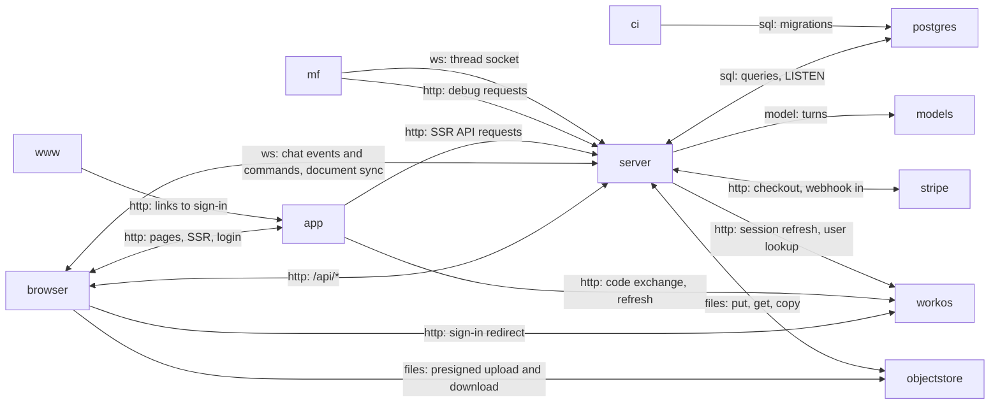

# The running system

What runs when a writer uses Meridian Flow, as it runs under `pnpm dev`: a browser, two Nitro/Vite
processes (the app and the server), a landing site, Postgres, and the outside services the server
calls. **Nothing is deployed yet.** The hosting plan (Railway, one server replica, a Caddy ingress that
gives the app and API one origin) is written down but not built: see the
[hosting page](https://github.com/haowjy/meridian-flow-docs/blob/main/kb/wiki/architecture/hosting.md).
The deploy script is a stub and CI's only job after the build is a smoke check that runs when
`STAGING_URL` is set.

Local development puts every process behind Portless HTTPS routes, and the app's Vite dev proxy
forwards server-owned HTTP to the server.

## browser

The writer's browser: the app's JavaScript, local replicas in IndexedDB, a send journal in localStorage, two sockets.

It runs the React app that the `app` process serves. IndexedDB holds the local replicas of documents and folders, so a document opens and takes edits before the server answers. A sent message is written to a journal in localStorage before it is posted, so it survives a reload that happens before the server confirms it. One WebSocket carries chat events and commands, another carries document sync.

- Kind: client
- Paths: `apps/app/src/router.tsx`, `apps/app/src/routes/__root.tsx`
- Docs: [app CONTEXT](../../apps/app/.context/CONTEXT.md)
- Opens: [App](app.md)

## app

`@meridian/app`: TanStack Start on Nitro. Serves pages and owns the sign-in callback.

It renders pages on the server, owns `/login`, `/logout`, `/signup`, `/healthz` and `/api/auth/callback`, and runs the WorkOS AuthKit middleware. Its SSR loaders call the server at `MERIDIAN_API_ORIGIN`. Every other `/api/*` request and both sockets go from the browser to the server; under `pnpm dev` the Vite proxy does that forwarding.

- Kind: service
- Paths: `apps/app/src/start.ts`, `apps/app/src/server/meridian-authkit-middleware.ts`, `apps/app/vite.config.ts`
- Docs: [app CONTEXT](../../apps/app/.context/CONTEXT.md)
- Opens: [App](app.md)

## server

`@meridian/server`: Nitro. REST, the thread-event socket, the Yjs socket and the domains behind them.

One process serves REST under `/api/*`, the thread-event WebSocket at `/api/threads/ws`, the Yjs WebSocket at `/ws/yjs` (Hocuspocus), and `/healthz` and `/readyz`. The thread hub and the Yjs rooms live in this process's memory, so there must be one replica.

- Kind: service
- Paths: `apps/server/nitro.config.ts`, `apps/server/server/lib/app.ts`, `apps/server/server/plugins/startup.ts`
- Docs: [server CONTEXT](../../apps/server/.context/CONTEXT.md)
- Machines: [lib](../../apps/server/server/lib/.context/state-machines.md)
- Opens: [Server](server.md)

## www

`@meridian/www`: the public landing site.

It imports only the design tokens. "Sign in" and "Start writing" are links to `MERIDIAN_APP_ORIGIN`, which the browser follows; www never calls the app.

- Kind: service
- Paths: `apps/www/src/router.tsx`, `apps/www/src/routes/index.tsx`
- Docs: [www AGENTS](../../apps/www/AGENTS.md)
- Machines: [landing](../../apps/www/src/features/landing/.context/state-machines.md)

## postgres

Postgres 16 with the `pg_bigm` extension: the only database.

The Drizzle schema lives in `packages/database`. The server listens on `thread_events` to wake the thread hub, and project search needs `pg_bigm`, so a hosted Postgres without it won't do. Production would need that image too.

- Kind: store
- Paths: `packages/database/src/schema`, `packages/database/src/migrations`, `tools/postgres/Dockerfile`
- Docs: [database CONTEXT](../../packages/database/.context/CONTEXT.md)
- See: [database package](code.md#database)

## objectstore

Where uploaded and imported file bytes live, behind `ObjectStorePort`.

Two adapters: `local` (disk, with signed URLs served under `/api/object-store/local`) and `s3` (presigned PUT and GET, `copy`, `getStream`). `resolveBackends` in `lib/backend-policy.ts` picks one. Which provider any deployment would use is not decided in the repo.

- Kind: store
- Paths: `apps/server/server/domains/storage/ports/object-store.ts`, `apps/server/server/lib/object-store-factory.ts`
- Docs: [storage CONTEXT](../../apps/server/server/domains/storage/.context/CONTEXT.md)

## models

The model providers: Anthropic, OpenAI, DeepSeek and Gemini.

The runtime calls them through one gateway, with keys from `FLOW_<PROVIDER>_API_KEY` and no fallback between providers. With no provider key set, or `MODEL_PROVIDER=mock`, it starts an in-process mock provider; live dev runs go to `deepseek-flash`.

- Kind: external
- Paths: `apps/server/server/domains/runtime/gateway/config/registry.ts`
- Docs: [runtime CONTEXT](../../apps/server/server/domains/runtime/.context/CONTEXT.md)

## workos

WorkOS AuthKit: hosted sign-in and the sealed `wos-session` cookie.

The app sets the cookie at the callback, and the server unseals it on every request. The server creates the writer's `public.users` row on first sign-in. The callback URL is registered on the app's origin, which is why a deployed system needs one origin for app and API.

- Kind: external
- Paths: `apps/server/server/lib/auth.ts`, `apps/app/src/routes/api/auth/callback.tsx`
- Docs: [server CONTEXT](../../apps/server/.context/CONTEXT.md)

## stripe

Stripe: checkout sessions and a webhook.

Credit grants come from the webhook and balances from the ledger in Postgres, never from Stripe at read time.

- Kind: external
- Paths: `apps/server/server/domains/billing/adapters/stripe/stripe-gateway.ts`, `apps/server/server/routes/api/billing/webhooks/stripe.post.ts`
- Docs: [billing CONTEXT](../../apps/server/server/domains/billing/.context/CONTEXT.md)

## mf

`./mf`: the command-line client for debugging and for agents.

It calls the same HTTP routes and uses the same thread socket client and view model as the app, so both read the same data. Only the rendering differs.

- Kind: client
- Paths: `tools/mf/src/main.ts`
- Docs: [thread-client CONTEXT](../../packages/thread-client/.context/CONTEXT.md)

## ci

GitHub Actions: build, test and, on a push to `staging`, a stub deploy.

The workflow builds the app, server and www, runs migrations when `STAGING_DATABASE_URL` is set, calls `deploy-staging.sh` (which only prints a warning) and runs a smoke check when `STAGING_URL` is set.

- Kind: external
- Paths: `.github/workflows/deploy-staging.yml`, `tools/deploy/deploy-staging.sh`
- Drift: the hosting page says a `staging` branch was ruled out, but `deploy-staging.yml` still deploys on a push to `staging` and root `AGENTS.md` names `staging` as a merge target. `docs/deploy/README.md` says a release pipeline promotes images by digest; no such pipeline exists.
