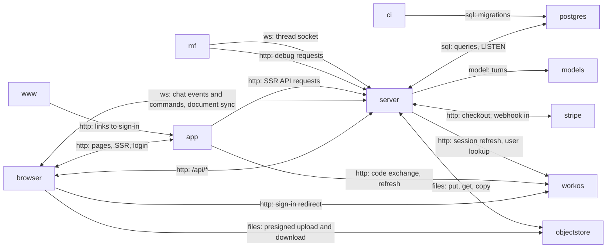

# The running system

What runs when a writer uses Meridian Flow, as it runs under `pnpm dev`: a browser, the app and
the server (two Nitro processes), a landing site, Postgres, and the outside services the server
calls. Every process sits behind a Portless HTTPS route. **Nothing is deployed yet**; the plan is
on the [hosting page](https://github.com/haowjy/meridian-flow-docs/blob/main/kb/wiki/architecture/hosting.md).

## browser

The writer's browser: the app's JavaScript, local replicas in IndexedDB, a send journal in localStorage, two sockets.

IndexedDB holds local copies of documents and folders, and localStorage holds each sent message until the server confirms it. One WebSocket carries chat, another document sync.

- Kind: client
- Paths: `apps/app/src/router.tsx`, `apps/app/src/routes/__root.tsx`
- Docs: [app CONTEXT](../../apps/app/.context/CONTEXT.md)
- Opens: [App](app.md)

## app

`@meridian/app`: TanStack Start on Nitro. Serves pages and owns the sign-in callback.

Renders pages on the server and owns sign-in (`/login`, `/logout`, `/signup`, `/api/auth/callback`). Every other `/api/*` request and both sockets go to the server; under `pnpm dev` the Vite proxy forwards them.

- Kind: service
- Paths: `apps/app/src/start.ts`, `apps/app/src/server/meridian-authkit-middleware.ts`, `apps/app/vite.config.ts`
- Docs: [app CONTEXT](../../apps/app/.context/CONTEXT.md)
- Opens: [App](app.md)

## server

`@meridian/server`: Nitro. REST, the thread-event socket, the Yjs socket and the domains behind them.

One process serves `/api/*`, the thread socket at `/api/threads/ws` and the Yjs socket at `/ws/yjs`. The thread hub and the Yjs rooms live in its memory, so there must be one replica.

- Kind: service
- Paths: `apps/server/nitro.config.ts`, `apps/server/server/lib/app.ts`, `apps/server/server/plugins/startup.ts`
- Docs: [server CONTEXT](../../apps/server/.context/CONTEXT.md)
- Machines: [lib](../../apps/server/server/lib/.context/state-machines.md)
- Opens: [Server](server.md)

## www

`@meridian/www`: the public landing site.

"Sign in" and "Start writing" are plain links to the app; www never calls it.

- Kind: service
- Paths: `apps/www/src/router.tsx`, `apps/www/src/routes/index.tsx`
- Docs: [www AGENTS](../../apps/www/AGENTS.md)
- Machines: [landing](../../apps/www/src/features/landing/.context/state-machines.md)

## postgres

Postgres 16 with the `pg_bigm` extension: the only database.

The server listens on `thread_events` to wake the thread hub. Project search needs `pg_bigm`, so a hosted Postgres without it won't do.

- Kind: store
- Paths: `packages/database/src/schema`, `packages/database/src/migrations`, `tools/postgres/Dockerfile`
- Docs: [database CONTEXT](../../packages/database/.context/CONTEXT.md)
- See: [database package](code.md#database)

## objectstore

Where uploaded and imported file bytes live, behind `ObjectStorePort`.

Two adapters, `local` (disk) and `s3`, chosen by `resolveBackends` in `lib/backend-policy.ts`. No deployment's provider is decided.

- Kind: store
- Paths: `apps/server/server/domains/storage/ports/object-store.ts`, `apps/server/server/lib/object-store-factory.ts`
- Docs: [storage CONTEXT](../../apps/server/server/domains/storage/.context/CONTEXT.md)

## models

The model providers: Anthropic, OpenAI, DeepSeek and Gemini.

Called through one gateway, with no fallback between providers. With no provider key, or `MODEL_PROVIDER=mock`, a mock provider runs in process.

- Kind: external
- Paths: `apps/server/server/domains/runtime/gateway/config/registry.ts`
- Docs: [runtime CONTEXT](../../apps/server/server/domains/runtime/.context/CONTEXT.md)

## workos

WorkOS AuthKit: hosted sign-in and the sealed `wos-session` cookie.

The app sets the cookie at the callback and the server unseals it on every request. The callback is registered on the app's origin, so a deployed system needs one origin for app and API.

- Kind: external
- Paths: `apps/server/server/lib/auth.ts`, `apps/app/src/routes/api/auth/callback.tsx`
- Docs: [server CONTEXT](../../apps/server/.context/CONTEXT.md)

## stripe

Stripe: checkout sessions and a webhook.

Credit grants come from the webhook and balances from the ledger in Postgres, never from Stripe at read time.

- Kind: external
- Paths: `apps/server/server/domains/billing/adapters/stripe/stripe-gateway.ts`, `apps/server/server/routes/api/billing/webhooks/stripe.post.ts`
- Docs: [billing CONTEXT](../../apps/server/server/domains/billing/.context/CONTEXT.md)

## mf

`./mf`: the command-line client for debugging and for agents.

Uses the same HTTP routes, thread socket client and view model as the app. It talks to the current worktree's `pnpm dev` server, found through its Portless route, or to the one `MF_SERVER_URL` names.

- Kind: client
- Paths: `tools/mf/src/main.ts`, `tools/mf/src/core/session.ts`
- Docs: [thread-client CONTEXT](../../packages/thread-client/.context/CONTEXT.md)

## ci

GitHub Actions: build, test and, on a push to `staging`, a stub deploy.

Builds the three apps, runs migrations when `STAGING_DATABASE_URL` is set, and calls a deploy script that only prints a warning.

- Kind: external
- Paths: `.github/workflows/deploy-staging.yml`, `tools/deploy/deploy-staging.sh`
- Drift: the hosting page says a `staging` branch was ruled out, but `deploy-staging.yml` still deploys on a push to `staging` and root `AGENTS.md` names `staging` as a merge target. `docs/deploy/README.md` says a release pipeline promotes images by digest; no such pipeline exists.
