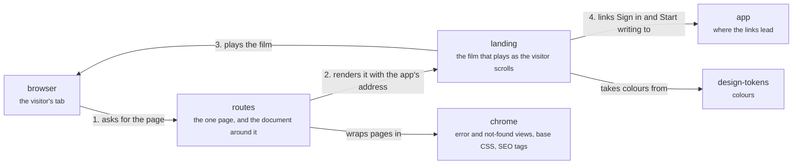

# www

`apps/www/src`: the public landing site. A visitor's browser asks for the page (1), a route renders the landing page with the app's address (2), the page plays its scroll film in the browser (3), and its "Sign in" and "Start writing" links lead to the app (4). www never calls the app or the server. Back to the [system](system.md).

## routes

The one route, `/`, and the root document around it.

`routes/index.tsx` reads the app's origin on the server (`MERIDIAN_APP_ORIGIN`, else the production or dev address) and passes it to the landing page, adding the canonical link and structured data. `routes/__root.tsx` sets the head, the font preload and the theme colour.

- Kind: module
- Paths: `apps/www/src/routes`, `apps/www/src/router.tsx`
- Docs: [www AGENTS](../../apps/www/AGENTS.md)

## landing

The landing page: server-rendered markup that a script then plays as a film.

React renders the markup, so the page reads without script. `film.ts` then writes that DOM frame by frame from the beats in `timeline.ts`; CSS owns placement.

- Kind: feature
- Paths: `apps/www/src/features/landing`
- Docs: [www AGENTS](../../apps/www/AGENTS.md)
- Machines: [landing](../../apps/www/src/features/landing/.context/state-machines.md)

## chrome

What every page shares.

The error boundary, the not-found view, the base stylesheet and the SEO meta helper.

- Kind: module
- Paths: `apps/www/src/components`, `apps/www/src/styles`, `apps/www/src/utils`

## browser

The visitor's browser tab.

Plays the film and follows the links; there is no sign-in on this site.

- Kind: context
- See: [browser](system.md#browser)

## app

`apps/app`: the web app.

www links to it and never calls it.

- Kind: context
- See: [app](system.md#app)

## design-tokens

Where the colours live.

www imports no other workspace package.

- Kind: context
- See: [design-tokens](code.md#design-tokens)
