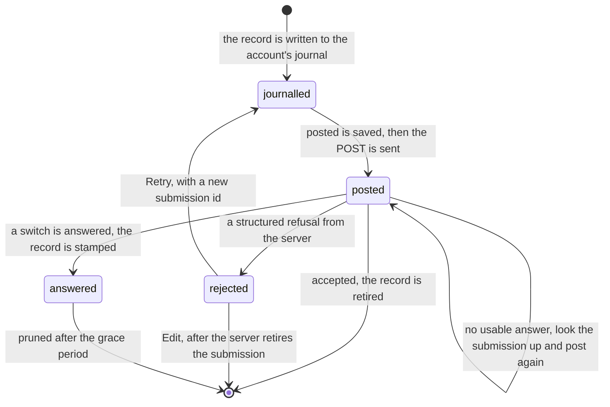

# Chat submission state machine

One message (or write-mode switch) the writer sent, from Send to the server's answer. Send
writes the message to a journal in the browser's localStorage, kept per account (`store.ts`),
and `driver.ts` posts it from there, so a reload does not lose a message the server has not
confirmed. The record has no status field: its state is which of `posted`,
`state: "rejected"` and `answer` are set. The rules are in [CONTEXT.md](CONTEXT.md).

- **`posted` is saved before the first POST.** It records that the server may have the
  message. A record without it can be deleted locally, because nothing was sent. A record with
  it is removed only on the server's word: an acceptance, a structured refusal, or the server
  withdrawing the message.
- **Only a structured refusal is a rejection.** A transport error, a timeout, a 5xx, or a
  success body that fails its schema all leave the record `posted`, because the server may
  have taken the message. Calling any of those a rejection lets the writer edit and resend
  words the server already has.
- **Retry on a rejected record mints a new submission id** and clears `posted`. Retry on an
  unanswered one keeps the id, so the server deduplicates.
- **A rejected record blocks the ones behind it in its chat.** Records are posted in `seq`
  order, and those after a rejected one wait until it is retried, edited or withdrawn; sending around it would
  reorder the conversation.
- A write-mode switch is stamped with `answer` instead of being deleted, so every tab reads
  the same server fact. A stamped record is never posted again and is pruned at the first write after
  `ANSWER_GRACE_MS`.

The pattern:
[a command that may have landed](../../../../../../.context/state-machines/command-that-may-have-landed.md).
