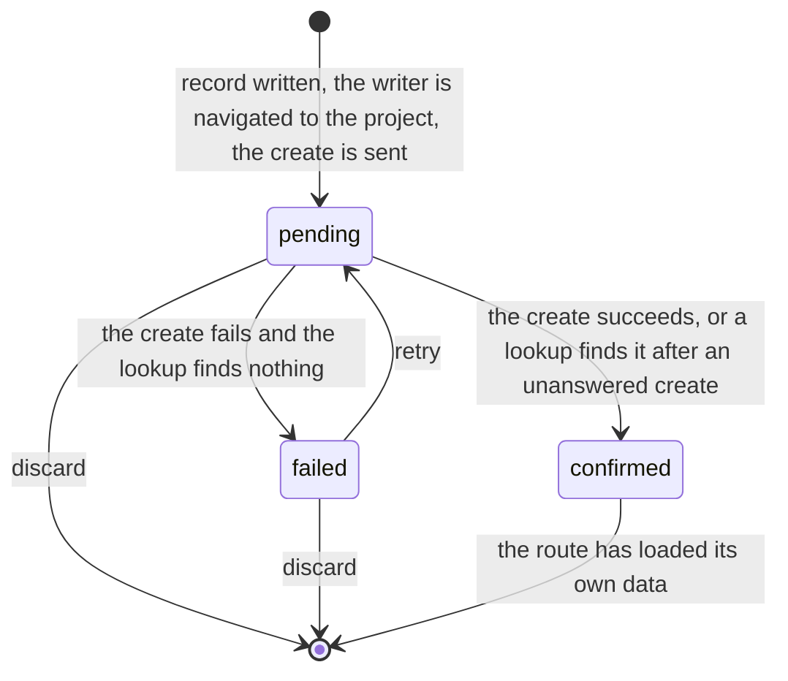

# Creation record state machine

Something the writer created that the server has not confirmed yet (`CreationStatus` in
`creation-registry.ts`). The registry is generic; its user today is project creation in
`../query/useProjectCreation.ts`, which adds `none` for "no record".

- **The id is minted on the client and the writer is navigated before the request is sent.**
  The record and a placeholder in the query cache are what the destination renders until the
  server answers.
- **An unanswered create is looked up before it counts as failed** (`createWithRecovery`): the
  same id is read back, and if the server has it the create succeeded. The original error is
  kept when the lookup cannot settle it.
- **A confirmed record leaves only once the route has data** (`useSettleConfirmedCreation`).
  Removing it from the mutation's success handler can land while the first navigation is still
  loading, leaving the screen with neither the record nor the data.
- Records are held in memory per account; a record for another account is never read.

The pattern:
[a command that may have landed](../../../../../../.context/state-machines/command-that-may-have-landed.md).
