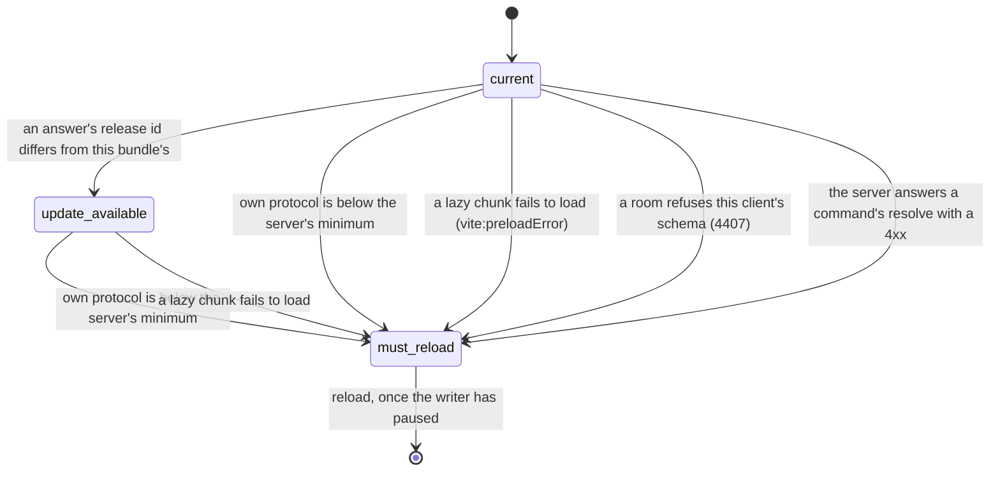

# Release machine

What one open tab knows about the app being deployed under it (`release.ts`). One store behind
the header words; `AppStatus` shows it beside "Not sent".

- **Fed by every API answer.** `installReleaseWatch` wraps `fetch` for same-origin `/api/`
  requests: it sends `x-meridian-protocol` and reads `x-meridian-release` and the server's
  `current;min=<minimum>`. The thread socket's `connected` frame carries the same two
  (`serverVersion` is the release id). The server never refuses on any of it.
- **The word is the button.** `update-available` and `must-reload` both show "Reload to update"
  ("Update" on a phone); the press reloads at once.
- **`must-reload` holds sends.** `sendsHeld()` is the command driver's `held` port: records wait
  in the journal and go out from the new code. The tab reloads when no keystroke or press for 3 s
  (1.5 s when hidden), no IME composition is open and the driver has no request mid-send.
- **One reload per release pair.** A `sessionStorage` key of own release and the server's
  release is written before the reload, so a stale bundle served again cannot loop. With the key
  present the hold lifts and the word stays a button.
- **Never goes back.** The only way out of `must-reload` is the reload itself.
