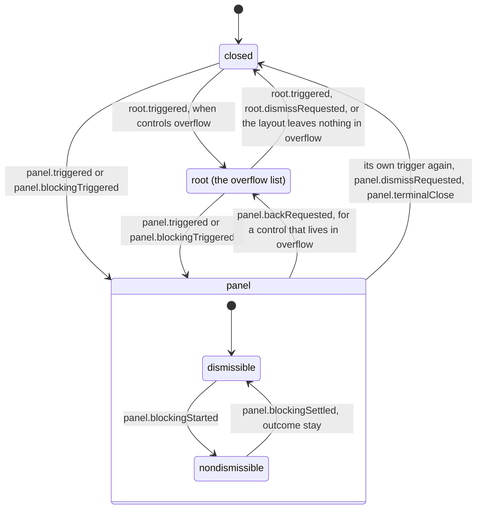

# Composer toolbar state machine

Which toolbar surface is open (`NavigationSurface` in `composer-toolbar-navigation.ts`): none,
the overflow list (`root`), or one control's panel. A panel is either dismissible or locked
while it does work that must not be interrupted.

The overflow list is `root` in the code. The diagram calls it `overflow` because Mermaid
cannot draw a state whose id is `root`.

- **A locked panel ignores dismiss, back, and other panels' triggers.** It closes only through
  `panel.blockingSettled` with outcome `close`, or `panel.terminalClose`.
- **Layout changes wait for a locked panel.** A measurement that arrives while the panel is
  `nondismissible` is held in `deferredLayout` and applied when the work settles; applying it
  at once can move the control out from under the panel that is using it.
- **Events name the panel session they came from** and are dropped when it is not the current
  one, so a late event from a closed panel cannot close its successor.
- Every transition returns the focus target along with the surface. Focus is part of the
  machine's output, not something the components decide.
