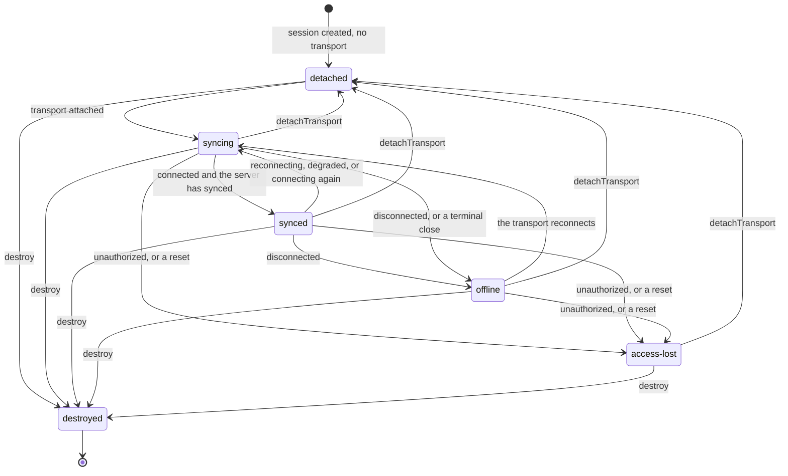
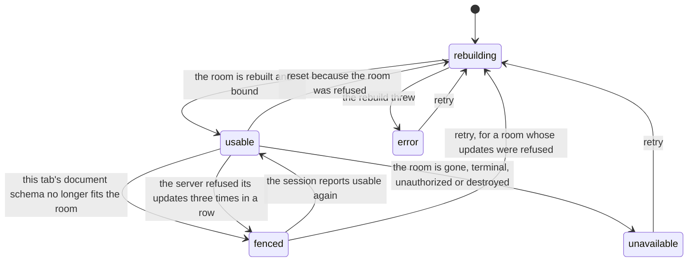

# Editor session state machines

## Document session status

What one open document's connection to the server is doing (`DocumentSessionStatus` in
`document-session.ts`). Apart from `destroyed`, the status is not stored and stepped: it is
recomputed by `deriveStatus` from the facts below whenever one of them changes. To change it,
change the derivation. `detachTransport` removes the transport, so the derivation gives `detached`.

`deriveStatus` decides in this order:

1. No transport: `syncing` while one is being attached, else `detached`.
2. Local persistence not yet replayed: `syncing`.
3. Transport `unauthorized` or `reset`: `access-lost`. Transport `terminal`: `offline`.
4. First server sync not complete: `syncing`.
5. Transport `disconnected`: `offline`.
6. Transport `reconnecting`, `degraded` or `connecting`, or the provider not synced: `syncing`.
7. Otherwise `synced`.

- **The terminal checks come before the first-sync gate** (step 3 before 4). After a permanent
  denial the first sync never completes, and with the order reversed the document would show
  "syncing" forever.
- **`reconnecting` is `syncing`, not `offline`.** `offline` means edits are only being kept
  locally; the pill the writer sees is built on that difference
  ([sync status](../../../features/editor/.context/state-machines.md)).
- **`synced` does not mean the server has every local edit.** That is
  `serverHasLocalChanges`: true once the server has acknowledged every local update sent on
  this connection.
- **A detached session keeps its document.** `detachTransport` closes the socket and keeps the
  Y.Doc, local persistence and undo history; edits made meanwhile wait in the document until
  the next `attachTransport` syncs them. The session registry detaches a session it is keeping
  when no view wants its socket open and it has no unsent edits
  (`detachUnwantedTransport`). An attach that follows waits for the detach to finish closing.
- `destroyed` is the one stored state: once set, `recomputeStatus` returns without deriving.
- The transport states are `ConnectionState` from
  [thread-client](../../../../../../packages/thread-client/.context/state-machines.md); the
  document transport is the publisher of `reset` and `unauthorized`.

## Draft room read

Whether a draft's room can be shown and acted on (`DraftRoomState` in `draft-room-read.ts`).
The room is the Yjs room `draft:<draftId>`, which review opens instead of the live document's.

- **Commands act only on `usable`** (`usable()`). The editor still shows a `fenced` room,
  read-only with its notice: a schema fence, or "Couldn't save your latest changes" with Try
  again. A command on it would write what the server has refused.
- **A refused room is rebuilt once per session.** The pool retires the session in the same
  notification, and the `refused` latch stops later snapshots from the retired session from
  starting a second rebuild.
- **Retry from `unavailable` works only when the room can be opened again.** A room the pool
  closed for good stays unavailable.
- A rebuild result is used only if it is still the newest attempt and the read is not disposed.
