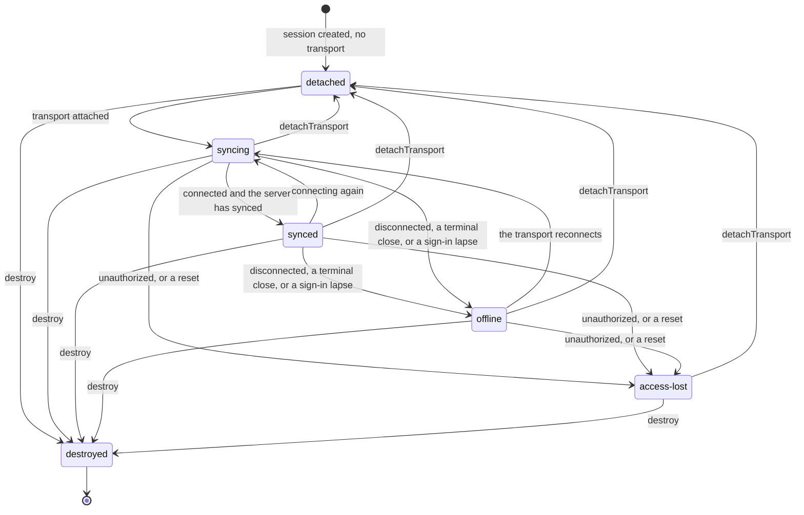
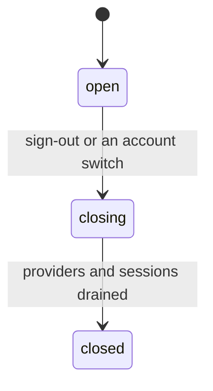

# Editor session state machines

## Document session status

What one open document's connection to the server is doing (`DocumentSessionStatus` in
`document-session.ts`). Apart from `destroyed`, the status is not stored and stepped: it is
recomputed by `deriveStatus` from the facts below whenever one of them changes. To change it,
change the derivation. `detachTransport` removes the transport, so the derivation gives `detached`.

`deriveStatus` decides in this order:

1. No transport: `syncing` while one is being attached, else `detached`.
2. Transport `unauthorized` or `reset`: `access-lost`.
3. Local persistence not yet replayed: `syncing`.
4. Transport `terminal` or `signed-out` (a sign-in lapse): `offline`.
5. First server sync not complete: `syncing`.
6. Transport `disconnected`: `offline`.
7. Transport `connected`: `synced`.
8. Otherwise (`connecting`): `syncing`.

- **The terminal checks come before the first-sync gate** (steps 2 and 4 before 5). After a
  permanent denial the first sync never completes, and with the order reversed the document would
  show "syncing" forever.
- **`access-lost` comes before the local-persistence gate** (step 2 before 3), so the status alone
  says the room's access ended: callers read `status === "access-lost"`, never the transport's
  `unauthorized`.
- **`connecting` is `syncing`, not `offline`.** `offline` means edits are only being kept
  locally; the pill the writer sees is built on that difference
  ([sync status](../../../features/editor/.context/state-machines.md)).
- **`synced` does not mean the server has every local edit.** That is
  `serverHasLocalChanges`: true once the server has acknowledged every local update sent on
  this connection.
- **A detached session keeps its document.** `detachTransport` closes the socket and keeps the
  `RoomDocs`, local persistence and undo history; edits made meanwhile wait in the document until
  the next `attachTransport` syncs them. The session registry detaches a session it is keeping
  when no view wants its socket open and it has no unsent edits
  (`detachUnwantedTransport`).
- `destroyed` is the one stored state: once set, `recomputeStatus` returns without deriving.
- The transport states are the [room connection](../../transport/.context/state-machines.md)'s.

## Account session runtime

Whether the account's document sessions take new work (`AccountDocumentSessionRuntime` in
`account-document-session-runtime.ts`, with the registry's own `accountRuntimeState`). Sign-out
and switching accounts close it.

- **`closing` refuses new work and lets go of what is held.** `release` still runs, so a view unmounting during the close does not leak a hold.
- **Closing the runtime does not by itself delete local copies.** A copy goes on a fact that is
  final (the node's purge, its Work or chat purged, the account removed from the project:
  `list-removal-observer`) or at sign-out (`clearForSignOut` → `clearAccountCopies`, which fails
  the sign-out with `SignOutIncomplete("copies")` when one remains). A session closing, or access
  the account lost for now, never deletes one.
