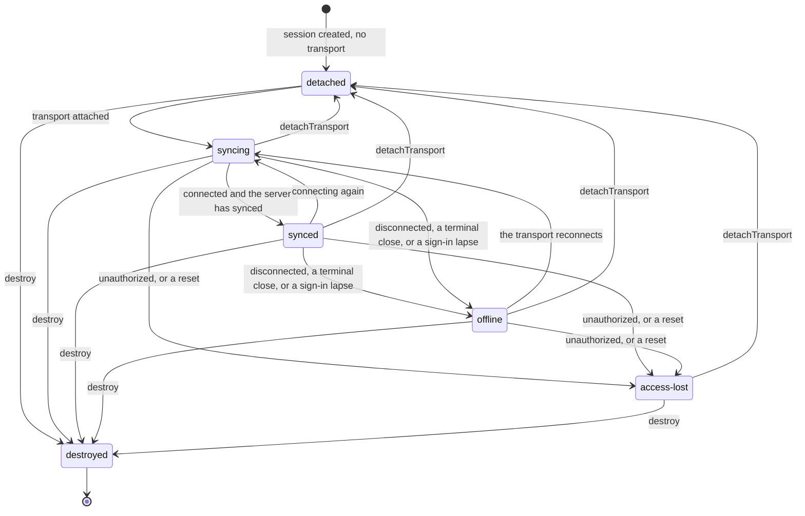

# Editor session state machines

## Document session status

What one open document's connection to the server is doing (`DocumentSessionStatus` in
`document-session.ts`). Apart from `destroyed`, the status is not stored and stepped: it is
recomputed by `deriveStatus` from the facts below whenever one of them changes. To change it,
change the derivation. `detachTransport` removes the transport, so the derivation gives `detached`.

`deriveStatus` decides in this order:

1. No transport: `syncing` while one is being attached, else `detached`.
2. Transport `unauthorized` or `reset`: `access-lost`.
3. Local persistence not yet replayed: `syncing`.
4. Transport `terminal` or `signed-out` (a sign-in lapse): `offline`.
5. First server sync not complete: `syncing`.
6. Transport `disconnected`: `offline`.
7. Transport `connected`: `synced`.
8. Otherwise (`connecting`): `syncing`.

- **The terminal checks come before the first-sync gate** (steps 2 and 4 before 5). After a
  permanent denial the first sync never completes, and with the order reversed the document would
  show "syncing" forever.
- **`access-lost` comes before the local-persistence gate** (step 2 before 3), so the status alone
  says the room's access ended: callers read `status === "access-lost"`, never the transport's
  `unauthorized`.
- **`connecting` is `syncing`, not `offline`.** `offline` means edits are only being kept
  locally; the pill the writer sees is built on that difference
  ([sync status](../../../features/editor/.context/state-machines.md)).
- **`synced` does not mean the server has every local edit.** That is
  `serverHasLocalChanges`: true once the server has acknowledged every local update sent on
  this connection. Saved is later still: `hasUnsavedEdits` turns false only once the server's
  saved frame covers the copy, about 2 s after the last batch.
- **A detached session keeps its document.** `detachTransport` closes the socket and keeps the
  `RoomDocs`, local persistence and undo history; edits made meanwhile wait in the document until
  the next `attachTransport` syncs them. The session registry detaches a session it is keeping
  when no view wants its socket open and it has no unsaved edits
  (`detachUnwantedTransport`).
- `destroyed` is the one stored state: once set, `recomputeStatus` returns without deriving.
- The transport states are the [room connection](../../transport/.context/state-machines.md)'s.

## Session registry room

What the registry holds for one room of one document (`DocumentSessionRegistry` in
`document-session-registry-implementation.ts`). The registry keeps one entry per document:
its Live room and its fork rooms, one per draft. A room exists from `admit` until
`clearLocalCopy` or the account's `close`, and a lease names it. While a room has a session,
its slot holds the session, the copy it opened (key, incarnation, Web Lock hold) and one
`phase`.

```mermaid
stateDiagram-v2
  [*] --> none: admit
  none --> open: get, retain, or sign-out opening a stored copy to deliver it
  open --> grace: nothing retains it (for Live, no fork has a session); 3 s timer
  grace --> open: get, retain, or a restart (which starts the grace again if still unretained)
  grace --> holding: the timer fires, unretained, with unsaved edits the room can still take
  grace --> kept: the timer fires, unretained, saved, with Undo history in a room that takes writes
  grace --> none: the timer fires, unretained, otherwise
  holding --> kept: no longer must wait (settleDrainedRoom), with Undo history in a room that takes writes
  holding --> none: no longer must wait, otherwise; or 10 min connected without a save
  holding --> open: get, or retain
  kept --> holding: another tab's writes it must deliver (deliverTabWrites)
  kept --> none: the history empties, or more than 8 are kept and it changed least recently
  kept --> open: get, or retain
  open --> open: replaced
  grace --> open: replaced
  holding --> open: replaced
  kept --> open: replaced
  open --> none: clearLocalCopy or account close
  grace --> none: clearLocalCopy or account close
  holding --> none: clearLocalCopy or account close
  kept --> none: clearLocalCopy or account close
  none --> [*]: clearLocalCopy or account close
```

- **`none` after a retirement is not available until the destroy finishes.** `retire` and
  `retireRoom` take the session out of the slot and hand it to the teardown owner, which calls
  `destroy` at once. Until that finishes, `admit` and opening the room throw (`assertAvailable`)
  and sign-out's stored-copy pass skips the room. Only a replaced session waits for its
  editors to unbind first (`retireReplaced`).
- **One phase per slot, changed only by `enter`.** `enter` stops what the phase it leaves runs:
  the grace timer, the hold's subscription and 10-minute clock, the kept session's history
  subscription. A phase set any other way leaves a timer running that later retires a session
  someone holds again.
- **A fork slot opens only over its document's Live session.** `openCopy` reads the Live
  session from the same entry, and `DocumentSession` refuses a fork without one. `retain` opens
  a fork's Live room before the fork, and the Live room counts as retained while any fork of
  it has a session. When a fork retires, its Live room's grace is scheduled again.
- **Retirement goes forks first, then Live** (`retireDocument`), whether `clearLocalCopy` or
  the account's `close` calls it: a fork reads through Live's docs until they are freed. Each
  document's forks are handed to the teardown owner in the call itself; its Live session goes
  once they have finished. A Live replacement keeps the same order: each fork is rebuilt over
  the new Live session, and the old Live session retires only after the old forks have.
- **Replaced, from any phase.** A session that must drop undeliverable edits (`makeInert`, then
  `replaceRoom`) leaves the slot with its phase stopped. The new session enters `open`, then
  `grace` if nothing retains the room.
- **The account closing.** Aborting the account's signal makes `admit`, `whenSentAcknowledged`,
  `clearLocalCopy` and every call that takes a lease (`get`, `retain`,
  `restartUnavailableRoom`) refuse, and stops `deliverTabWrites`; sessions stay where they are
  until `close`, which the account lifetime calls after the abort, retires every document.
  `release` still runs. Retiring at the abort itself would destroy sessions during render on
  an account switch, where `beginClose` aborts, while editors still subscribe to them.
