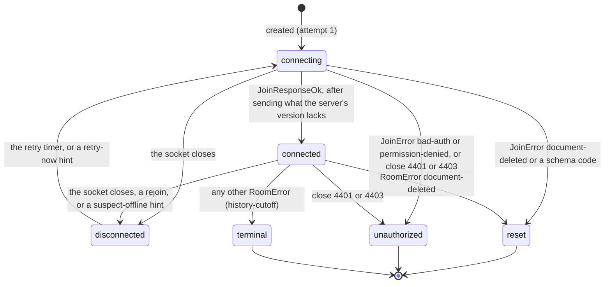

# Transport state machines

## Room connection

One room's socket to `/ws/loro` (`createLoroRoomTransport` in `loro-room-transport.ts`): a
document's Live or fork room, or a tree list. The state is the transport's `RoomConnectionState`,
published through `subscribeStatus`; `DocumentSession` derives its status from it
([document session status](../../editor/.context/state-machines.md)), and `TreeListSession` its
`TreeListStatus` ([list connection](../../tree-list/.context/state-machines.md)). The server's half
is [a joined `/ws/loro` room](../../../../../server/server/lib/.context/state-machines.md).

- **`reset`, `unauthorized` and `terminal` end the room** (`ended()`): it never connects again, a
  retry-now hint does nothing, and `whenSentAcknowledged` waiters resolve. The transport never
  comes back; its owner replaces it. A document session's registry does it with
  `restartUnavailableRoom` when an open binds the room again. A tree list's `TreeListRegistry`
  closes the session when its last hold is released, and the next `acquire` opens a new one.
- **A sign-in lapse waits like being offline.** A close with 4401 (`AUTH_FAILED`) sets
  `unauthorized` but, unlike every other end, leaves `whenCurrentChangesAcknowledged` barriers
  waiting, so a caller waiting on one waits for the writer to sign in and the transport to be
  replaced; `DocumentSession` reads the state as `offline` (`isSignInLapse`). A JoinError, a 4403
  close, a reset or a terminal end rejects the barriers.
- **A rejoin is a close and a connect.** A `JoinError` the server answers for a document it
  doesn't know yet, a `RejoinSuggested` (an access change, or a server error), and `onJoined`
  asking for a rejoin all close the socket with reason `rejoin`, which reconnects at once; any
  other close waits `RETRY_MS[attempt]`. `attempt` resets to 0 on `JoinResponseOk`, so the backoff
  grows only across connections that never joined.
- **`connected` comes after the Join's batch is sent.** `whenSentAcknowledged` takes the batches
  it waits on only once the room reads as connected, so the batch carrying what was typed while
  away is one of them ([CONTEXT.md](CONTEXT.md#acknowledgement-and-barriers)). Moving the status
  earlier lets a press made offline reach the server before that typing.
- **A close forgets the unacknowledged batches.** The next Join sends `exportSince` of the
  version the server answers with: whatever the server lacks, not the forgotten batches as they
  were. A batch the server imported whose `Ack` was lost is not sent again.
