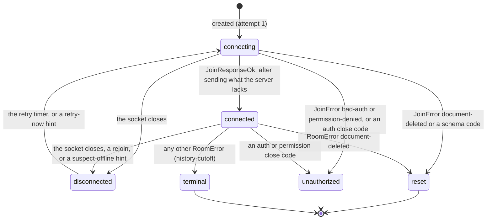

# Transport state machines

## Room connection

One room's socket to `/ws/loro` (`createLoroRoomTransport` in `loro-room-transport.ts`): a
document's Live or fork room, or a tree list. The state is the transport's
`DocumentSessionConnectionState`, published through `subscribeStatus`; `DocumentSession` derives
its status from it ([document session status](../../editor/.context/state-machines.md)). The
server's half is [a joined `/ws/loro` room](../../../../../server/server/lib/.context/state-machines.md).

- **`reset`, `unauthorized` and `terminal` end the room** (`ended()`): it never connects again,
  barriers reject, and a retry-now hint does nothing. Only the session registry brings it back,
  with a new transport (`restartUnavailableRoom`).
- **A rejoin is a close and a connect.** A `JoinError` the server answers for a document it
  doesn't know yet, a `RejoinSuggested` (an access change, or a server error), and `onJoined`
  asking for a rejoin all close the socket with reason `rejoin`, which reconnects at once; any
  other close waits `RETRY_MS[attempt]`. `attempt` resets on each Join.
- **`connected` comes after the Join's batch is sent.** `whenSentAcknowledged` takes the batches
  it waits on only once the room reads as connected, so the batch carrying what was typed while
  away is one of them ([CONTEXT.md](CONTEXT.md#acknowledgement-and-barriers)). Moving the status
  earlier lets a press made offline reach the server before that typing.
- A close drops the unacknowledged batches; the next Join's `exportSince` resends them.
- The thread socket's `reconnecting` and `degraded` states are not this transport's: it never
  publishes them.
