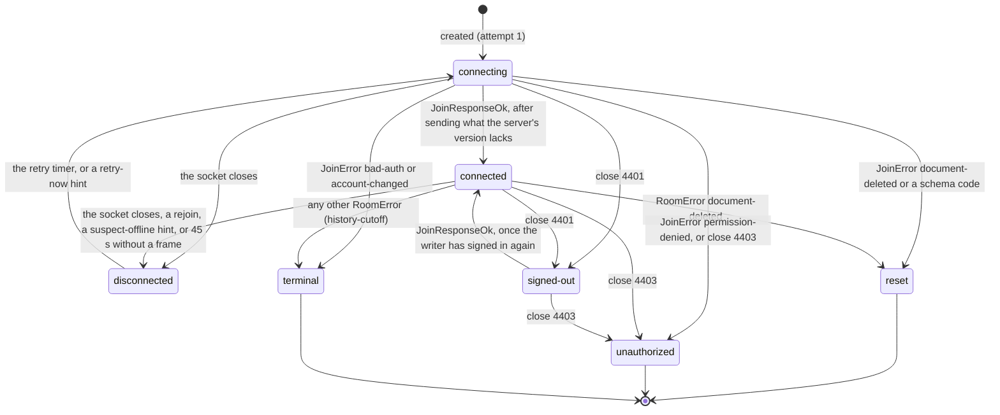

# Transport state machines

## Room connection

One room's socket to `/ws/loro` (`createLoroRoomTransport` in `loro-room-transport.ts`): a
document's Live or fork room, or a tree list. The state is the transport's `RoomConnectionState`,
published through `subscribeStatus`; `DocumentSession` derives its status from it
([document session status](../../editor/.context/state-machines.md)), and `TreeListSession` its
`TreeListStatus` ([list connection](../../tree-list/.context/state-machines.md)). The server's half
is [a joined `/ws/loro` room](../../../../../server/server/lib/.context/state-machines.md).

- **`unauthorized` means access ended**, nothing else: a `permission-denied` Join error or a
  4403. A `bad-auth` Join error is a Join this build formed wrong, which a retry would send again,
  so it ends the room `terminal`. So does `account-changed`: the browser's cookie is another
  account's, and the transport tells its owner (`onAccountChanged`), which ends the lifetime.
- **`reset`, `unauthorized` and `terminal` end the room** (`ended()`): it never connects again, a
  retry-now hint does nothing, and `whenSentAcknowledged` waiters resolve. The transport never
  comes back; its owner replaces it. A document session's registry does it with
  `restartUnavailableRoom` when an open binds the room again. A tree list's `TreeListRegistry`
  closes the session when its last hold is released, and the next `acquire` opens a new one.
- **A sign-in lapse is offline, not an end.** A close with 4401 (`AUTH_FAILED`) sets
  `signed-out`, and the room keeps retrying on the backoff and on retry-now hints. `signed-out`
  lasts until a Join is answered: a retry doesn't pass through `connecting`, and a retry that
  closes with any other code (the network dropped too, or the browser went offline) stays
  `signed-out`, so the sign-in prompt goes only on a rejoin and doesn't flicker. Only a 4403 ends
  it. `whenSentAcknowledged` waiters stay pending, so a press waits for
  the writer to sign in (in any tab: the cookie is shared) and leaves once the Join's batch, which
  carries the typing, is acknowledged. `DocumentSession` reads it as `offline`, `TreeListSession`
  as `unauthenticated`. Signing in from the prompt reloads the page, and the journaled press waits
  again on the reloaded rooms.
- **A rejoin is a close and a connect.** A `RejoinSuggested` (an access change, or a server
  error) and `onJoined` asking for a rejoin close the socket with reason `rejoin`, which reconnects
  at once; any other close waits `RETRY_MS[attempt]`. A `JoinError` for a document the server
  doesn't know (its create not landed yet, or a draft gone for good) is a refusal, not a
  suggestion: it closes with `join-refused` and backs off like any other close, so a refusal that
  never ends costs one Join every 10 s instead of hammering the server. `attempt` resets to 0 on `JoinResponseOk`, so the backoff
  grows only across connections that never joined.
- **`connected` comes after the Join's batch is sent.** `whenSentAcknowledged` takes the batches
  it waits on only once the room reads as connected, so the batch carrying what was typed while
  away is one of them ([CONTEXT.md](CONTEXT.md#acknowledgement)). Moving the status
  earlier lets a press made offline reach the server before that typing.
- **A close forgets the unacknowledged batches.** The next Join sends `exportSince` of the
  version the server answers with: whatever the server lacks, not the forgotten batches as they
  were. A batch the server imported whose `Ack` was lost is not sent again.
- **Each Join replaces both versions.** `JoinResponseOk` clears what the server received and saved
  and takes them again from the answer, so a server that restarted and lost unsaved batches
  answers lower, and the copy sends what that lacks. Saved moves within a connection only on a
  saved frame ([CONTEXT.md](CONTEXT.md#received-and-saved)).
