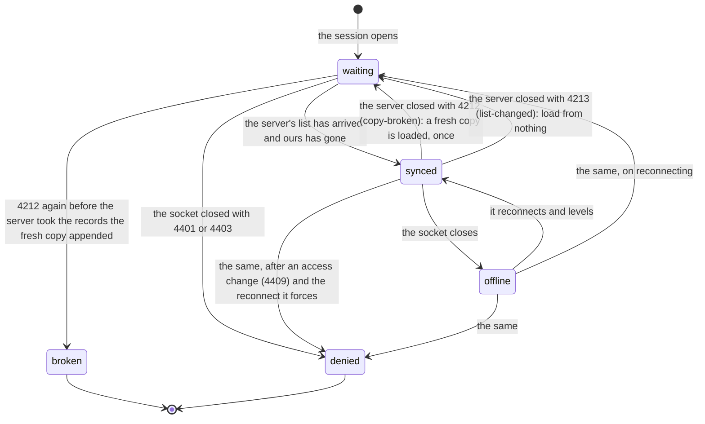

# Tree list state machines

## List connection

A tab's view of one list's connection (`TreeListStatus` in `tree-list-session.ts`, from
`ListSyncState` in `@meridian/tree-list-sync`). The tab that owns the connection computes it;
the others show what it announces over the channel. It has the shape of
[a connection that replays](../../../../../../.context/state-machines/connection-that-replays.md)
with Yjs's sync in place of a replay: reconnecting brings the copy and the server level, and
nothing is replayed.

- `waiting` lasts until the first sync of this session, however much the stored copy holds: a
  copy that has not caught up is not proof that a node is absent.
- A close with `4212` means the server found something in the copy an honest client never writes.
  The same bytes would be sent again, so nothing reconnects: the snapshot's `doc` becomes a fresh
  document under a new Yjs client id, and the records the old copy held that the server lacks are
  appended once, those `clientMayWrite` accepts. The ones it does not are the snapshot's
  `dropped`, kept nowhere else. If the fresh copy breaks again before the server has taken what
  was appended, the session is `broken` and nothing connects again; the copy and the writer's
  records stay on the device.
- A close with `4213` means the stored copy is of another list (a reset database, a recreated
  account list). It is replaced by an empty one and carries nothing: its records name nodes
  that are gone.
- The socket's URL carries `?list=<the id the copy is of>`; a copy that has none learns it from
  the room's first stateless message.
- The state follows the code of the socket's close, which the server sends itself. `4401` and
  `4403` are `denied` and final; any other close (a drop, a restart, `4409` after an access
  change, `1013` after a server error) is `offline`, and the provider reconnects. Access that
  ended is then refused on the reconnect.
- A replacement stores the records it carries in the next stored database before the old one
  goes, so an owner that closes mid-recovery leaves them to the next owner, which appends
  whatever the server lacks.

## Connection owner

Which tab holds the connection: `follower` until the tab holds the list's Web Lock, then `owner`
for as long as the tab lives. Followers queue on the lock, so when the owner's tab closes the
next one takes over with the copy it already has.
