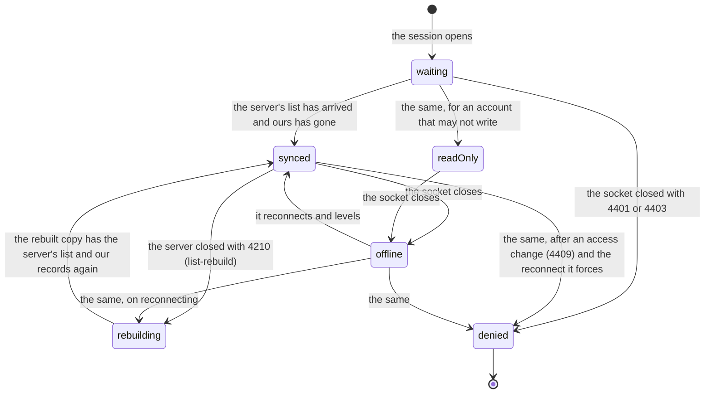

# Tree list state machines

## List connection

A tab's view of one list's connection (`TreeListStatus` in `tree-list-session.ts`, from
`ListSyncState` in `@meridian/tree-list-sync`). The tab that owns the connection computes it;
the others show what it announces over the channel. It has the shape of
[a connection that replays](../../../../../../.context/state-machines/connection-that-replays.md)
with Yjs's sync in place of a replay: reconnecting brings the copy and the server level, and
nothing is replayed.

- `waiting` lasts until the first sync of this session, however much the stored copy holds: a
  copy that has not caught up is not proof that a node is absent.
- `rebuilding` throws the copy away: the snapshot's `doc` becomes a new document under a new Yjs
  client id. The records the old copy held that the server had not admitted are appended again.
- `readOnly` is `read-only` in the code: synced, and the account may not write, so the copy's own
  records stay on the device.
- The state follows the code of the socket's close, which the server sends itself. `4210` rebuilds;
  `4401` and `4403` are `denied` and final; any other close (a drop, a restart, `4409` after
  an access change, `1013` after a server error) is `offline`, and the provider reconnects.
  Access that ended is then refused on the reconnect.
- A rebuild stores the records it carries in the next stored database before the old one goes,
  so an owner that closes mid-rebuild leaves them to the next owner, which appends again
  whatever the server lacks. The server's close names the record it refused;
  that one is given up on (the snapshot's `rejected`) and the rest go in one update.

## Connection owner

Which tab holds the connection: `follower` until the tab holds the list's Web Lock, then `owner`
for as long as the tab lives. Followers queue on the lock, so when the owner's tab closes the
next one takes over with the copy it already has.
