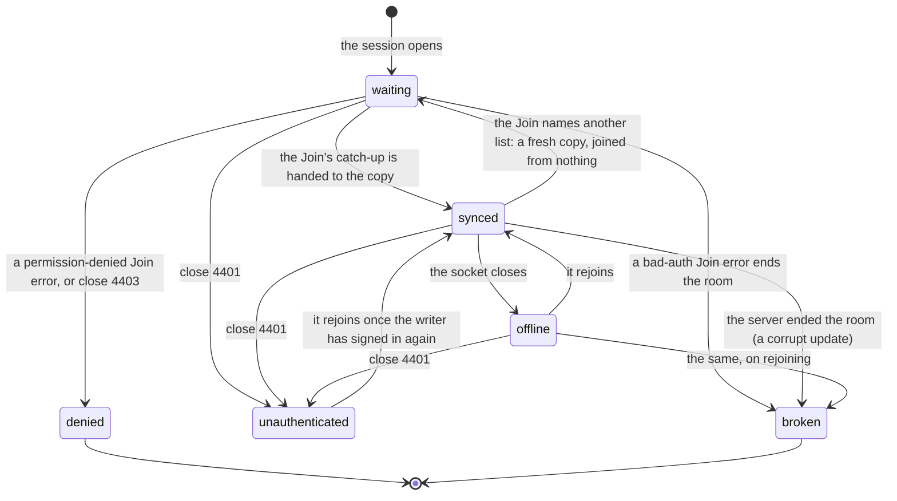

# Tree list state machines

## List connection

A tab's view of one list's connection (`TreeListStatus` in `tree-list-session.ts`, mapped from the
room transport's state). Every tab joins the list's room on `/ws/loro` itself. It has the shape of
[a connection that replays](../../../../../../.context/state-machines/connection-that-replays.md)
with the Join exchange in place of a replay: each Join sends what the server lacks and receives
what the copy lacks, so reconnecting brings the copy and the server level.

- `waiting` lasts until the first Join of this session and its catch-up batch are in, however
  much the stored copy holds: a copy that has not caught up is not proof that a node is absent.
  The session reads the transport's `synced`; it keeps no rule of its own.
- `JoinResponseOk.extra` names the list (`LoroJoinExtra.list`). A stored copy of another list (a
  reset database, a recreated account list) is replaced by an empty one, which carries nothing:
  its records name nodes that are gone. The old copy's doc is freed when the session closes.
- `broken` keeps the copy and the writer's records on the device; nothing connects again.

