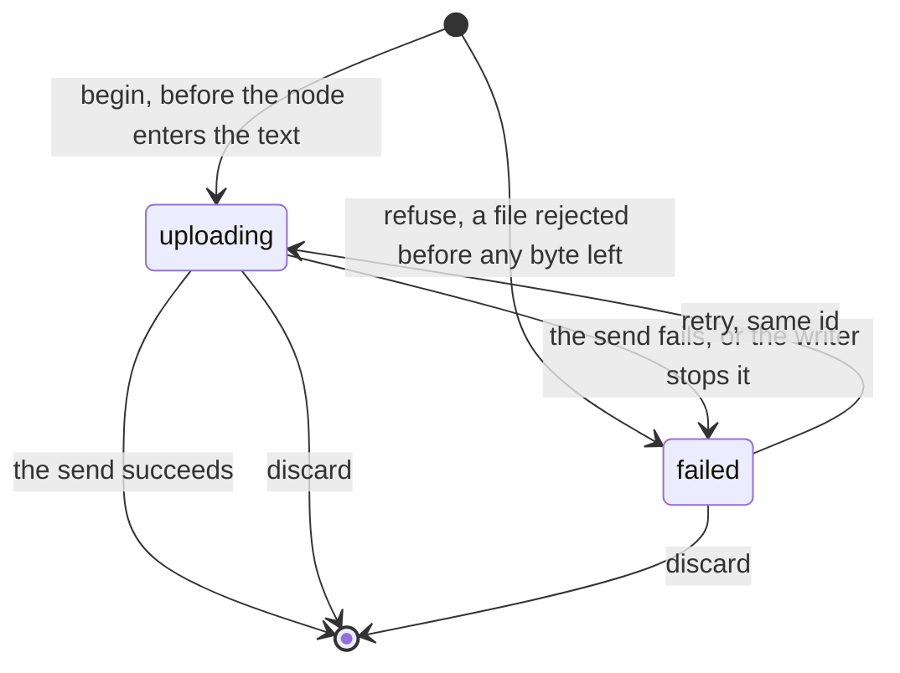

# Upload store state machine

One file being sent from the editor or the composer (`UploadState` in `upload-store.ts`). The
text gets an image or file node as soon as the upload begins, and the node draws from this
entry while the upload is unfinished. Success deletes the entry, and the node then shows the
uploaded file. The server's side of the same upload is the
[upload intake](../../../../../server/server/domains/context/uploads/.context/state-machines.md).

- **`begin` runs before the node is inserted**, so a node never draws without an entry behind
  it.
- **A refused file cannot be retried**: its entry has no `run`, and `retry` does nothing
  without one.
- **An entry belongs to a holder** (the surface that sent it). `discardHeld` drops everything a
  surface sent when the surface goes; an entry whose node has left the text is kept for a
  grace period first, so cut and paste or undo does not cancel the upload.
- The store is module memory. A reload forgets every unfinished upload; the abandoned sweep on
  the server cleans up what they reserved.
