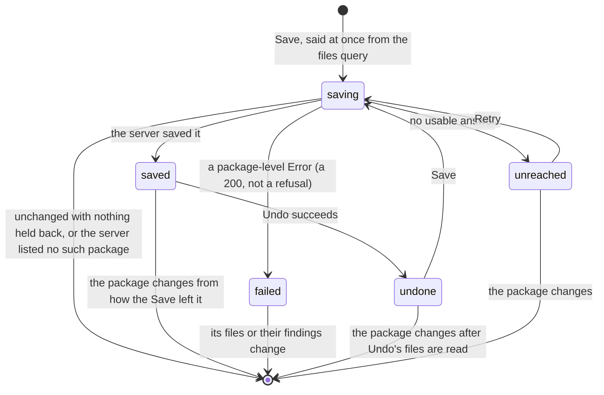
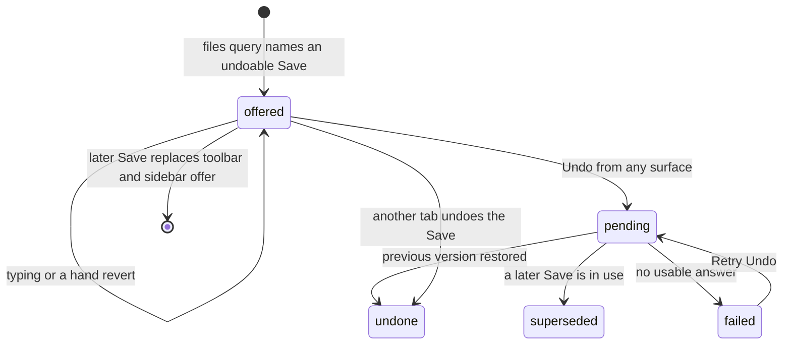

# features/agents state machines

## Package Save word

What the writer's last Save or Undo of one Agent package says where the package's state shows
(`package-save.ts`). The package's own state is the server's and is not drawn here: the word
only stands in front of it while it holds.

- **`saving` is predicted from the files query**: a package-level Error (state `cant-save`, or
  an Error in a file that defines no Agent or skill) shows "Not saved"; a package whose every
  change is to an item with an Error saved nothing new; anything else "Saved". Undo is offered
  once the server gives a `saveId`. The server's outcome replaces it. What is out of use is not
  taken from the outcome (only the server knows which held item keeps a good save): it is counted
  from the files with `troubleAfterSave`, which says the same of the files before the Save and of
  the files read after it, so the count never changes when the answer lands.
## Save Undo

The files query owns the offer, including after reload and AI Saves. The latest row names its
Undo target, so receipts show Undone or a later Save without offering a stale action.
Save and Undo publish the same agent-files hint as document edits, including text-free changes.

- **Undo merges the previous text into the files**, so `undone` waits for the files to be read
  again and then holds while the package is as Undo left it and reads Unsaved; one that reads Saved
  shows nothing, the state says it. Only pending requests and failures awaiting retry are kept by `saveId`. Completed results
  come from package status, not tab memory.
- **A word holds while the package is as the word speaks of it** (its state, `saveId`, changes
  and findings): for a settled `saved` or `undone`, as the files read after it, and the word holds
  until that read lands (judged against the package as pressed, the fresh files dropped it for a
  frame); for the rest, as the writer pressed it. Typing after a Save ends the word even when the same file changes again,
  and so does putting a file back by hand. Holding `saved` on the state alone left "1 not in use"
  up after a hand revert made the package read `saved`.
- **Retry sends the Save again with nothing to match it by.** That is safe: a Save of files
  that already are the saved version answers `unchanged`. A second Undo of one `saveId` answers
  `undone: false` with `already-undone`, distinct from `later-save`.
- Words live in memory, per package, shared by every surface that shows it (the user level's
  across projects); a reload forgets them and the state shows alone.
