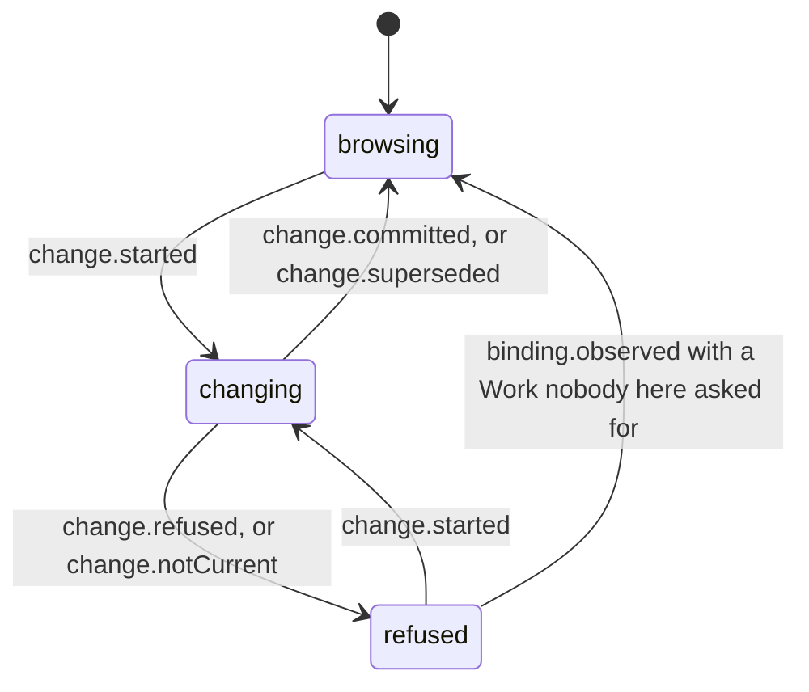
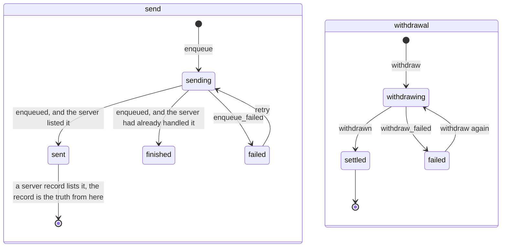
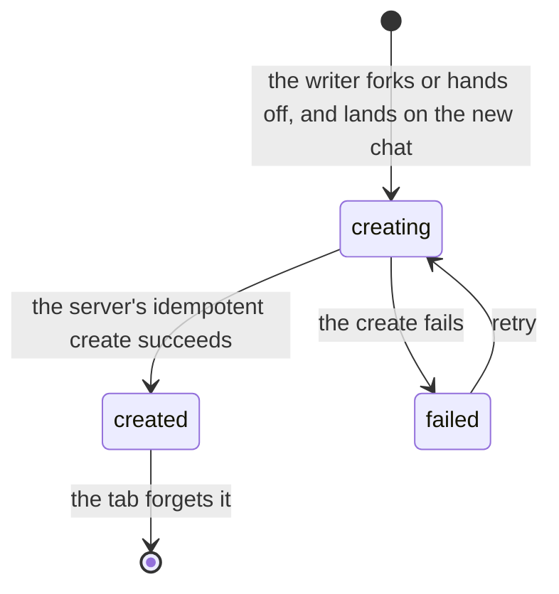

# Chat state machines

The chat feature's own machines. Product words are in the
[glossary](../../../../../../.context/glossary.md). The states a turn and a run go through are
the server's:
[runtime](../../../../../server/server/domains/runtime/.context/state-machines.md). The message
journal is in [chat-submissions](../../../client/chat-submissions/.context/state-machines.md).

## Composer Work binding

The Work picker in the composer while the writer changes which Work a chat belongs to
(`reduceComposerWorkBinding` in `composer-work-binding-reducer.ts`).

- **Answers are matched by request id.** `committed`, `refused`, `notCurrent` and `superseded`
  are ignored unless the view is `changing` with that request, so a slow answer to an older
  request cannot move the picker.
- **`binding.observed` during a change does not end it.** The server's projection can arrive
  before the mutation's answer; the reducer only notes whether it was the target or another
  Work and waits for the answer.
- After a commit the reducer expects one observation of the new Work
  (`expectedLocalWorkId`) and swallows it. Any other observed change is someone else's and is
  announced.
- Announcements are queued in `effects` and removed by `effects.consumed`; the reducer never
  performs them.

## Queued control

One compaction request or write-mode switch the writer made while a reply was running, so
it waits in the queue
(`controlsReducer` in `thread-controls/thread-controls.ts`). An entry has two independent
parts: sending it, and withdrawing it.

The row the writer sees (`queuedControls`) is `withdraw_failed` when a withdrawal failed,
hidden while one is in flight or settled, else `failed` or `sending` from the send, else
`queued`.

- **An entry leaves only on proof.** `reconcile` deletes one when the server answered it, or
  when a record newer than the last one that listed it no longer does and the history has
  caught up to that point (`droppedAt`). An older record that lacks the entry may simply
  predate its admission, and deleting on it makes the row vanish and come back.
- `withdraw_not_found` and `hide_switch` delete the entry at once.

## Fork and handoff creation

A chat created from another one, shown before the server has it (`DerivationStatus` in
`derivation/derive-conversation.ts`). A fork keeps the conversation up to a chosen turn; a
handoff starts fresh from a brief the model writes about the old chat. The writer is taken to the new chat first; see
[fork-and-handoff.md](fork-and-handoff.md).

`created` is kept until the tab forgets the chat so the destination never flashes empty
between the optimistic view and the server's. A failure is shown on the destination, where
the writer already is.

## Projections, not machines

These read like states but have no transitions of their own; each is computed from a turn's
status every render:

- `BriefCardState`, the card for a handoff's brief (`derivation/handoff-seed.ts`): `generating` for `pending` or `streaming`,
  `ready` for `complete`, `stopped` for `cancelled`, `failed` otherwise.
- `DividerState`, the line that marks a compaction in the transcript (`compaction/compaction-model.ts`): `pending`, `complete`, `failed`,
  `cancelled`, from the compaction turn.
