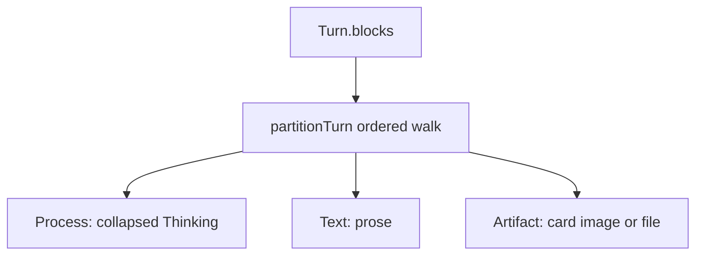

# features/chat — Process/Text/Artifact composition model

This reference defines how an ordered assistant `Block[]` becomes one render list.
The partition is deterministic from block order/type, not stream or terminal state.
`partitionTurn`, `classifyTurn` and tool visibility live in the view model
(`viewTranscript` in `@meridian/thread-client`), which `./mf thread view` prints
too; this app draws the items it is handed and never filters raw turns.

## Tiers and partition

- **Process** is a contiguous run of visible reasoning and process tools, rendered
  as one default-collapsed `Thinking` disclosure. Hidden tool rows whose custom
  card already surfaces them are dropped. A `thread_message` refused before a
  child run started has no card, so its failure row stays in the fold.
- **Text** is an assistant text block rendered as prose and never folded.
- **Artifact** is a writer-facing custom card, image, or file and never folds.
  A `return_result` report is visible through its process-tool pair but remains
  an artifact-like writer-facing result.

`partitionTurn(sortedBlocks)` walks once. Visible reasoning and process tools
append to the open process run; empty reasoning placeholders and activity
placeholders are dropped. Text, image/file, or custom card flushes the process
run and emits its own item. A later reasoning run therefore starts a new fold
below prose or an artifact. There is no settlement-time regrouping.

Render identity is positional: `blockRenderKey` uses turn and sequence, never
`block.id`. Text and artifact identity must survive streaming; a process item
uses its first block. The digest names successful skills and reads, omits
successful writes because receipts summarize them, and reports failures and
other tools as steps. Its accessible name is the visible label.

## Durable cards and deliveries

Each admitted card-bearing invocation has one retained helper-result card. Its
typed result and bound Agent definition are authoritative; the UI never parses
model `output` or duplicates hidden protocol rows. Terminal state is child
execution truth, not parent admission. Cards branch on `deliveryMode`: background
cards remain compact launches while running and expand to a saved report when
finished; direct cards retain launch, live edge, and expandable result.

`thread_report` remains a process step because the invocation card is the
one surface for that run. Child completion is a structured
`subagent_update` transcript event correlated by execution ID; render it as a
quiet row at its causal position and never infer it from notice text. Machine
deliveries (`inbox_message`) use the same row chrome with the message text;
writer sends never become delivery rows and stay bubbles. A mid-run adopted
writer turn is stamped `metadata.delivery: "steer"`, and response grouping reads
that fact rather than comparing client and server times. Only the
explicit child-chat control navigates to another thread; ordinary row/card
actions expand or reveal in the current transcript.

Historical `meridian.block.upserted` replaces an already-loaded turn in place.
If its target is absent, invalidate/refetch the durable snapshot rather than
creating a synthetic streaming turn; an equal replacement is a
reference-preserving no-op. `waitingWriterMessages` (`@meridian/thread-client`)
projects writer rows still waiting; `awaiting_run` has no duplicate queue label.

Interrupt responses are fire-and-forget and use local state keyed by
`(threadId, turnId, interruptId)`. Pending controls remain disabled across
remount; proven or ambiguous failure offers Retry with the same tuple. The agent
outcome is never projected locally: the journaled server interrupt lifecycle
stays authoritative and clears the local entry. Non-fatal rejection frames
settle that state without tearing down the run subscription. The server does not
advertise `ask_user` until its rework
([#601](https://github.com/haowjy/meridian-flow/issues/601)); keep the interrupt
card and its response path, they are not dead code.

## Tool presentation

`tool-renderers.tsx` keys must be real runtime tool names; a renamed tool
silently falls through to the default, so check keys when either side changes.
Unknown tools show a humanized name only, never arguments or paths. Inline
expansions show curated result rows, stream tails, or plain output, never raw
JSON (that goes behind a dev-only setting).

## Invariants

- Thinking is collapsed by default in live and settled turns. Never branch
  partitioning on `isLive`, partial shape, or stream buffers.
- Prose and artifacts stay visible. Folding them loses the writer's manuscript
  and remounts content during streaming.
- Hidden protocol is dropped, not folded, using the shared visibility predicate.
- Only finished turns end replies; continuations, server steers, and active
  background work keep the reply open.
- Do not create a second card store, parse notice text, or key on unstable
  block IDs.

Interrupt settlement and the runtime probe are tracked in
[chat TODO](TODO.md). Activity, spacing, composer, fork, and tool surfaces have
their own references in the parent [chat guide](../AGENTS.md).
